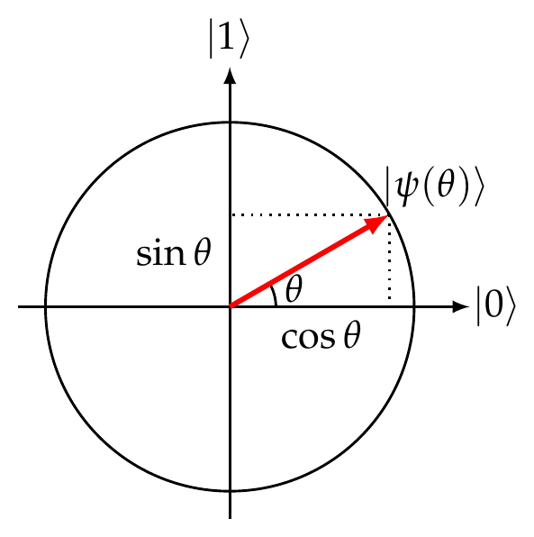

::pagesources{label="Exercise sheets:" items="E05:2;E06:1;E09:1-4"}

## Deutsch's algorithm

::pagesources{label="Notes:" notes="/notes/deutsch/"}

### Cirq: Deutsch's algorithm with a phase oracle

::source{sheet="5" exercise="5" pages="2"}

:::note[Programming exercise]
This is a Cirq exercise; see [how the programming exercises work](/exercises/#programming-exercises).
:::

### Cirq: Deutsch's algorithm with a binary oracle

::source{sheet="5" exercise="6" pages="2"}

:::note[Programming exercise]
This is a Cirq exercise; see [how the programming exercises work](/exercises/#programming-exercises).
:::

## Deutsch–Jozsa and Bernstein–Vazirani

::pagesources{label="Notes:" notes="/notes/deutsch-jozsa-bernstein-vazirani/"}

### Hadamard transform

::source{sheet="6" exercise="1" pages="1"}

Recall that $s \cdot x = \sum_{i=1}^n s_i x_i$ denotes the inner product of bit strings $s, x \in \{0,1\}^n$ modulo 2.

1. Verify that, for any $s \in \{0,1\}^n$,

   $$
   \frac{1}{\sqrt 2}\left(\ket{0} + (-1)^{s_1}\ket{1}\right) \otimes \cdots \otimes \frac{1}{\sqrt 2}\left(\ket{0} + (-1)^{s_n}\ket{1}\right) = \frac{1}{\sqrt{2^n}} \sum_{x \in \{0,1\}^n} (-1)^{s \cdot x} \ket{x}.
   $$

2. Let $s \in \{0,1\}^n$. Verify that

   $$
   \frac{1}{2^n} \sum_{x \in \{0,1\}^n} (-1)^{s \cdot x} = \delta_{s, 0^n} = \begin{cases} 1 & \text{if } s = 0 \ldots 0, \\ 0 & \text{otherwise.} \end{cases}
   $$

3. Recall that the entry of $H^{\otimes n}$ at row $x \in \{0,1\}^n$ and column $y \in \{0,1\}^n$ is

   $$
   \frac{1}{\sqrt{2^n}} (-1)^{x \cdot y}.
   $$

   Using this, verify explicitly that $H^{\otimes n}$ is a unitary matrix, i.e., that $H^{\otimes n} (H^{\otimes n})^\dagger = I$.

### Deterministic algorithm for Bernstein–Vazirani

::source{sheet="6" exercise="2" pages="1"}

Find a deterministic classical algorithm that solves the Bernstein–Vazirani problem with certainty by evaluating the function exactly $n$ times. In other words, find a collection of $n$ strings $x \in \{0,1\}^n$ such that evaluating the function $f(x) = s \cdot x$ on them uniquely determines $s$.

### Bernstein–Vazirani for an affine function

::source{sheet="6" exercise="3" pages="1"}

Consider a slight extension of the Bernstein–Vazirani problem where the function $f$ within the oracle is affine rather than linear, i.e., $f(x) = s \cdot x + b$, for some unknown $s \in \{0,1\}^n$ and $b \in \{0,1\}$. Would the final measurement still return $s \in \{0,1\}^n$ correctly?

### All ones in Deutsch–Jozsa

::source{sheet="6" exercise="4" pages="1"}

When deriving the Deutsch–Jozsa algorithm, we looked at the probability of getting all zeroes in the final measurement. Let's say we instead looked at the probability of getting all ones. Characterize those Boolean functions $f : \{0,1\}^n \to \{0,1\}$ for which the final measurement produces the outcome $z = 1^n = 11 \ldots 1$ with probability 1.

### Cirq: Bernstein–Vazirani

::source{sheet="6" exercise="5" pages="1"}

:::note[Programming exercise]
This is a Cirq exercise; see [how the programming exercises work](/exercises/#programming-exercises).
:::

### Cirq: Deutsch–Jozsa

::source{sheet="6" exercise="6" pages="1"}

:::note[Programming exercise]
This is a Cirq exercise; see [how the programming exercises work](/exercises/#programming-exercises).
:::

## Grover's algorithm

::pagesources{label="Notes:" notes="/notes/grover/"}

### Two reflections make a rotation

::source{sheet="9" exercise="1" pages="1-2"}

The goal of this exercise is to verify that two consecutive reflections produce a rotation whose angle is twice the angle between the axes of the two reflections (recall that this observation is at the core of the analysis of Grover's algorithm). Just like in Grover's algorithm, in this exercise all amplitudes are real. That is, we only consider qubit states of the form

$$
\ket{\psi(\theta)} = \begin{pmatrix} \cos\theta \\ \sin\theta \end{pmatrix} = \cos\theta \ket{0} + \sin\theta \ket{1},
\tag{1}
$$

for some angle $\theta \in [0, 2\pi)$. You can visualize any such state as a unit vector in two (real) dimensions:

1. Verify that the Pauli $Z$ operation

   $$
   Z = \begin{pmatrix} 1 & 0 \\ 0 & -1 \end{pmatrix}
   $$

   corresponds to a reflection about the horizontal axis in this picture. Explain why this implies that $Z\ket{\psi(\theta)} = \ket{\psi(-\theta)}$ where $\ket{\psi(\theta)}$ is defined in eq. (1).

2. Verify that

   $$
   R(\alpha) = \begin{pmatrix} \cos\alpha & \sin\alpha \\ \sin\alpha & -\cos\alpha \end{pmatrix}
   $$

   is a reflection about the axis that is at angle $\alpha/2$ with $\ket{0}$. That is, verify that

   $$
   R(\alpha)\ket{\psi(\tfrac{\alpha}{2})} = \ket{\psi(\tfrac{\alpha}{2})}, \qquad R(\alpha)\ket{\psi(\tfrac{\alpha}{2} + \tfrac{\pi}{2})} = -\ket{\psi(\tfrac{\alpha}{2} + \tfrac{\pi}{2})}.
   $$

::pagebreak{sheet="9" page="2"}

3. Verify that $R(\alpha)$ acts on a general state $\ket{\psi(\theta)}$ as follows:

   $$
   R(\alpha)\ket{\psi(\theta)} = \ket{\psi(\alpha - \theta)}.
   $$

4. Let $G(\alpha) = R(\alpha) Z$ be a product of two consecutive reflections, $Z$ and $R(\alpha)$. As determined previously, the angle between them is $\alpha/2$. Write down the matrix for $G(\alpha)$ and verify that $G(\alpha)$ is a rotation by angle $\alpha$ anti-clockwise. That is, verify that

   $$
   G(\alpha)\ket{\psi(\theta)} = \ket{\psi(\theta + \alpha)},
   $$

   for any $\theta \in \mathbb{R}$.

### Cirq: One-out-of-four search

::source{sheet="9" exercise="2" pages="2"}

:::note[Programming exercise]
This is a Cirq exercise; see [how the programming exercises work](/exercises/#programming-exercises).
:::

### Cirq: Iterative reflection

::source{sheet="9" exercise="6" pages="4"}

:::note[Programming exercise]
This is a Cirq exercise; see [how the programming exercises work](/exercises/#programming-exercises).
:::

*Hint:* Python's built-in function `round` rounds to the nearest integer.

### Cirq: Grover's algorithm

::source{sheet="9" exercise="7" pages="4"}

:::note[Programming exercise]
This is a Cirq exercise; see [how the programming exercises work](/exercises/#programming-exercises).
:::
