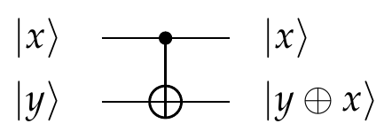
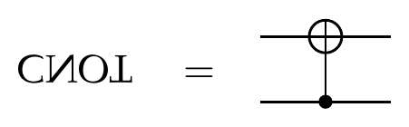
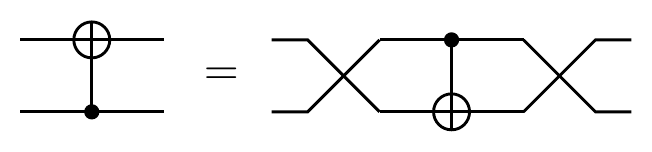
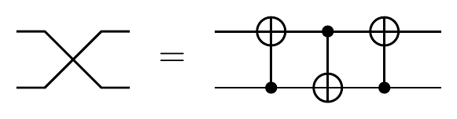
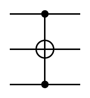

::pagesources{label="Exercise sheets:" items="E04:1-3;E05:1-2;E09:2-4"}

## Quantum gates

::pagesources{label="Notes:" notes="/notes/quantum-gates/"}

### The quantum SWAP gate

::source{sheet="4" exercise="1" pages="1"}

The two-qubit SWAP gate is defined on the standard basis states as follows:

$$
\mathrm{SWAP}\ket{a,b} = \ket{b,a}, \tag{1}
$$

for all $a,b \in \{0,1\}$, where $\ket{a,b}$ is a shorthand for $\ket{a}\otimes\ket{b}$. This definition is then extended by linearity to all two-qubit states.

1. Write down the matrix representation of SWAP.
2. Let $\ket{\alpha} = \begin{pmatrix} x \\ y \end{pmatrix}$ and $\ket{\beta} = \begin{pmatrix} z \\ t \end{pmatrix}$ be two arbitrary single-qubit states. Compute explicitly the entries of vectors $\ket{\alpha}\otimes\ket{\beta}$ and $\ket{\beta}\otimes\ket{\alpha}$.
3. Show that it follows from the above definition of SWAP in eq. (1) that

   $$
   \mathrm{SWAP}\ket{\alpha}\otimes\ket{\beta} = \ket{\beta}\otimes\ket{\alpha},
   $$

   for any single-qubit states $\ket{\alpha},\ket{\beta} \in \mathbb{C}^2$, not just the standard basis states.

### Controlled-NOT gate

::source{sheet="4" exercise="2" pages="1-2"}

The controlled-NOT gate, denoted CNOT, is a 2-qubit gate that flips the state of the second (target) qubit if the first (control) qubit is in the state $\ket{1}$. Its definition on the standard basis states and its graphical notation are as follows:

$$
\mathrm{CNOT}\ket{x,y} = \ket{x, y\oplus x}, \tag{2}
$$



where $x,y \in \{0,1\}$. The goal of this exercise is for you to understand how this gate works.

1. Write down CNOT as a $4\times4$ matrix.
2. Let $X = \mathrm{NOT} = \begin{pmatrix} 0 & 1 \\ 1 & 0 \end{pmatrix}$ be the Pauli $X$ matrix that also implements the logical NOT operation. Verify that

   $$
   \mathrm{CNOT} = \ketbra{0}{0}\otimes I + \ketbra{1}{1}\otimes X. \tag{3}
   $$

   What is the intuitive meaning of this identity?

::pagebreak{sheet="4" page="2"}

3. If we set $y = 0$ in eq. (2) then we get

   $$
   \mathrm{CNOT}\ket{x,0} = \ket{x,x},
   $$

   for any $x \in \{0,1\}$. Does this identity extend to arbitrary single-qubit quantum states (in a similar way to how eq. (1) generalized in case of the SWAP gate)? That is, is it true that

   $$
   \mathrm{CNOT}\ket{\psi}\otimes\ket{0} = \ket{\psi}\otimes\ket{\psi},
   $$

   for any single-qubit state $\ket{\psi} \in \mathbb{C}^2$, not just the standard basis states? Prove this or find a counterexample.

### Understanding the upside-down CNOT inside-out

::source{sheet="4" exercise="3" pages="2"}

The goal of this exercise is to derive the matrix representation for the upside-down CNOT gate



in three different ways.

1. Write down how this gate acts on the four two-qubit computational basis states and derive its matrix representation from this.
2. Notice that

   

   where crossed wires denote the SWAP gate. In other words,

   $$
   \mathrm{CNOT}^{\updownarrow} = \mathrm{SWAP}\cdot\mathrm{CNOT}\cdot\mathrm{SWAP}.
   $$

   Use the matrix representation of SWAP from the previous exercise and the matrix representation of CNOT from the previous exercise to derive the matrix representation of $\mathrm{CNOT}^{\updownarrow}$.
3. What is the expression for $\mathrm{CNOT}^{\updownarrow}$ that is analogous to eq. (3)? Compute the two terms in this expression and verify that they sum up to the correct matrix.

### Exercise 4.4

::source{sheet="4" exercise="4" pages="3"}

Verify the following circuit identity:



Also known as the XOR swap algorithm, it lets you exchange two variables without using additional memory:

```
X := X XOR Y;
Y := X XOR Y;
X := X XOR Y;
```

### Toffoli gate

::source{sheet="4" exercise="5" pages="3"}

The Toffoli gate is a three-qubit gate defined on the computational basis states as follows:

$$
\ket{x_1,x_2,y} \mapsto \ket{x_1,x_2,y\oplus x_1x_2},
$$

for all $x_1,x_2,y \in \{0,1\}$.

1. Write down the Toffoli gate in matrix form.
2. Verify that the Toffoli gate is the same as the controlled-controlled-NOT gate, meaning that it flips the third (target) qubit if the first two (control) qubits are both in state $\ket{1}$. Write down the decomposition of the controlled-controlled-NOT gate analogous to eq. (3) and verify that you recover the Toffoli gate.

### Hadamarding the CNOT gate

::source{sheet="5" exercise="1" pages="1"}

Write down the quantum circuit for the operation $(H \otimes H)\,\mathrm{CNOT}\,(H \otimes H)$. Compute its matrix representation. What gate does this operation amount to?

### Funny Toffoli gate

::source{sheet="5" exercise="2" pages="1"}

Write down the explicit matrix for Toffoli gate that is applied in the following way:



Here the second qubit is the target and the first and third qubits are the controls.

### Cirq: Implementing SWAP

::source{sheet="5" exercise="4" pages="2"}

:::note[Programming exercise]
This is a Cirq exercise; see [how the programming exercises work](/exercises/#programming-exercises).
:::

## Reversible computation and oracles

::pagesources{label="Notes:" notes="/notes/reversible-computation/"}

### Oracles

::source{sheet="5" exercise="3" pages="1-2"}

Let $\mathrm{EQ} : \{0,1\}^2 \to \{0,1\}$ be the equality function on two bits:

$$
\mathrm{EQ}(x_1, x_2) = \begin{cases} 1 & \text{if } x_1 = x_2, \\ 0 & \text{if } x_1 \neq x_2. \end{cases}
$$

1. Write down the matrix for the phase oracle $O_{\mathrm{EQ}}$.

2. Write down how the bit oracle $U_{\mathrm{EQ}}$ acts on a general standard basis vector $\ket{x_1, x_2, y}$ where $x_1, x_2, y \in \{0,1\}$.

3. Notice that a bit oracle does not alter the input bits $x_1$ and $x_2$ and that it either flips the output bit $y$ or leaves it alone, depending on the value of the function. Using this observation, identify which blocks of the $8 \times 8$ matrix $U_{\mathrm{EQ}}$ are non-zero. Then fill in these blocks accordingly.

4. Express $\mathrm{EQ}$ using XOR and NOT. Using this expression, write $\mathrm{EQ}(x_1, x_2)$ as an algebraic expression of $x_1$ and $x_2$ (modulo 2).

5. Based on the above expression, write down a quantum circuit for $U_{\mathrm{EQ}}$ that involves only CNOT and $X$ gates.

### Cirq: OR-circuit on two qubits

::source{sheet="5" exercise="7" pages="2"}

:::note[Programming exercise]
This is a Cirq exercise; see [how the programming exercises work](/exercises/#programming-exercises).
:::

### Cirq: OR-circuit on three qubits

::source{sheet="5" exercise="8" pages="2"}

:::note[Programming exercise]
This is a Cirq exercise; see [how the programming exercises work](/exercises/#programming-exercises).
:::

## Quantum compiling

::pagesources{label="Notes:" notes="/notes/quantum-compiling/"}

### Pauli rotations

::source{sheet="9" exercise="3" pages="2-3"}

The goal of this exercise is to understand how Pauli matrices are related to various qubit rotation operations.

1. Recall that the matrix exponential of any complex square matrix $M$ is defined using the Taylor series of the exponential function:

   $$
   \exp(M) = \sum_{n=0}^{\infty} \frac{M^n}{n!}.
   $$

   Let $P$ be any complex square matrix such that $P^2 = I$. Show that, for any $\delta \in \mathbb{R}$,

   $$
   \exp(iP\delta) = I\cos\delta + iP\sin\delta.
   \tag{2}
   $$

   *Hint:* Recall Euler's formula $e^{i\varphi} = \cos\varphi + i\sin\varphi$, for any $\varphi \in \mathbb{R}$. This formula is in fact valid also for $\varphi \in \mathbb{C}$. To prove this, observe that cosine is an even function and sine is an odd function. Moreover, the even $n$ terms in the Taylor series of $e^{i\varphi}$ constitute precisely the Taylor series for $\cos\varphi$ and the odd $n$ terms constitute precisely the Taylor series for $i\sin\varphi$. You can prove the above matrix version of Euler's formula using the same observation.

2. Recall that the three non-trivial Pauli matrices are

   $$
   X = \begin{pmatrix} 0 & 1 \\ 1 & 0 \end{pmatrix}, \qquad Y = \begin{pmatrix} 0 & -i \\ i & 0 \end{pmatrix}, \qquad Z = \begin{pmatrix} 1 & 0 \\ 0 & -1 \end{pmatrix}.
   $$

   Let us exponentiate them and define the following single-qubit operations:

   $$
   R_x(\delta) = \exp(-iX\tfrac{\delta}{2}), \qquad R_y(\delta) = \exp(-iY\tfrac{\delta}{2}), \qquad R_z(\delta) = \exp(-iZ\tfrac{\delta}{2}).
   \tag{3}
   $$

   Note that these operations are unitary (recall Exercise 6 from Tutorial 2). Compute explicitly their matrix entries as a function of $\delta$.

3. Explain why $R_x(\alpha)R_x(\beta) = R_x(\alpha + \beta)$, for any $\alpha, \beta \in \mathbb{R}$, and similarly why this holds also for $R_y$ and $R_z$.

   *Hint:* Show that it follows from eq. (2) that $e^{iP\delta_1}e^{iP\delta_2} = e^{iP(\delta_1 + \delta_2)}$.

::pagebreak{sheet="9" page="3"}

4. Prove that $XR_y(\delta)X = R_y(-\delta)$ and $XR_z(\delta)X = R_z(-\delta)$.

   *Hint:* Note that $XYX = -Y$ and $XZX = -Z$. Then use eq. (2).

5. Recall from the first lecture that a general single-qubit state can be written as

   $$
   \ket{\psi(\theta, \varphi)} = \begin{pmatrix} \cos\frac{\theta}{2} \\ e^{i\varphi}\sin\frac{\theta}{2} \end{pmatrix},
   $$

   for some angles $\theta$ and $\varphi$ that correspond, respectively, to latitude and longitude in spherical coordinates. It turns out that the operations in eq. (3) correspond to rotations by an angle $\delta$ around the corresponding coordinate axis of the Bloch sphere.

   - Verify that $R_z(\delta)$ is indeed a rotation by angle $\delta$ around the $z$ axis of the Bloch sphere. That is, verify that, up to a global phase,

     $$
     R_z(\delta)\ket{\psi(\theta, \varphi)} = \ket{\psi(\theta, \varphi + \delta)}.
     $$

   - Verify that $R_y(\delta)$ is indeed a rotation by angle $\delta$ around the $y$ axis. That is,

     $$
     R_y(\delta)\ket{\psi(\theta, 0)} = \ket{\psi(\theta + \delta, 0)}.
     $$

### ZYZ, ABC, and controlled-U

::source{sheet="9" exercise="4" pages="3-4"}

This exercise has two goals: first, we would like to decompose a general single-qubit operation $U$ as a sequence of Pauli rotations from eq. (3); second, we would like to implement the controlled-$U$ operation on two qubits using only CNOT and arbitrary single-qubit gates.

Recall from Homework 1 that any single-qubit unitary operation $U$ can be written as

$$
U = e^{i\varphi} \begin{pmatrix} e^{i\alpha}\cos\theta & e^{i\gamma}\sin\theta \\ -e^{-i\gamma}\sin\theta & e^{-i\alpha}\cos\theta \end{pmatrix},
$$

for some angles $\varphi, \alpha, \gamma, \theta \in \mathbb{R}$.

1. Verify that

   $$
   U = e^{i\varphi} R_z(-\alpha - \gamma) R_y(-2\theta) R_z(-\alpha + \gamma),
   $$

   where $R_z$ and $R_y$ are the $z$ and $y$ rotations defined in eq. (3). Explain why this implies that every single-qubit gate can be written as

   $$
   U = e^{i\varphi} R_z(\beta) R_y(\eta) R_z(\delta),
   $$

   for some angles $\varphi, \beta, \eta, \delta \in \mathbb{R}$. This is known as the "ZYZ decomposition" of $U$.

2. Out of nowhere, let us define

   $$
   \begin{aligned}
   A &= R_z(\beta) R_y(\eta/2), \\
   B &= R_y(-\eta/2) R_z(-(\delta + \beta)/2), \\
   C &= R_z((\delta - \beta)/2).
   \end{aligned}
   $$

::pagebreak{sheet="9" page="4"}

   Verify that

   $$
   ABC = I, \qquad\qquad U = e^{i\varphi} AXBXC.
   $$

   *Hint:* Use items 3 and 4 from the previous exercise. In particular, you can use item 4 to compute $XBX$ by noting that

   $$
   XR_y(\delta_1)R_z(\delta_2)X = XR_y(\delta_1)X \cdot XR_z(\delta_2)X = R_y(-\delta_1)R_z(-\delta_2).
   $$

3. Verify the following circuit identity:

   

   where $U$ and $A, B, C$ are from item 2 and $F = \begin{pmatrix} 1 & 0 \\ 0 & e^{i\varphi} \end{pmatrix}$.

### Cirq: Implementation of two-level unitaries

::source{sheet="9" exercise="5" pages="4"}

:::note[Programming exercise]
This is a Cirq exercise; see [how the programming exercises work](/exercises/#programming-exercises).
:::

### Cirq: ABC & ZYZ decomposition

::source{sheet="9" exercise="8" pages="4"}

:::note[Programming exercise]
This is a Cirq exercise; see [how the programming exercises work](/exercises/#programming-exercises).
:::
