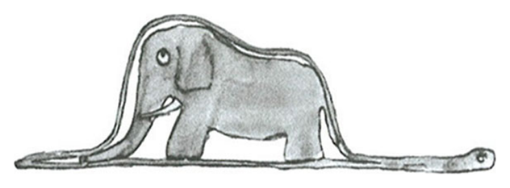

::pagesources{label="Exercise sheets:" items="E13:1-6"}

## Density matrices and mixed states

::pagesources{label="Notes:" notes="/notes/density-matrices/"}

### Quantum one-time pad

::source{sheet="13" exercise="1" pages="1"}

Let $\vec r = (x, y, z) \in \mathbb{R}^3$ be an arbitrary point inside the Bloch ball (i.e., a vector of norm at most one: $x^2 + y^2 + z^2 \le 1$). You will show in Homework 3 that the density matrix describing the (mixed) state corresponding to $\vec r$ is given by

$$
\rho(\vec r) = \frac{1}{2}(I + xX + yY + zZ),
$$

where $I = \begin{pmatrix} 1 & 0 \\ 0 & 1 \end{pmatrix}$, $X = \begin{pmatrix} 0 & 1 \\ 1 & 0 \end{pmatrix}$, $Y = \begin{pmatrix} 0 & -i \\ i & 0 \end{pmatrix}$, $Z = \begin{pmatrix} 1 & 0 \\ 0 & -1 \end{pmatrix}$ are the four Pauli matrices.

1. (Encoding) Assume that Alice is given an arbitrary quantum state $\rho(\vec r)$. She chooses two bits $a, b \in \{0, 1\}$ and does the following:

   - If $a = 1$ she applies $X$ to her qubit.
   - If $b = 1$ she applies $Z$ to her qubit.

   Depending on her choice of $a$ and $b$, she gets the following state:

   $$
   \mu_{a,b}(\vec r) = Z^b X^a \rho(\vec r) X^a Z^b.
   $$

   What are the Bloch vectors of these four states?

2. (Eavesdropping) Assume that Alice and Bob met some time ago and chose $a, b \in \{0, 1\}$ uniformly at random. Using this $a$ and $b$ as a secret key, Alice generates the state $\mu_{a,b}(\vec r)$ and sends it to Bob.

   Assume the state is intercepted by Eve. Since she does not know $a$ and $b$, she effectively gets each $\mu_{a,b}(\vec r)$ with probability $1/4$. From her perspective, the state she receives is

   $$
   \mu = \frac{1}{4} \sum_{a,b \in \{0,1\}} \mu_{a,b}(\vec r).
   $$

   Show that, irrespective of $\vec r$, this is always the maximally mixed state, i.e.,

   $$
   \mu = \frac{I}{2}.
   $$

   In particular, this means that $\mu$ contains no information about $\vec r$.

3. (Decoding) Eve realizes that she is out of luck and hands her qubit over to Bob. Recall that Bob knows the secret key $a, b$. What operation should he apply to recover the original state $\rho(\vec r)$?

## Graphical notation

::pagesources{label="Notes:" notes="/notes/graphical-notation/"}

*No animals should be harmed during these exercises.* <small>(footnote on the title of exercise sheet 13)</small>

### Dictionary

::source{sheet="13" pages="2"}

### Elephant eaten by a snake

::source{sheet="13" pages="2"}

### Snake basics

::source{sheet="13" exercise="2" pages="3"}

Recall that $\ket{\Phi}_{AB} := \sum_{i=1}^d \ket{i}_A \otimes \ket{i}_B$ corresponds to a snake looking back across its shoulder. Based on hints generously provided by Antoine de Saint-Exupéry, use graphical notation to show the following identities:

1. (Tensor and matrix product) If four snakes eat four elephants and two of them eat the tails of the other two, it is the same as if two long snakes would eat two elephants each:

   $$
   (A \otimes B) \cdot (C \otimes D) = (A \cdot C) \otimes (B \cdot D).
   $$

2. (Snake equation) You can fold a snake in three layers in two different ways:

   $$
   \begin{aligned}
   I &= \left(I_A \otimes \bra{\Phi}_{BC}\right) \cdot \left(\ket{\Phi}_{AB} \otimes I_C\right) \\
   &= \left(\bra{\Phi}_{AB} \otimes I_C\right) \cdot \left(I_A \otimes \ket{\Phi}_{BC}\right).
   \end{aligned}
   $$

3. (Transpose) If a snake eats an upside-down elephant, it has to fold one way or the other to make sure the elephant is comfortable:

   $$
   \begin{aligned}
   E^\mathsf{T} &= (I_A \otimes \bra{\Phi}_{BC}) \cdot (I_A \otimes E_B \otimes I_C) \cdot (\ket{\Phi}_{AB} \otimes I_C) \\
   &= (\bra{\Phi}_{AB} \otimes I_C) \cdot (I_A \otimes E_B \otimes I_C) \cdot (I_A \otimes \ket{\Phi}_{BC}).
   \end{aligned}
   $$

4. (Sliding) An elephant ends upside-down when digested by a snake who is looking across its shoulder:

   $$
   (E_A \otimes I_B)\ket{\Phi}_{AB} = (I_A \otimes E_B^\mathsf{T})\ket{\Phi}_{AB}.
   $$

5. (Trace) A snake which has eaten an elephant and then its own tail:

   $$
   \begin{aligned}
   \operatorname{Tr} E &= \bra{\Phi}_{AB} \cdot (E_A \otimes I_B) \cdot \ket{\Phi}_{AB} \\
   &= \bra{\Phi}_{AB} \cdot (I_A \otimes E_B) \cdot \ket{\Phi}_{AB}.
   \end{aligned}
   $$

6. (Cyclic property of trace) If a snake eats an elephant, then a hippopotamus, and then its own tail, it can digest the two animals in a cyclic fashion:

   $$
   \operatorname{Tr}(EH) = \operatorname{Tr}(HE).
   $$

### Advanced snakes

::source{sheet="13" exercise="3" pages="4"}

Recall that

$$
\mathrm{SWAP}_{AB} := \sum_{i,j=1}^d \left(\ket{i}_A \otimes \ket{j}_B\right) \cdot \left(\bra{j}_A \otimes \bra{i}_B\right)
$$

corresponds to two snakes crossing each other and that

$$
\operatorname{Tr}_B H_{AB} = \sum_{i=1}^d (I_A \otimes \bra{i}_B) \cdot H_{AB} \cdot (I_A \otimes \ket{i}_B)
$$

corresponds to a hippopotamus in a pink tutu doing a grand plié[^E13-2] (also known as partial trace). Use graphical notation to show the following identities:

1. (Reduced state of the maximally entangled state) Stretching a snake straight:

   $$
   \operatorname{Tr}_B \ketbra{\Phi}{\Phi}_{AB} = I_A.
   $$

2. (Partial trace) From a distance, a Siamese snake which has eaten a giraffe and then one of its own tails may be confused with a hippopotamus doing a grand plié:

   $$
   (I_A \otimes \bra{\Phi}_{BC}) \cdot (G_{AB} \otimes I_C) \cdot (I_A \otimes \ket{\Phi}_{BC}) = \operatorname{Tr}_B G_{AB}.
   $$

3. Partial trace of a rank-1 matrix via swap:

   $$
   (I_A \otimes \bra{\varphi}_{BC}) \cdot (\mathrm{SWAP}_{AB} \otimes I_C) \cdot (I_A \otimes \ket{\psi}_{BC}) = \operatorname{Tr}_B \ketbra{\psi}{\varphi}_{AB}.
   $$

4. Partial trace identity of four rank-1 matrices:

   $$
   \operatorname{Tr}\left[\left(\operatorname{Tr}_A \ketbra{\alpha}{\beta}_{AB}\right) \cdot \left(\operatorname{Tr}_A \ketbra{\gamma}{\delta}_{AB}\right)\right] = \operatorname{Tr}\left[\left(\operatorname{Tr}_B \ketbra{\alpha}{\delta}_{AB}\right) \cdot \left(\operatorname{Tr}_B \ketbra{\gamma}{\beta}_{AB}\right)\right].
   $$

5. (Cyclic shift from swaps) Show that $R_{ABC}^3 = I_{ABC}$ where

   $$
   R_{ABC} = (\mathrm{SWAP}_{AB} \otimes I_C) \cdot (I_A \otimes \mathrm{SWAP}_{BC}).
   $$

6. (Trace of a power) Three twisted snakes eat three elephants and then each others tails:

   $$
   \operatorname{Tr}(R_{ABC} \cdot E^{\otimes 3}) = \operatorname{Tr}(E^3).
   $$

7. (Partial swap) Let $U_{AB} = \sqrt{\lambda}\, I_{AB} + i\sqrt{1-\lambda}\, \mathrm{SWAP}_{AB}$ for some $\lambda \in [0, 1]$. Verify that $U_{AB}$ is unitary and derive a simple expression for the state

   $$
   \operatorname{Tr}_B\left[U_{AB} (\rho_A \otimes \sigma_B) U_{AB}^\dagger\right]
   $$

   just in terms of $\lambda$ and the two input states $\rho$ and $\sigma$.

[^E13-2]: If you attempt this move during the exercise class, you are doing it at your own risk!

### Snakes and vectorization

::source{sheet="13" exercise="4" pages="5"}

Recall that $\operatorname{vec}(M) := (M_A \otimes I_B)\ket{\Phi}_{AB}$. Use graphical notation to show the following identities:

1. Vectorization identity:

   $$
   (A \otimes B) \cdot \operatorname{vec}(X) = \operatorname{vec}(A X B^\mathsf{T}).
   $$

2. More vectorization:

   $$
   (I \otimes B) \cdot \operatorname{vec}(A) = (A \otimes I) \cdot \operatorname{vec}(B^\mathsf{T}).
   $$

3. Vectorization and partial trace:

   $$
   \operatorname{Tr}_B\left(\operatorname{vec}(X)_{AB} \operatorname{vec}(Y)_{AB}^\dagger\right) = X Y^\dagger, \qquad \operatorname{Tr}_A\left(\operatorname{vec}(X)_{AB} \operatorname{vec}(Y)_{AB}^\dagger\right) = X^\mathsf{T} \bar{Y}.
   $$

4. (Purification) The canonical purification of a state $\rho$ is

   $$
   \ket{\psi}_{AB} := \left(\sqrt{\rho_A} \otimes I_B\right)\ket{\Phi}_{AB} = \operatorname{vec}(\sqrt{\rho}).
   $$

   Verify that $\braket{\psi|\psi} = 1$ and $\operatorname{Tr}_B\left(\ketbra{\psi}{\psi}_{AB}\right) = \rho_A$.

### Teleportation from snakes

::source{sheet="13" exercise="5" pages="5-6"}

Recall that the Pauli $X$ and $Z$ matrices are

$$
X := \begin{pmatrix} 0 & 1 \\ 1 & 0 \end{pmatrix}, \qquad\qquad Z := \begin{pmatrix} 1 & 0 \\ 0 & -1 \end{pmatrix}
$$

and the four Bell states are

$$
\begin{aligned}
\ket{\beta_{00}} &:= \frac{\ket{00} + \ket{11}}{\sqrt 2} = \frac{1}{\sqrt 2}\ket{\Phi}, & \ket{\beta_{01}} &:= \frac{\ket{01} + \ket{10}}{\sqrt 2}, \\
\ket{\beta_{10}} &:= \frac{\ket{00} - \ket{11}}{\sqrt 2}, & \ket{\beta_{11}} &:= \frac{\ket{01} - \ket{10}}{\sqrt 2},
\end{aligned}
$$

where $\ket{\Phi} = \ket{00} + \ket{11} = \operatorname{vec}(I)$ is the non-normalized EPR state.

1. Verify that, for any $z, x \in \{0, 1\}$,

   $$
   \ket{\beta_{zx}} = \frac{1}{\sqrt 2} \operatorname{vec}(Z^z X^x).
   $$

2. Show that, for any $\ket{\psi} \in \mathbb{C}^2$,

   $$
   \left(\bra{\beta_{00}}_{AA'} \otimes I_B\right) \cdot \left(\ket{\psi}_A \otimes \ket{\beta_{00}}_{A'B}\right) = \frac{1}{2}\ket{\psi}_B.
   $$

3. Generalize this by finding a matrix $P_{zx}$ such that, for all $z, x \in \{0, 1\}$,

   $$
   \left(\bra{\beta_{zx}}_{AA'} \otimes I_B\right) \cdot \left(\ket{\psi}_A \otimes \operatorname{vec}(P_{zx})_{A'B}\right) = \frac{1}{2}\ket{\psi}_B.
   $$

::pagebreak{sheet="13" page="6"}

4. Find a matrix $Q_{zx}$ such that, for all $z, x \in \{0, 1\}$,

   $$
   (Q_{zx})_B \cdot \left(\bra{\beta_{zx}}_{AA'} \otimes I_B\right) \cdot \left(\ket{\psi}_A \otimes \ket{\beta_{00}}_{A'B}\right) = \frac{1}{2}\ket{\psi}_B.
   $$

5. Derive the teleportation protocol from this.

### Quantum software

::source{sheet="13" exercise="6" pages="6"}

Alice has invented a new quantum algorithm and implemented it on her quantum computer. Her algorithm is described by some $d \times d$ unitary $U$. Alice decides to sell it to make some money, so she opens a quantum software factory that produces the maximally entangled state $\frac{1}{\sqrt d}\ket{\Phi}_{AA'}$ with $U$ applied on the first register. This state effectively encodes the unitary $U_A$ since it is equal to

$$
(U_A \otimes I_{A'}) \cdot \frac{1}{\sqrt d}\ket{\Phi}_{AA'} = \frac{1}{\sqrt d}\operatorname{vec}(U)_{AA'}.
$$

Bob has a $d$-dimensional state $\ket{\psi}_B$ on which he wants to run Alice's algorithm. He purchases one copy of Alice's state and measures the registers $A'B$ in some basis that contains the maximally entangled state $\frac{1}{\sqrt d}\ket{\Phi}_{A'B}$.

- What is the probability that Bob gets the outcome corresponding to $\frac{1}{\sqrt d}\ket{\Phi}_{A'B}$?
- What is his post-measurement state in this case?
