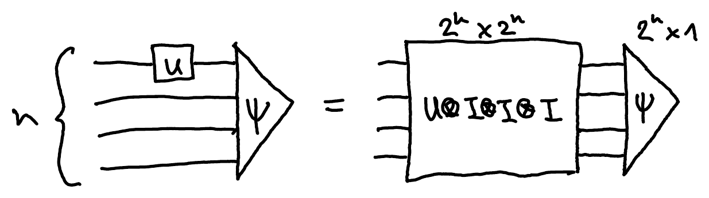
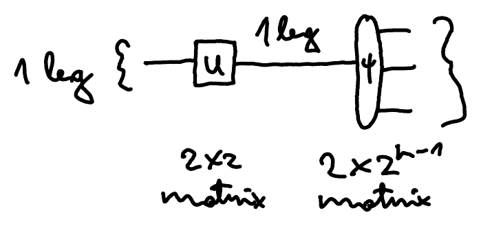
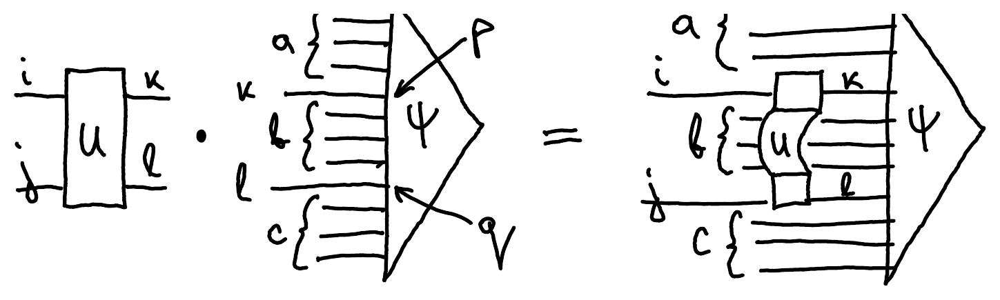

::pagesources{items="L13:16-17"}

## Simulation of quantum circuits: naive approach vs tensor networks

::source{lecture="13" pages="16"}

Let's say we store an $n$-qubit state $\ket{\psi}$ as a vector with $2^n$ components. How expensive is it to apply a 1-qubit gate on the first qubit?

Naive approach - treat $U$ as a $2^n \times 2^n$ matrix:



This has complexity $2^n \cdot 2^n \cdot 1 = 2^{2n}$.

On the other hand, if we treat $U$ and $\ket{\psi}$ as tensors and only contract one index, we are effectively multiplying smaller matrices:



This has complexity $2 \cdot 2 \cdot 2^{n-1} = 2^{n+1}$, which is much better than the naive approach. Hence this is also the method used by many simulators, such as the one in Cirq.

Let's take a look at how to implement this in Python.

## Example Python code

::source{lecture="13" pages="17"}

If we store an $n$-qubit state $\ket{\psi}$ as a vector with $2^n$ components, we can apply 1-qubit and 2-qubit gates by contracting the legs on which the gate acts with a tensor describing the gate itself.

Let's say we want to apply a 2-qubit gate $U$ on qubits $p < q$ of $\ket{\psi}$:



Create all-zeroes vector with $2^n$ complex entries and initialize to $\ket{0}^{\otimes n}$:

```python
state = np.zeros(2**n, np.complex64)
state[0] = 1+0j
```

Group legs into 5 groups of sizes $p, 1, q-p-1, 1, n-q-1$:

```python
psi = state.reshape([2**p, 2, 2**(q-p-1), 2, 2**(n-q-1)])
```

Contract the gate and state tensors:

```python
state = np.einsum('ijkl, akblc->aibjc', U, psi)
```

This is essentially what happens inside Cirq.
