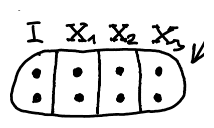
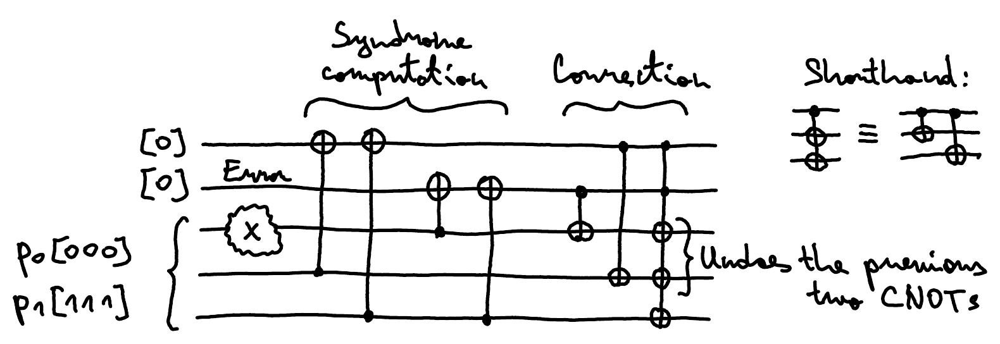
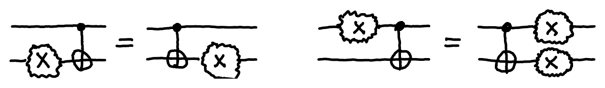

The goal of this lecture is to understand how one can go about correcting errors in quantum states. It is not obvious at all that this is even possible, so we will first see how this works for deterministic and probabilistic bits.

## Classical repetition code

The simplest way to protect information from errors is by duplicating it. This introduces a lot of redundancy, so even if some copies are perturbed or even destroyed, one can still recover the information from the remaining copies. For example, let's make 3 copies:

$$
\begin{aligned}
\text{Enc:}\quad 0 &\to 000 \\
1 &\to 111
\end{aligned}
$$

This code works well if at most one bit-flip error occurs. Alternatively, you can think of each bit as getting flipped with a very small probability. For example, 001 was most likely produced by an error on the last bit of 000, rather than by two errors, one on each of the first two bits of 111. In general, we decode by majority vote:

$$
\text{Dec:}\quad
\left.\begin{matrix} 000 \\ 001 \\ 010 \\ 100 \end{matrix}\right\} \to 0
\qquad
\left.\begin{matrix} 111 \\ 110 \\ 101 \\ 011 \end{matrix}\right\} \to 1
$$

This takes care of any single-bit error.

## Problem setup

Let us state a bit more formally the problem we are trying to address. Imagine somebody gives you an unknown qubit state $\ket{\psi} \in \C^2$ and asks you to store it for some time or transmit it to somebody else. If the storage device or transmission channel is not perfect, any individual qubit might get perturbed with very small probability by an arbitrary single-qubit operation $U \in \mathrm{U}(2)$. Hence, we want to spread the information out into several qubits to protect it:

We need to apply a fixing operation Fix often enough to make sure that the errors do not accumulate and we have at most one error to fix. We assume that at each time step any of the $n$ qubits is affected by an unknown single-qubit gate with very small probability.

## Obstacles to quantum error correction

At first it might seem that quantum error correction is impossible, for several reasons:

- we cannot duplicate information, since quantum states cannot be copied;
- we cannot check whether an error has occurred without measuring the state, but a measurement would destroy the state;
- the errors are continuous: there are infinitely many possible errors, so we cannot hope to correct them perfectly.

This list seems pretty daunting. However, none of these obstacles is unique to quantum computing. They are all a consequence of the linearity of the state space and operations, which is also the case for probabilistic bits. So we first tackle them in this simpler setting, and then generalize to the quantum case.

## Error correction for probabilistic bits

We cannot copy probabilistic bits either, but we can still use the 3-bit repetition code: we encode $[0]$ and $[1]$ as before and extend by linearity:

$$
\text{Enc:}\quad p_0[0] + p_1[1] \mapsto p_0[000] + p_1[111]
$$

We can achieve this by using two CNOTs:

![Circuit: the first qubit in state p0[0]+p1[1] is the control of two CNOTs targeting two qubits initialised to [0], giving p0[000]+p1[111]](../../../assets/figures/L12-p03-1.png "w=512")

::pagebreak{lecture="12" page="4"}

That's great, but how do we detect errors? Say an $X$ error happened on the first bit:

$$
(X \otimes I \otimes I) \cdot (p_0[000] + p_1[111]) = p_0[100] + p_1[011].
$$

We can't just measure the bits to compare them, since this would collapse the distribution to one of the two cases, and $p_0$ and $p_1$ would no longer appear in it. However, our goal is not to learn the values of individual bits, but rather which of the possible errors occurred. There are 4 cases:

$$
\begin{aligned}
\text{no error:}\quad & p_0[000] + p_1[111] \\
X_1:\quad & p_0[100] + p_1[011] \\
X_2:\quad & p_0[010] + p_1[101] \\
X_3:\quad & p_0[001] + p_1[110]
\end{aligned}
$$

We see that all eight 3-bit strings occur, each exactly once. In fact, the errors partition these strings into 4 groups, each containing 2 strings: a string of Hamming weight 0 or 1 (at most one 1), and its negation. All we want is to figure out which of the four cases we are in, without identifying an individual string (as this would destroy $p_0$ and $p_1$):

$$
\begin{array}{c|c|c|c}
 & \mathrlap{\overbrace{\hphantom{x_2 \oplus x_3 \quad\ x_1 \oplus x_3}}^{\text{Error syndrome}}} & & \\
 & y_1 & y_2 & \\
x_1x_2x_3 & x_2 \oplus x_3 & x_1 \oplus x_3 & \text{Error} \\
\hline
\substack{000 \\ 111} & 0 & 0 & I \\
\hline
\substack{100 \\ 011} & 0 & 1 & X_1 \\
\hline
\substack{010 \\ 101} & 1 & 0 & X_2 \\
\hline
\substack{001 \\ 110} & 1 & 1 & X_3
\end{array}
$$

We can do this by inspecting the correlations between bits. For example, as the table shows, the parities $y_1 = x_2 \oplus x_3$ and $y_2 = x_1 \oplus x_3$ uniquely identify which error occurred. These two bits are the **error syndrome**. We can then correct the error by applying $X_y$, where $y = y_1y_2$ is the index of the flipped bit in binary.

::pagebreak{lecture="12" page="5"}

This can be implemented with CNOTs that compute the two parities into two extra syndrome bits:

![Circuit: two syndrome qubits [0] are the targets of CNOTs controlled by the data qubits p0[000]+p1[111] (an X error on the first data qubit), then measured to give y1 and y2 in {0,1}](../../../assets/figures/L12-p05-1.png "w=616")

We can even start correcting the error on the fly, before measuring: we simply use the syndrome bits as controls and the data bits as targets:

The syndrome bits can now be safely discarded, and the data bits will be automatically corrected. This is somewhat similar to how a refrigerator keeps your food cool by pumping out the heat. You can actually keep track of how an $X$ error propagates through the circuit by using the following identities:

This way you can move the errors to the right until they fall out the other end.

::pagebreak{lecture="12" page="6"}

What about the final issue, namely dealing with continuous errors? For example, imagine that an $X$ error is applied with some arbitrary probability $q$. This corresponds to the following operation:

$$
Q = (1-q)I + qX = \begin{pmatrix} 1-q & q \\ q & 1-q \end{pmatrix}.
$$

Assume this error happens on the first bit. The resulting state is

$$
\begin{aligned}
& \big((( 1-q)I + qX) \otimes I \otimes I\big) \cdot (p_0[000] + p_1[111]) \\
&= (1-q) \cdot (p_0[000] + p_1[111]) \\
&\quad + q \cdot (p_0[100] + p_1[011])
\end{aligned}
$$

By linearity, computing the syndrome results in two additional bits that take different values in the two cases (depending on whether $I$ or $X$ was applied on the first bit):

$$
\begin{aligned}
&(1-q) \cdot [00] \otimes (p_0[000] + p_1[111]) \\
&+ q \cdot [01] \otimes (p_0[100] + p_1[011])
\end{aligned}
$$

Measuring the syndrome bits forces the error to become one of the two types, rather than a linear combination:

$$
\begin{gathered}
[00] \otimes (p_0[000] + p_1[111]) \\
\text{or} \\
[01] \otimes (p_0[100] + p_1[011])
\end{gathered}
$$

and we know which one it is from the measurement outcome, so we can easily correct it.

::pagebreak{lecture="12" page="7"}

Assume we encode 1 bit into $n$ bits to protect it against single-bit flip errors. How big does $n$ have to be for this to work (could it be 2, for example)? And does it get easier or harder to protect the information against errors if we use more bits?

We can answer this with a simple counting argument. The total dimension of an $n$-bit code is $2^n$. There are $n$ different possible bit-flip errors, plus the lucky case of no error, so there are $n+1$ cases we need to be able to discriminate. Each case takes up a 2-dimensional subspace, spanned by the two encoded strings with that error applied (like the groups of two strings above). So we need to fit $n+1$ 2-dimensional subspaces into a $2^n$-dimensional space, which means that

$$
2^n \geq 2(n+1)
$$

The smallest $n$ for which this holds is $n = 3$, so 2 bits are not enough. As $n$ increases, it gets easier and easier to fit $n+1$ 2-dimensional subspaces in a $2^n$-dimensional space.
