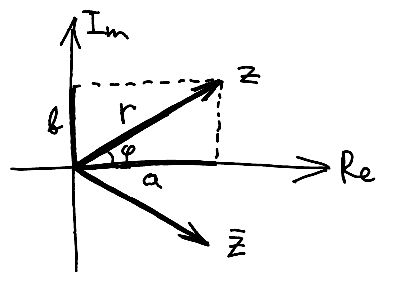

::pagesources{items="L01:7-8" exercises="/exercises/foundations/#complex-numbers"}

## Complex numbers

::source{lecture="1" pages="7"}

Let $i$ be the **imaginary unit** ($i^2 = -1$) and $\R$ denote the real numbers, and $\C$ the complex numbers. Any **complex number** $z \in \C$ can be written in two forms:

- algebraic: $z = a + ib \qquad a, b \in \R$
- exponential: $z = r e^{i\varphi} \qquad r \geq 0,\ \varphi \in [0, 2\pi)$

Euler's formula is very useful:

$$
e^{i\varphi} = \cos\varphi + i \sin\varphi \qquad\qquad \varphi \in \R
$$

Just like for real numbers,

$$
e^{i(\alpha + \beta)} = e^{i\alpha} \cdot e^{i\beta} \qquad\qquad \alpha, \beta \in \R
$$

In particular,

$$
e^{i\varphi} \cdot e^{-i\varphi} = e^{i(\varphi - \varphi)} = e^0 = 1
$$

so $e^{-i\varphi}$ is the multiplicative inverse of $e^{i\varphi}$. That means $1/e^{i\varphi} = e^{-i\varphi}$.

## Geometry of ℂ

::source{lecture="1" pages="8"}

You can think of $z \in \C$ as a point in the plane. Its coordinates are $(a, b)$ where

$$
a = \mathrm{Re}\, z \qquad\qquad b = \mathrm{Im}\, z
$$

are the **real** and **imaginary** parts of $z$. Also, $\varphi$ is the angle with the $x$ axis and $r$ is the distance from the origin.

## Arithmetic of ℂ

::source{lecture="1" pages="8"}

- addition & subtraction:

  $$
  (a + ib) \pm (c + id) = (a \pm c) + i(b \pm d)
  $$
- multiplication:

  $$
  (a + ib) \cdot (c + id) = (ac - bd) + i(ad + bc)
  $$

  $$
  r_1 e^{i\varphi_1} \cdot r_2 e^{i\varphi_2} = r_1 r_2\, e^{i(\varphi_1 + \varphi_2)}
  $$
- absolute value:

  $$
  |z| = \sqrt{a^2 + b^2} = r \qquad\qquad |z_1 \cdot z_2| = |z_1| \cdot |z_2|
  $$

  Squared absolute value plays an important role:

  $$
  |z|^2 = a^2 + b^2 = r^2
  $$
- complex conjugation: $\qquad \bar{i} = -i$

  $$
  \bar{z} = z^* = a - ib = r e^{-i\varphi}
  $$

  very useful for computing squared absolute value:

  $$
  z \cdot \bar{z} = |z|^2
  $$

  and the real and imaginary parts:

  $$
  z + \bar{z} = 2\,\mathrm{Re}\, z \qquad\qquad z - \bar{z} = 2i\,\mathrm{Im}\, z
  $$
