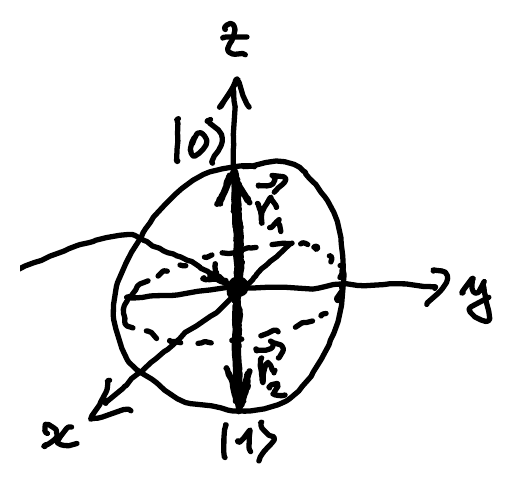
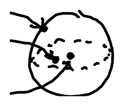

If quantum mechanics really describes the world, it should also capture classical probabilistic processes. In particular, [probabilistic bits](/notes/probabilistic-bits/) should occur as a special case of qubits. However, this is not the case in our current formalism.

## Density matrix

If we measure $\ket{\psi} \in \C^d$ in the standard basis, we get outcome $k \in \{1, \dots, d\}$ with probability

$$
\begin{aligned}
p_k = \abs{\braket{k|\psi}}^2 &= \braket{k|\psi} \cdot \overline{\braket{k|\psi}} \\
&= \braket{k|\psi} \cdot (\braket{k|\psi})^\dagger \\
&= \braket{k|\psi}\!\braket{\psi|k} \\
&= \braket{k|\rho|k}
\end{aligned}
$$

where $\rho := \ket{\psi}\!\bra{\psi}$ is called the **density matrix** of $\ket{\psi}$. If we measure $\ket{\psi}$ in any other orthonormal basis $\ket{b_1}, \dots, \ket{b_d}$ instead, the outcome probabilities can still be obtained from $\rho$ with a similar formula: outcome $k$ has probability $\braket{b_k|\rho|b_k}$.

Conveniently, $\rho$ does not depend on the [global phase](/notes/qubits/#global-phase) of $\ket{\psi}$: since $(e^{i\varphi}\ket{\psi})^\dagger = e^{-i\varphi}\bra{\psi}$, the two phases cancel out in $\ket{\psi}\!\bra{\psi}$.

## Mixed states

Let $\ket{\psi_1}, \dots, \ket{\psi_n} \in \C^d$ be arbitrary states and let $q_1, \dots, q_n \in [0,1]$ be a probability distribution (that is, $q_i \geq 0$ and $\sum_{i=1}^n q_i = 1$). The states $\ket{\psi_i}$ together with the probabilities $q_i$ are called an **ensemble**.

What are the outcome probabilities if you pick the state $\ket{\psi_i}$ with probability $q_i$ and measure it in the standard basis? You get $k \in \{1, \dots, d\}$ with probability

$$
\begin{aligned}
p_k &= \sum_{i=1}^n q_i \abs{\braket{k|\psi_i}}^2 \\
&= \sum_{i=1}^n q_i \braket{k|\psi_i}\!\braket{\psi_i|k} \\
&= \braket{k|\underbrace{\left(\sum_{i=1}^n q_i \ket{\psi_i}\!\bra{\psi_i}\right)}_{\rho}|k}
\end{aligned}
$$

So in this case too, we can define a density matrix $\rho$ that fully determines the outcome probabilities. We call the states $\ket{\psi_i}$ **pure** and $\rho$ **mixed**, because $\rho$ is a probability distribution, or "mixture", over pure states.

## Bloch ball

We can generalize the [Bloch sphere](/notes/qubits/#bloch-sphere) representation of pure states from Lecture 1 to mixed states. Recall from Homework 3 that

$$
\vec{r} = \begin{pmatrix} x \\ y \\ z \end{pmatrix} \in \R^3 \iff \ket{\psi(\vec{r})} = \frac{1}{\sqrt{2(z+1)}} \begin{pmatrix} z+1 \\ x+iy \end{pmatrix} \in \C^2
$$

::pagebreak{lecture="13" page="3"}

establishes a correspondence between unit vectors in $\R^3$ (that is, $x^2+y^2+z^2=1$) and unit vectors in $\C^2$ with the global phase ignored (also known as the complex projective space).

You showed in Homework 3 that the density matrix of $\ket{\psi(\vec{r})}$ is

$$
\rho(\vec{r}) = \ket{\psi(\vec{r})}\!\bra{\psi(\vec{r})} = \frac{1}{2}(I + xX + yY + zZ)
$$

which is much easier to remember than the formula for $\ket{\psi(\vec{r})}$. We call $\vec{r}$ the **Bloch vector** of $\ket{\psi(\vec{r})}$ or $\rho(\vec{r})$.

If you pick $\ket{\psi(\vec{r}_1)}$ with probability $q_1$ and $\ket{\psi(\vec{r}_2)}$ with probability $q_2$, the resulting density matrix is

$$
\begin{aligned}
& q_1 \rho(\vec{r}_1) + q_2 \rho(\vec{r}_2) \\
&= q_1 \frac{1}{2}(I + x_1 X + y_1 Y + z_1 Z) \\
&\quad + q_2 \frac{1}{2}(I + x_2 X + y_2 Y + z_2 Z) \\
&= \frac{1}{2}\left(I + (q_1 x_1 + q_2 x_2) X + (q_1 y_1 + q_2 y_2) Y + (q_1 z_1 + q_2 z_2) Z\right) \\
&= \rho(q_1 \vec{r}_1 + q_2 \vec{r}_2)
\end{aligned}
$$

In other words, the Bloch vector of the mixture is the weighted average $q_1 \vec{r}_1 + q_2 \vec{r}_2$ of the two Bloch vectors. For example, if $\vec{r}_1 = \begin{pmatrix} 0 \\ 0 \\ 1 \end{pmatrix}$ and $\vec{r}_2 = \begin{pmatrix} 0 \\ 0 \\ -1 \end{pmatrix}$ (the Bloch vectors of $\ket{0}$ and $\ket{1}$) and $q_1 = q_2 = \frac{1}{2}$, then

$$
q_1 \vec{r}_1 + q_2 \vec{r}_2 = \frac{1}{2}\begin{pmatrix} 0 \\ 0 \\ 1-1 \end{pmatrix} = \begin{pmatrix} 0 \\ 0 \\ 0 \end{pmatrix}.
$$

::pagebreak{lecture="13" page="4"}

The resulting state is called the **maximally mixed state**:

$$
\frac{1}{2}\ket{0}\!\bra{0} + \frac{1}{2}\ket{1}\!\bra{1} = \frac{1}{2}\begin{pmatrix} 1 & 0 \\ 0 & 1 \end{pmatrix} = \frac{1}{2} I.
$$

It can be obtained from other states as well, for example from $\ket{+}$ and $\ket{-}$:

$$
\frac{1}{2}\ket{+}\!\bra{+} + \frac{1}{2}\ket{-}\!\bra{-} = \frac{1}{2}\begin{pmatrix} 1 & 0 \\ 0 & 1 \end{pmatrix}.
$$

Indeed, the Bloch vectors of $\ket{+}$ and $\ket{-}$ are $\vec{r}_1 = \begin{pmatrix} 1 \\ 0 \\ 0 \end{pmatrix}$ and $\vec{r}_2 = \begin{pmatrix} -1 \\ 0 \\ 0 \end{pmatrix}$, so their average

$$
\frac{1}{2} \vec{r}_1 + \frac{1}{2} \vec{r}_2 = \frac{1}{2}\begin{pmatrix} 1-1 \\ 0 \\ 0 \end{pmatrix} = \begin{pmatrix} 0 \\ 0 \\ 0 \end{pmatrix}
$$

is also at the origin.

In fact,

$$
\frac{1}{2}\rho(\vec{r}) + \frac{1}{2}\rho(-\vec{r}) = \frac{1}{2} I
$$

for any $\vec{r} \in \R^3$. Recall from Homework 3 that $\{\ket{\psi(\vec{r})}, \ket{\psi(-\vec{r})}\}$ is an orthonormal basis for any unit vector $\vec{r}$, so an equal mixture of the two states of such a basis is always the maximally mixed state.

Any $\vec{r} \in \R^3$ such that $\norm{\vec{r}} \leq 1$ describes a valid quantum state $\rho(\vec{r})$. Together these vectors form the **Bloch ball**.

Intuitively, the length $\norm{\vec{r}}$ of the Bloch vector measures the "purity" of the state $\rho(\vec{r})$:

- $\norm{\vec{r}} = 1 \Rightarrow$ pure
- $\norm{\vec{r}} < 1 \Rightarrow$ mixed
- $\norm{\vec{r}} = 0 \Rightarrow$ maximally mixed

The eigenvalues of $\rho(\vec{r})$ are $\frac{1}{2}(1 \pm \norm{\vec{r}})$, which are $\{0, 1\}$ for pure states and $\{\frac{1}{2}, \frac{1}{2}\}$ for the maximally mixed state.

## Mixed states of dimension d

When does a matrix $\rho \in M_d(\C)$ describe a valid mixed state? It has to satisfy three conditions:

- $\rho$ is Hermitian: $\left(\sum_{i=1}^n q_i \ket{\psi_i}\!\bra{\psi_i}\right)^\dagger = \sum_{i=1}^n q_i \ket{\psi_i}\!\bra{\psi_i}$.
- Measurement probabilities in any basis are non-negative:

  $$
  \braket{\varphi|\rho|\varphi} \geq 0 \quad \forall \ket{\varphi} \in \C^d
  $$

- The probabilities (when measuring in the standard basis) sum to 1:

  $$
  \sum_{k=1}^d \braket{k|\rho|k} = 1
  $$

Matrices with the first two properties are called **positive semidefinite**, and this constraint is written $\rho \geq 0$. (This does not mean that the entries of $\rho$ are non-negative.) Equivalently, $\rho$ is Hermitian, $\rho^\dagger = \rho$, and has non-negative eigenvalues.

The third condition is written $\Tr \rho = 1$, where

$$
\Tr \rho := \sum_{k=1}^d \rho_{kk}
$$

is called the **trace** of $\rho$. It is just the sum of the diagonal entries.

You can think of mixed states as "non-commutative" probability distributions. Diagonal states represent actual probability distributions (for $d = 2$, a [probabilistic bit](/notes/probabilistic-bits/)):

$$
\rho = \begin{pmatrix} p_1 & & & 0 \\ & p_2 & & \\ & & \ddots & \\ 0 & & & p_d \end{pmatrix}
$$
