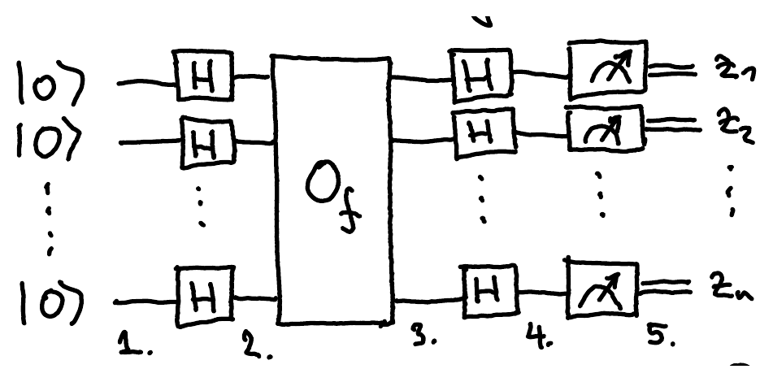

[Deutsch's algorithm](/notes/deutsch/) uses only 1 or 2 qubits. Below are extensions of this basic algorithm to $n$ qubits, which play around with the same idea in different ways. They are all based on the Hadamard transform, a generalization of the simple $2\times 2$ Hadamard matrix $H = \frac{1}{\sqrt 2}\begin{pmatrix}1 & 1\\ 1 & -1\end{pmatrix}$.

## Hadamard transform

The $n$-qubit Hadamard transform is

$$
H^{\otimes n} = H \otimes H^{\otimes n-1} = \frac{1}{\sqrt 2}\begin{pmatrix}1 & 1\\ 1 & -1\end{pmatrix} \otimes H^{\otimes n-1} = \frac{1}{\sqrt 2}\begin{pmatrix}H^{\otimes n-1} & H^{\otimes n-1}\\ H^{\otimes n-1} & -H^{\otimes n-1}\end{pmatrix}.
$$

For example,

$$
H^{\otimes 2} = \frac{1}{2}\begin{pmatrix}1 & 1 & 1 & 1\\ 1 & -1 & 1 & -1\\ 1 & 1 & -1 & -1\\ 1 & -1 & -1 & 1\end{pmatrix}.
$$

To get a formula for the entries of $H^{\otimes n}$, first write $H$ as a sum of outer products:

$$
H = \frac{1}{\sqrt 2}\begin{pmatrix}1 & 1\\ 1 & -1\end{pmatrix} = \sum_{x,y\in\{0,1\}} \frac{1}{\sqrt 2}(-1)^{xy}\ket{x}\!\bra{y}
$$

Hence

$$
H_{xy} = \frac{1}{\sqrt 2}(-1)^{xy}, \quad \text{for all } x,y\in\{0,1\}.
$$

Similarly,

$$
H\otimes H = \left(\frac{1}{\sqrt 2}\sum_{x_1,y_1\in\{0,1\}} (-1)^{x_1y_1}\ket{x_1}\!\bra{y_1}\right) \otimes \left(\frac{1}{\sqrt 2}\sum_{x_2,y_2\in\{0,1\}} (-1)^{x_2y_2}\ket{x_2}\!\bra{y_2}\right)
$$

$$
= \frac{1}{2}\sum_{x_1,x_2,y_1,y_2\in\{0,1\}} (-1)^{x_1y_1+x_2y_2}\ket{x_1}\!\bra{y_1}\otimes\ket{x_2}\!\bra{y_2} = \frac{1}{2}\sum_{x_1,x_2,y_1,y_2\in\{0,1\}} (-1)^{x_1y_1+x_2y_2}\ket{x_1x_2}\!\bra{y_1y_2}
$$

so $\frac{1}{2}(-1)^{x_1y_1+x_2y_2}$ is the entry of $H^{\otimes 2}$ at row $x_1x_2$ and column $y_1y_2$.

::pagebreak{lecture="6" page="2"}

By induction,

$$
H^{\otimes n} = \sum_{x,y\in\{0,1\}^n} \frac{1}{\sqrt{2^n}}(-1)^{x\cdot y}\ket{x}\!\bra{y}
$$
where $x\cdot y = \sum_{i=1}^n x_iy_i = x_1y_1 + x_2y_2 + \cdots + x_ny_n \pmod 2$ is the inner product of $x$ and $y$ modulo 2, that is, of $x$ and $y$ viewed as vectors in the vector space $\mathbb{Z}_2^n$. We see from this that

$$
H^{\otimes n}\ket{y} = \frac{1}{\sqrt{2^n}}\sum_{x\in\{0,1\}^n}(-1)^{x\cdot y}\ket{x}
$$

for any computational basis state $\ket{y}$, $y\in\{0,1\}^n$. Since $H\cdot H = I$, we also have

$$
H^{\otimes n}\cdot\frac{1}{\sqrt{2^n}}\sum_{x\in\{0,1\}^n}(-1)^{x\cdot y}\ket{x} = \ket{y} \qquad\text{for any } y\in\{0,1\}^n.
$$

## Deutsch-Jozsa algorithm (with phase oracle)

Here $O_f\ket{x} = (-1)^{f(x)}\ket{x}$ is the [phase oracle](/notes/reversible-computation/#phase-kick-back) for a function $f:\{0,1\}^n\to\{0,1\}$, and the measurement outcomes form the string $z = z_1z_2\ldots z_n \in\{0,1\}^n$. The state at each numbered step is:

1. $\ket{0}^{\otimes n}$
2. $(H\ket{0})^{\otimes n} = \ket{+}^{\otimes n} = \left(\frac{1}{\sqrt 2}(\ket{0}+\ket{1})\right)^{\otimes n} = \frac{1}{\sqrt{2^n}}\sum_{x\in\{0,1\}^n}\ket{x}$, the same as $H^{\otimes n}\ket{0^n}$
3. $\frac{1}{\sqrt{2^n}}\sum_{x\in\{0,1\}^n} O_f\ket{x} = \frac{1}{\sqrt{2^n}}\sum_{x\in\{0,1\}^n}(-1)^{f(x)}\ket{x}$
4. $\frac{1}{\sqrt{2^n}}\sum_{x\in\{0,1\}^n}(-1)^{f(x)}H^{\otimes n}\ket{x} = \sum_{z\in\{0,1\}^n}\frac{1}{2^n}\sum_{x\in\{0,1\}^n}(-1)^{f(x)+z\cdot x}\ket{z}$, using the formula for $H^{\otimes n}\ket{x}$ above
5. Measuring gives $z\in\{0,1\}^n$ with probability $\left|\frac{1}{2^n}\sum_{x\in\{0,1\}^n}(-1)^{f(x)+z\cdot x}\right|^2$

## Deutsch-Jozsa problem

We get $z\in\{0,1\}^n$ with probability $p_z = \left|\frac{1}{2^n}\sum_{x\in\{0,1\}^n}(-1)^{f(x)+z\cdot x}\right|^2$.

For example, since $0^n\cdot x = 0$ for every $x$, the probability of getting $z = 00\ldots0 = 0^n$ is

$$
p_0 = \left|\frac{1}{2^n}\sum_{x\in\{0,1\}^n}(-1)^{f(x)}\right|^2
$$

where $\frac{1}{2^n}\sum_{x\in\{0,1\}^n}(-1)^{f(x)}$ is simply the average of $(-1)^{f(x)}$ over all $x\in\{0,1\}^n$. When is $p_0 = 1$ or $p_0 = 0$?

- $p_0 = 1$ if $\frac{1}{2^n}\sum_{x\in\{0,1\}^n}(-1)^{f(x)} = \pm 1$, meaning that $f$ is **constant**:
  either $f(x) = 0$ for all $x\in\{0,1\}^n$ or $f(x) = 1$ for all $x\in\{0,1\}^n$.

- $p_0 = 0$ if $\frac{1}{2^n}\sum_{x\in\{0,1\}^n}(-1)^{f(x)} = 0$, meaning that $f$ is **balanced**:
  $\left|\{x\in\{0,1\}^n : f(x) = 0\}\right| = \left|\{x\in\{0,1\}^n : f(x) = 1\}\right| = 2^n/2$.

So if $f$ is constant, we always get outcome $z = 0^n$, and if $f$ is balanced, we never get $z = 0^n$.

**Problem**: We are promised that $f$ is either constant or balanced. Decide which of the two it is by evaluating $f$ on inputs of your choice.

**Result**: A quantum algorithm can solve this with certainty by evaluating $f$ only once. A deterministic classical algorithm needs $2^{n-1}+1$ evaluations, which is significantly more. However, a probabilistic classical algorithm can solve this with probability $\frac{3}{4}$ by evaluating $f$ only twice (this is left as homework).

## Bernstein-Vazirani problem

Recall that the Deutsch-Jozsa algorithm outputs $z\in\{0,1\}^n$ with probability $p_z = \left|\frac{1}{2^n}\sum_{x\in\{0,1\}^n}(-1)^{f(x)+z\cdot x}\right|^2$.

What other interesting functions can we choose so that $p_z$ is always either 1 or 0? Let $f(x) = s\cdot x$ for some $s\in\{0,1\}^n$, that is, $f$ is linear over $\mathbb{Z}_2$. Then

$$
\frac{1}{2^n}\sum_{x\in\{0,1\}^n}(-1)^{f(x)+z\cdot x} = \frac{1}{2^n}\sum_{x\in\{0,1\}^n}(-1)^{(s+z)\cdot x}
$$

Note that

$$
\sum_{x\in\{0,1\}^n}(-1)^{00\ldots0\cdot x} = \sum_{x\in\{0,1\}^n} 1 = 2^n
$$

so, since $s + s = 00\ldots0$ modulo 2,

$$
p_s = \left|\frac{1}{2^n}\sum_{x\in\{0,1\}^n}(-1)^{(s+s)\cdot x}\right|^2 = \left|\frac{1}{2^n}\cdot 2^n\right|^2 = |1|^2 = 1.
$$

Since $p$ is obtained by measuring a quantum state, it is a probability distribution, so its values add up to 1. Since $p_s = 1$, this implies that $p_z = 0$ for $z\neq s$ (exercise: verify this explicitly).

So if $f(x) = s\cdot x$ for some $s\in\{0,1\}^n$, then $p_s = 1$ and $p_z = 0$ for any $z\neq s$. Hence, the measurement outcome is always $z = s$.

**Problem**: We are promised that $f(x) = s\cdot x$ for some $s\in\{0,1\}^n$. Determine $s$ by evaluating $f$ on inputs of your choice.

**Result**: A quantum algorithm can solve this problem with certainty by evaluating $f$ once. Any deterministic algorithm needs to evaluate $f$ at least $n$ times (exercise). Even a probabilistic algorithm needs $\Omega(n)$ evaluations[^fix-1] of $f$ to succeed with probability $\geq 3/4$.

[^fix-1]: Corrected from the original notes, which have $O(n)$. This is a lower bound, so it is $\Omega(n)$.
