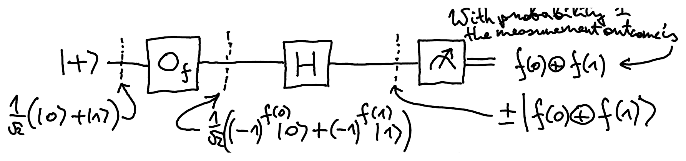
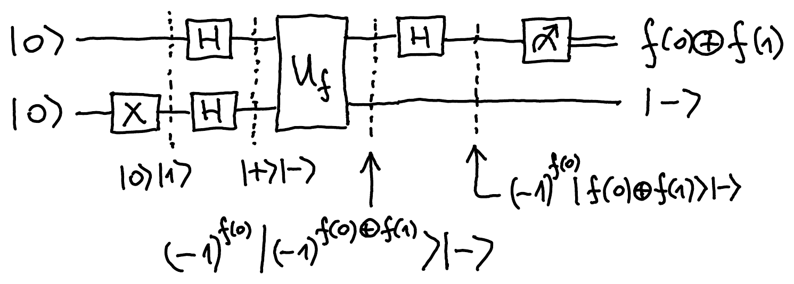

::pagesources{items="L05:8-9" exercises="/exercises/algorithms/#deutschs-algorithm"}

## Deutsch's algorithm for XOR

::source{lecture="5" pages="8"}

Let's say you are given two bits, $x_0, x_1 \in \{0,1\}$ and you want to compute $\mathrm{XOR}(x_0, x_1) = x_0 \oplus x_1$. Let's say each of these bits itself is the result of some other (possibly very difficult) computation:

$$
x_0 = f(0) \quad\text{and}\quad x_1 = f(1) \quad\text{for some}
$$

Boolean function $f : \{0,1\} \to \{0,1\}$. We want to know whether $f(0) \oplus f(1)$ is 0 or 1, i.e., whether $f(0) = f(1)$ or $f(0) \neq f(1)$. The only way to find this out on a classical computer is by computing both $f(0)$ and $f(1)$ first and then XORing the results. Hence, classically **two** evaluations of $f$ are required. Surprisingly, quantumly only **one** evaluation of $f$ suffices. Recall that quantum evaluation of $f$ corresponds to applying the oracle $U_f$ or $O_f$.

Here is **Deutsch's algorithm** for computing $f(0) \oplus f(1)$ with one application of $O_f$:

$$
\begin{aligned}
&= (-1)^{f(0)} \frac{1}{\sqrt{2}} \left( \ket{0} + (-1)^{f(0) \oplus f(1)} \ket{1} \right) \\
&= (-1)^{f(0)} \begin{cases} \ket{+} & \text{if } f(0) \oplus f(1) = 0 \\ \ket{-} & \text{if } f(0) \oplus f(1) = 1 \end{cases} \\
&\overset{\text{(up to global phase)}}{\sim} \ket{(-1)^{f(0) \oplus f(1)}}
\end{aligned}
\qquad
\boxed{H\ket{(-1)^x} = \ket{x}, \quad x \in \{0,1\}}
$$

## Interference

::source{lecture="5" pages="9"}

What gives Deutsch's algorithm advantage over (probabilistic) classical algorithms? It is **interference** -- amplitudes with opposite signs can cancel each other out. This can not happen with probabilities since they cannot be negative.

$$
\begin{aligned}
H\ket{+} &= \frac{1}{\sqrt{2}} \begin{pmatrix} 1 & 1 \\ 1 & -1 \end{pmatrix} \cdot \frac{1}{\sqrt{2}} \begin{pmatrix} 1 \\ 1 \end{pmatrix} = \frac{1}{2} \begin{pmatrix} 1+1 \\ 1-1 \end{pmatrix} = \begin{pmatrix} 1 \\ 0 \end{pmatrix} \\
H\ket{-} &= \frac{1}{\sqrt{2}} \begin{pmatrix} 1 & 1 \\ 1 & -1 \end{pmatrix} \cdot \frac{1}{\sqrt{2}} \begin{pmatrix} 1 \\ -1 \end{pmatrix} = \frac{1}{2} \begin{pmatrix} 1-1 \\ 1+1 \end{pmatrix} = \begin{pmatrix} 0 \\ 1 \end{pmatrix}
\end{aligned}
$$

For probabilistic bits we get:

$$
\frac{1}{2} \begin{pmatrix} 1 & 1 \\ 1 & 1 \end{pmatrix} \cdot \frac{1}{2} \begin{pmatrix} 1 \\ 1 \end{pmatrix} = \frac{1}{4} \begin{pmatrix} 1+1 \\ 1+1 \end{pmatrix} = \underbrace{\frac{1}{2} \begin{pmatrix} 1 \\ 1 \end{pmatrix}}_{\text{no destructive interference}}
$$

## Deutsch's algorithm (full version)

::source{lecture="5" pages="9"}

The full version (starting from $\ket{0}\ket{0}$ and using the bit oracle $U_f$) is as follows:

This algorithm uses only one call to the subroutine $U_f$ for evaluating $f$ and it succeeds in computing the value of $f(0) \oplus f(1)$ with probability 1.

We can return the last qubit back to $\ket{0}$ by applying $H$ and then $X$.
