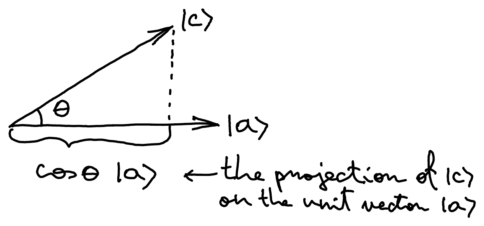

::pagesources{items="L02:5-10" exercises="/exercises/linear-algebra/#dirac-notation-inner-products-and-bases"}

## Dirac bra-ket notation

::source{lecture="2" pages="5"}

Column vector (ket)

$$
\ket{\psi} = \begin{pmatrix} a_1 \\ a_2 \\ \vdots \\ a_n \end{pmatrix} \in \C^n
$$

Row vector (bra)

$$
\bra{\psi} = (\underbrace{a_1^*}_{\text{Complex conjugate!}} \;\; a_2^* \;\; \cdots \;\; a_n^*)
$$

Ket and bra are **conjugate transposes** of each other:

$$
\ket{\psi}^\dagger \equiv \bra{\psi} \qquad \bra{\psi}^\dagger \equiv \ket{\psi}
$$

For $\ket{\psi}, \ket{\varphi} \in \C^n$ and $A \in M_{n,n}(\C)$ the following are valid matrix products:

- inner product: $\bra{\psi} \cdot \ket{\varphi} \equiv \braket{\psi|\varphi} \in \C$
- outer product: $\ket{\psi} \cdot \bra{\varphi} \equiv \ketbra{\psi}{\varphi} \in M_{n,n}(\C)$
- matrix-vector product: $A \cdot \ket{\psi} \equiv A\ket{\psi} \in \C^n$

  $\bra{\psi} \cdot A \equiv \bra{\psi}A \in \C^n$ (a row vector)

## Inner product

::source{lecture="2" pages="6"}

The **inner product** of vectors $\ket{a}, \ket{b} \in \C^n$ is the complex number $\braket{a|b}$.

If $\ket{a} = \begin{pmatrix} \alpha_1 \\ \alpha_2 \\ \vdots \\ \alpha_n \end{pmatrix}$ and $\ket{b} = \begin{pmatrix} \beta_1 \\ \beta_2 \\ \vdots \\ \beta_n \end{pmatrix}$ then

$$
\braket{a|b} = (\alpha_1^* \;\; \alpha_2^* \;\; \cdots \;\; \alpha_n^*) \begin{pmatrix} \beta_1 \\ \beta_2 \\ \vdots \\ \beta_n \end{pmatrix} = \sum_{i=1}^n \alpha_i^* \beta_i \in \C
$$

:::note
- $\braket{a|b} = (\braket{b|a})^\dagger = \overline{\braket{b|a}}$
- $\braket{a|a} = \sum_{i=1}^n \abs{\alpha_i}^2$ is a real number
- $\braket{a|a} \geq 0$ and $\braket{a|a} = 0 \iff \ket{a} = 0$ (the all-zeroes vector)
:::

## Norm and orthogonality

::source{lecture="2" pages="7"}

The **norm** (or "length") of $\ket{a} \in \C^n$ is

$$
\norm{\ket{a}} := \sqrt{\braket{a|a}} = \sqrt{\sum_{i=1}^n \abs{\alpha_i}^2} \geq 0
$$

A **unit vector** has norm 1: $\sum_{i=1}^n \abs{\alpha_i}^2 = 1$.

Recall: qubit states $\alpha\ket{0} + \beta\ket{1}$ are unit vectors since $\abs{\alpha}^2 + \abs{\beta}^2 = 1$.

**Cauchy-Schwarz inequality**:

$$
\abs{\braket{a|b}} \leq \norm{\ket{a}} \cdot \norm{\ket{b}} \qquad \text{for any } \ket{a}, \ket{b} \in \C^n
$$

If $\ket{a}$ and $\ket{b}$ are unit vectors then $\abs{\braket{a|b}} \in [0,1]$ so $\abs{\braket{a|b}} = \cos\theta \in [0,1]$ for some **angle** $\theta \in [0, \pi/2]$. The vectors are **orthogonal** if $\braket{a|b} = 0$, i.e., $\theta = \frac{\pi}{2}$.

:::note
when restricted to real vectors, the notions of norm and orthogonality coincide with what we are used to. The only difference is that complex vectors cannot have obtuse (larger than $90^\circ$ or $\pi/2$) angles.
:::

## Outer product and projector

::source{lecture="2" pages="8"}

For any $\ket{a} \in \C^n$ and $\ket{b} \in \C^m$, the matrix $\ketbra{a}{b} \in M_{n,m}(\C)$ is called the **outer product** of $\ket{a}$ and $\ket{b}$. It satisfies, for any $\ket{c} \in \C^m$,

$$
(\ket{a}\!\bra{b}) \cdot \ket{c} = \braket{b|c} \cdot \ket{a}
$$

If $\ket{a}$ is a unit vector then $\ket{a}\!\bra{a}$ is called the **projector** onto the one-dimensional subspace generated by $\ket{a}$. This is particularly clean for real vectors: if $\ket{a}, \ket{c} \in \R^n$ are real and we set $\cos\theta = \braket{a|c}$ then

$$
\ket{a}\!\braket{a|c} = \braket{a|c}\ket{a} = \cos\theta \ket{a}
$$

Here is a graphical depiction of this:

$\cos\theta\ket{a}$ ← the projection of $\ket{c}$ on the unit vector $\ket{a}$

## Basis

::source{lecture="2" pages="9"}

A **basis** of $\C^n$ is a minimal collection of vectors $\ket{b_1}, \dots, \ket{b_n}$ such that any vector $\ket{a} \in \C^n$ can be expressed as a linear combination of them:

$$
\ket{a} = \alpha_1\ket{b_1} + \cdots + \alpha_n\ket{b_n}
$$

for some coefficients $\alpha_i \in \C$. Minimality implies that $\ket{b_1}, \dots, \ket{b_n}$ are **linearly independent**, meaning that no $\ket{b_i}$ can be expressed as a linear combination of the rest. The size of a basis is uniquely determined by the vector space and is called its **dimension**.

:::example
The dimension of $\C^n$ is $n$. The dimension of the set of all $n \times m$ complex matrices $M_{n,m}(\C)$ as a linear space is $n \cdot m$!
:::

For a given basis $\ket{b_1}, \dots, \ket{b_n} \in \C^n$, every vector $\ket{a} \in \C$ can be uniquely represented by the $n$-tuple $\alpha_1, \dots, \alpha_n$ above called its **coordinates**.

An **orthonormal** basis consists of pair-wise orthogonal unit vectors $\ket{b_1}, \dots, \ket{b_n}$, meaning

$$
\braket{b_i|b_j} = \delta_{ij} := \begin{cases} 1 & \text{if } i = j \\ 0 & \text{if } i \neq j \end{cases}
$$

## Standard basis

::source{lecture="2" pages="10"}

Here are three different bases for $\C^2$:

$$
\begin{pmatrix} 3 \\ 2 \end{pmatrix}, \begin{pmatrix} 4 \\ -i \end{pmatrix} \qquad\qquad \begin{pmatrix} 1 \\ 0 \end{pmatrix}, \begin{pmatrix} 0 \\ 1 \end{pmatrix} \qquad\qquad \frac{1}{\sqrt{2}}\begin{pmatrix} 1 \\ 1 \end{pmatrix}, \frac{1}{\sqrt{2}}\begin{pmatrix} 1 \\ -1 \end{pmatrix}
$$

The last two are orthonormal. The **standard** or **computational** basis for $\C^n$ is

$$
\ket{1} \equiv \begin{pmatrix} 1 \\ 0 \\ \vdots \\ 0 \end{pmatrix} \qquad \ket{2} \equiv \begin{pmatrix} 0 \\ 1 \\ \vdots \\ 0 \end{pmatrix} \qquad \cdots \qquad \ket{n} \equiv \begin{pmatrix} 0 \\ 0 \\ \vdots \\ 1 \end{pmatrix}
$$

(Sometimes we will start from $\ket{0}$, e.g., when $n=2$.)

Any vector $\ket{a} \in \C^n$ can be expanded in the standard basis:

$$
\ket{a} = \begin{pmatrix} \alpha_1 \\ \vdots \\ \alpha_n \end{pmatrix} = \sum_{i=1}^n \alpha_i \ket{i}
$$

You can similarly expand a matrix. Notice that

$$
\ketbra{1}{2} = \begin{pmatrix} 1 \\ 0 \\ \vdots \\ 0 \end{pmatrix} \cdot (0 \;\; 1 \;\; \cdots \;\; 0) = \text{row 1} \to \begin{pmatrix} 0 & 1 & \cdots & 0 \\ 0 & 0 & \cdots & 0 \\ \vdots & \vdots & \ddots & \vdots \\ 0 & 0 & \cdots & 0 \end{pmatrix}
$$

*(column 2 ↓)*

Outer products form the **standard basis for matrices**:

$$
\begin{pmatrix} a_{11} & a_{12} & \cdots & a_{1m} \\ a_{21} & a_{22} & \cdots & a_{2m} \\ \vdots & \vdots & \ddots & \vdots \\ a_{n1} & a_{n2} & \cdots & a_{nm} \end{pmatrix} = \sum_{i=1}^n \sum_{j=1}^m a_{ij} \overbrace{\ket{\underbrace{i}_{n\text{ entries}}}\!\bra{\underbrace{j}_{m\text{ entries}}}}^{\text{1 at coordinates } (i,j) \text{ and zeros everywhere else}}
$$

Recovering the $(i,j)$-th entry of $A$: $\braket{i|A|j} = a_{ij}$.
