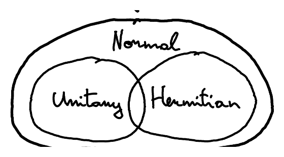

::pagesources{items="L02:11-12" exercises="/exercises/linear-algebra/#eigenvalues-and-special-matrices"}

## Eigenvalues and eigenvectors

::source{lecture="2" pages="11"}

An **eigenvector** of a square matrix $A \in M_{n,n}(\C)$ is a non-zero vector $\ket{v} \in \C^n$ such that

$$
A\ket{v} = \lambda\ket{v}
$$

for some $\lambda \in \C$ called the **eigenvalue** corresponding to $\ket{v}$. The eigenvalues of $A$ are the roots of the **characteristic polynomial**

$$
\det(A - \lambda I) = 0
$$

where $\det$ denotes the determinant and

$$
I = \sum_{i=1}^n \ket{i}\!\bra{i} = \begin{pmatrix} 1 & & 0 \\ & \ddots & \\ 0 & & 1 \end{pmatrix}
$$

is the $n \times n$ **identity matrix**. Each $n \times n$ matrix has at least one eigenvalue.

## Diagonal representation

::source{lecture="2" pages="11"}

A square matrix $A \in M_{n,n}(\C)$ is **diagonalisable** if

$$
A = \sum_{i=1}^n \lambda_i \ket{v_i}\!\bra{v_i}
$$

where $\ket{v_1}, \dots, \ket{v_n} \in \C^n$ is an orthonormal set of eigenvectors of $A$ with eigenvalues $\lambda_1, \dots, \lambda_n \in \C$. Note that $A\ket{v_j} = \sum_{i=1}^n \lambda_i \ket{v_i}\underbrace{\braket{v_i|v_j}}_{\delta_{ij}} = \lambda_j\ket{v_j}$, meaning that $A$ is **diagonal**

$$
\begin{pmatrix} \lambda_1 & & & \\ & \lambda_2 & & \\ & & \ddots & \\ & & & \lambda_n \end{pmatrix} = \mathrm{diag}(\lambda_1, \lambda_2, \dots, \lambda_n)
$$

in the basis of its eigenvectors.

## Normal, Hermitian and unitary matrices

::source{lecture="2" pages="12"}

A square matrix $A \in M_{n,n}(\C)$ is **normal** if

$$
A^\dagger A = A A^\dagger
$$

:::theorem[Theorem (p.72 of Nielsen & Chuang)]
A matrix is diagonalizable if and **only** if it is normal.
:::

A square matrix $A \in M_{n,n}(\C)$ is **Hermitian** if

$$
A = A^\dagger
$$

Such matrix is clearly normal and hence diagonalisable. A normal matrix is Hermitian iff it has real eigenvalues.

A square matrix $A \in M_{n,n}(\C)$ is **unitary** if (Recall from Lecture 1:)

$$
A A^\dagger = A^\dagger A = I
$$

$$
\begin{pmatrix} \bar{a} & \bar{b} \\ \bar{c} & \bar{d} \end{pmatrix} \cdot \begin{pmatrix} a & c \\ b & d \end{pmatrix} = \begin{pmatrix} \overbrace{\abs{a}^2 + \abs{b}^2}^{1} & \bar{a}c + \bar{b}d \\ \underbrace{a\bar{c} + b\bar{d}}_{0} & \underbrace{\abs{c}^2 + \abs{d}^2}_{1} \end{pmatrix}
$$

where $I$ is the $n \times n$ identity matrix. Unitary matrices are normal and therefore diagonalisable. All eigenvalues of a unitary operator have absolute value 1. Unitary operators preserve inner products: if $U$ is unitary and

$$
\left.\begin{aligned} \ket{a'} &= U\ket{a} \\ \ket{b'} &= U\ket{b} \end{aligned}\right\} \Rightarrow \braket{a'|b'} = (U\ket{a})^\dagger (U\ket{b}) = \bra{a}U^\dagger U\ket{b} = \braket{a|b}
$$

Any unitary matrix $U$ is of the form $U = e^{iH}$ for some Hermitian matrix $H$. You can think of Hermitian matrices as real numbers and unitary matrices as complex numbers of the form $e^{i\varphi}$ for some $\varphi \in \R$.
