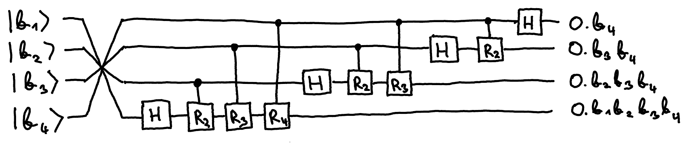
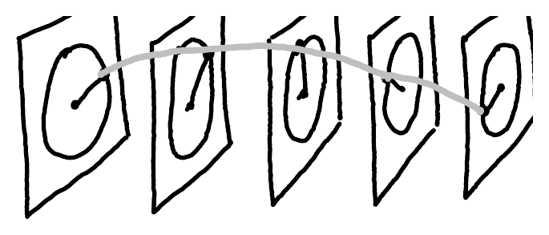

## Quantum Fourier transform

In [phase estimation](/notes/phase-estimation/) we defined the $n$-qubit quantum Fourier transform as

$$
\mathrm{QFT}\ket{b_1, b_2, \ldots, b_n} = \ket{\varphi_1} \otimes \ket{\varphi_2} \otimes \ldots \otimes \ket{\varphi_n},
$$

for all $b_1, b_2, \ldots, b_n \in \{0,1\}$, where $b = 0.b_1 b_2 \ldots b_n$ in binary and

$$
\ket{\varphi_{n-k}} = \frac{1}{\sqrt{2}} \left(\ket{0} + e^{2\pi i \cdot \underbrace{2^k \cdot b}_{0.b_{k+1} \ldots b_n}}\ket{1}\right)
$$

For $n=4$ the QFT circuit looks like this:

where $R_k$ rotates around the $Z$ axis by angle $2\pi / 2^k$:

$$
R_k = \begin{pmatrix} 1 & 0 \\ 0 & e^{2\pi i / 2^k} \end{pmatrix}
$$

For example, $R_0 = I$, $R_1 = Z$, $R_2 = S$.

## Discrete Fourier transform

The quantum Fourier transform is a special case of the **discrete Fourier transform**, which exists for any matrix size $M \geq 1$, not just $M = 2^n$:

$$
\mathrm{QFT}(n) = D(2^n)
$$

Here $D(M)$ is an $M \times M$ complex matrix.

::pagebreak{lecture="10" page="7"}

The entries of $D(M)$ are as follows:

$$
D_{jk} = \frac{1}{\sqrt{M}} \omega_M^{jk}, \quad j, k \in \{0, \ldots, M-1\}
$$

where $\omega_M = e^{2\pi i / M}$. Note that $\omega_M^M = 1$ and $\bar{\omega}_M = \omega_M^{-1}$. Clearly, $D^\mathsf{T} = D$ since $D_{jk} = D_{kj}$, so $D^\dagger = \bar{D}$ and

$$
(D^\dagger)_{jk} = \frac{1}{\sqrt{M}} \omega_M^{-jk}
$$

We can easily write down the matrix for $D$, writing $\omega$ for $\omega_M$:

$$
D(M) = \frac{1}{\sqrt{M}} \begin{pmatrix}
1 & 1 & 1 & 1 & \cdots & 1 \\
1 & \omega & \omega^2 & \omega^3 & \cdots & \omega^{M-1} \\
1 & \omega^2 & \omega^4 & \omega^6 & \cdots & \omega^{2(M-1)} \\
1 & \omega^3 & \omega^6 & \omega^9 & \cdots & \omega^{3(M-1)} \\
\vdots & \vdots & \vdots & \vdots & \ddots & \vdots \\
1 & \omega^{M-1} & \omega^{2(M-1)} & \omega^{3(M-1)} & \cdots & \omega^{(M-1)^2}
\end{pmatrix}
$$

It is not obvious that $D$ is unitary, or that $D(2^n)$ agrees with what is implemented by $\mathrm{QFT}(n)$; both are exercises.

The intuition behind the discrete Fourier transform is as follows. The entries in each row of $D$ correspond to points on the unit circle that run around it at increasingly high speeds. If $\ket{y} = D\ket{x}$, then each entry of $\ket{y} \in \C^M$,

$$
y_j = \frac{1}{\sqrt{M}} \sum_{k=0}^{M-1} \omega^{jk} x_k,
$$

is the inner product of $\ket{x} \in \C^M$ with a spiral of a certain period:

This value is large if $\ket{x}$ oscillates with a similar period.
