::pagesources{items="L13:10-15" exercises="/exercises/mixed-states/#graphical-notation"}

## Graphical notation

::source{lecture="13" pages="10-12"}

There is an intuitive way of performing certain types of calculations that involves pictures instead of equations. This graphical notation is also known as **tensor networks**.

- Column vector $\ket{\psi} \in \C^d$

  $$
  \ket{\psi} = \sum_{j=1}^d \psi_j \ket{j}
  $$

  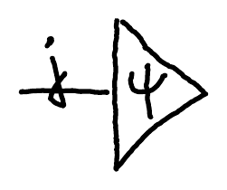

- Matrix $A \in M_d(\C)$

  $$
  A = \sum_{i,j=1}^d a_{ij} \ket{i}\!\bra{j}
  $$

  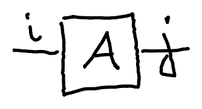

- Matrix-vector multiplication:

  $$
  \forall i: \sum_{j=1}^d A_{ij}\psi_j = \varphi_i
  $$

  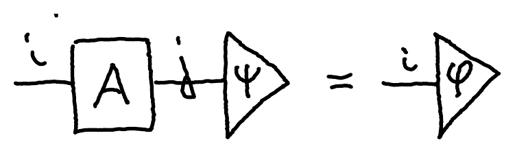

- Matrix-matrix multiplication:

  $$
  \forall i,k: \sum_{j=1}^d A_{ij}B_{jk} = C_{ik}
  $$

  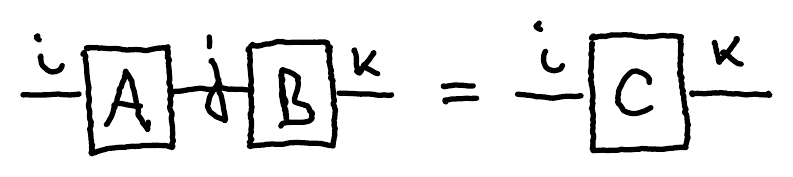

- Identity matrix:

  $$
  I = \sum_{i=1}^d \ket{i}\!\bra{i}
  $$

  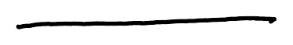

::pagebreak{lecture="13" page="11"}

- Tensor product:

  $$
  A \otimes B
  $$

  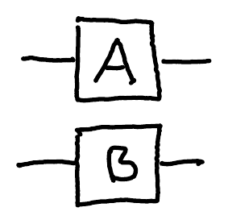

- Matrix transpose:

  $$
  A^\mathsf{T} = \sum_{i,j=1}^d a_{ij}\ket{j}\!\bra{i}
  $$

  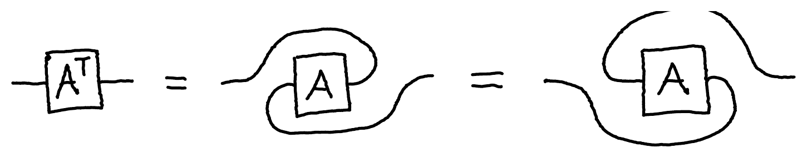

- Vector (conjugate) transpose:

  $$
  \bra{\psi} = \ket{\bar\psi}^\mathsf{T} =
  $$

  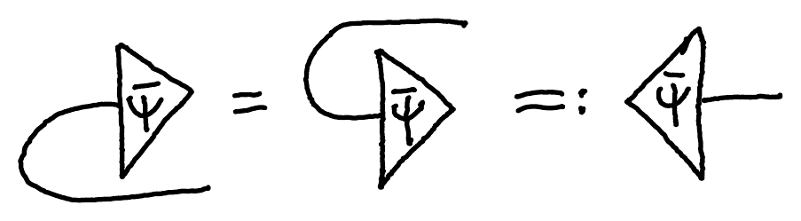

  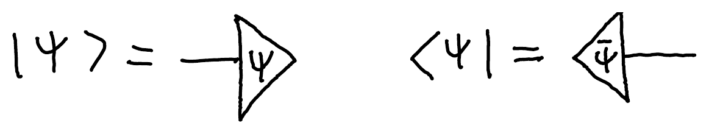

- Probability to get $\ket{\psi}$ when measuring $\rho$:

  $$
  \braket{\psi|\rho|\psi} =
  $$

  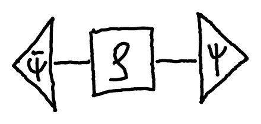

- Trace:

  $$
  \Tr M = \sum_{i=1}^d \braket{i|M|i} = \sum_{i=1}^d
  $$

  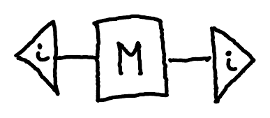

  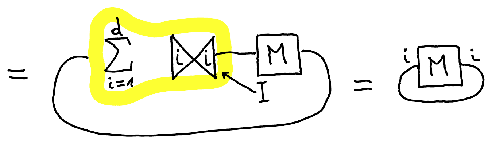

::pagebreak{lecture="13" page="12"}

- Partial trace:

  $$
  \Tr_B N_{AB} =
  $$

  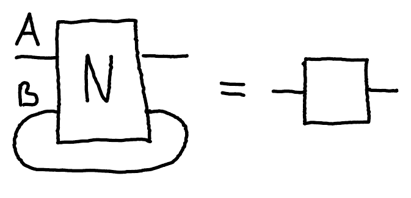

- **Un-normalized** maximally entangled state:

  $$
  I = \sum_{i=1}^d \ket{i}\!\bra{i} =
  $$

  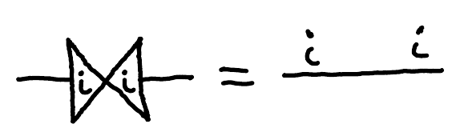

  $$
  \ket{\Phi} := \sum_{i=1}^d \ket{i}\ket{i} =
  $$

  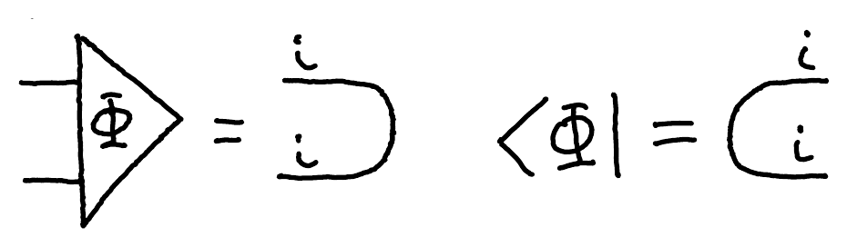

- SWAP gate:

  $$
  \mathrm{SWAP} = \sum_{i,j=1}^d \ket{i}\ket{j}\bra{j}\bra{i} =
  $$

  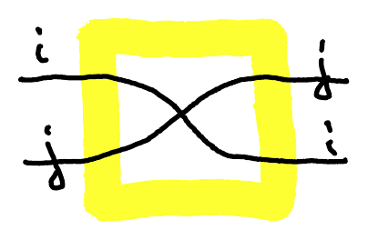

- Vectorization:

  $$
  X = \sum_{i,j=1}^d x_{ij}\ket{i}\!\bra{j} =
  $$

  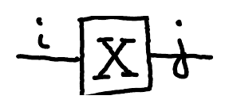

  $$
  \mathrm{vec}(X) = \sum_{i,j=1}^d x_{ij}\ket{i}\ket{j} =
  $$

  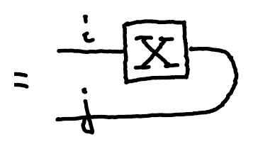

- Sliding:

  $$
  \mathrm{vec}(X) =
  $$

  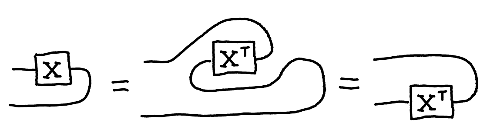

- Vectorization identity:

  $$
  (A \otimes B)\,\mathrm{vec}(X) = \mathrm{vec}(AXB^\mathsf{T})
  $$

  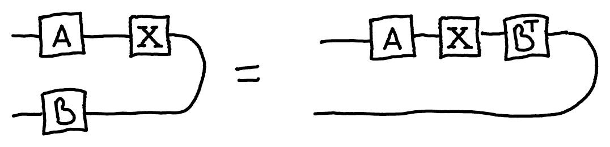

## Purification

::source{lecture="13" pages="13"}

Given a mixed state $\rho_A$, find a pure state $\ket{\Psi}_{AB}$ such that discarding the B system produces $\rho_A$:

$$
\Tr_B(\ket{\Psi}\!\bra{\Psi}_{AB}) = \rho_A
$$

Such $\ket{\Psi}_{AB}$ is known as a **purification** of $\rho_A$.

:::example

The maximally entangled state

$$
\ket{\beta}_{AB} = \frac{1}{\sqrt{d}}\ket{\Phi} = \frac{1}{\sqrt{d}}\sum_{i=1}^d \ket{i}\ket{i}
$$

is a purification of the maximally mixed state $I/d$ since

$$
\Tr_B(\ket{\beta}\!\bra{\beta}_{AB}) = \frac{1}{d}
$$

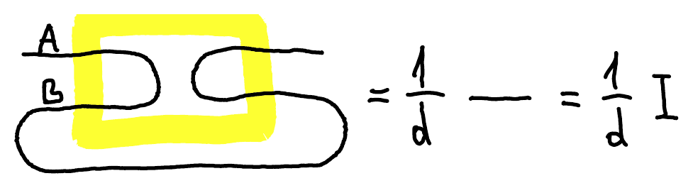

:::

For a general state $\rho$, with spectral decomposition

$$
\rho = \sum_i \lambda_i \ket{\psi_i}\!\bra{\psi_i}, \qquad \lambda_i \geq 0,
$$

its operator square root is given by

$$
\sqrt{\rho} = \sum_i \sqrt{\lambda_i}\ket{\psi_i}\!\bra{\psi_i}.
$$

You can verify that $\sqrt{\rho}\sqrt{\rho} = \rho$ and

$$
\ket{\Psi}_{AB} := (\sqrt{\rho_A} \otimes I_B)\ket{\Phi}_{AB}
$$

is a purification of $\rho_A$.

## Bell states and Pauli matrices

::source{lecture="13" pages="14"}

Bell states are related to Pauli matrices as follows (local conversion identities):

$$
\ket{\beta_{zx}} = \frac{1}{\sqrt{2}}\mathrm{vec}(Z^z X^x) \qquad \forall z, x \in \{0,1\}
$$

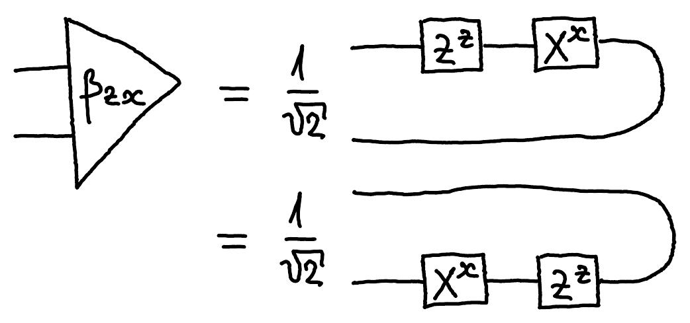

$Z^\mathsf{T} = Z$, $X^\mathsf{T} = X$ (by sliding)

## Teleportation

::source{lecture="13" pages="14-15"}

Here is how you can derive and analyze the teleportation protocol based on diagrams. Alice has an unknown state $\ket{\psi}_{A'} \in \C^2$ and shares with Bob the EPR state $\frac{1}{\sqrt{2}}(\ket{00} + \ket{11})_{AB} = \frac{1}{\sqrt{2}}\ket{\Phi}_{AB}$. If she measures her systems $A'A$ in the Bell basis and gets the outcome 00 corresponding to the EPR state $\ket{\beta_{00}} = \frac{1}{\sqrt{2}}\ket{\Phi}$, Bob's state is $\ket{\psi}_B$:

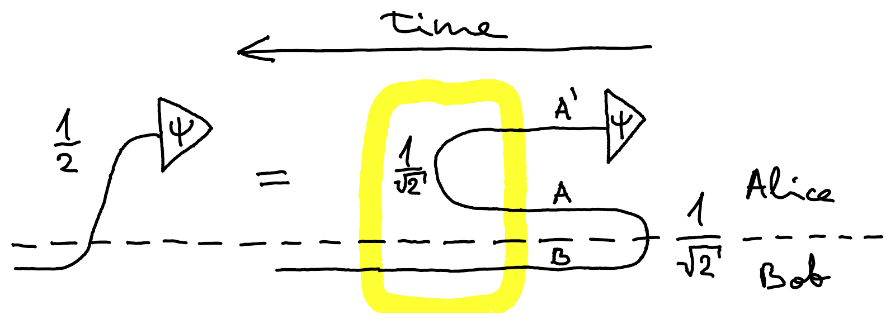

This happens with probability $\left(\frac{1}{2}\right)^2 = \frac{1}{4}$.

::pagebreak{lecture="13" page="15"}

More generally, if Alice gets outcomes $z, x \in \{0,1\}$, she sends them to Bob who needs to apply the Pauli correction operator $Z^z X^x$:

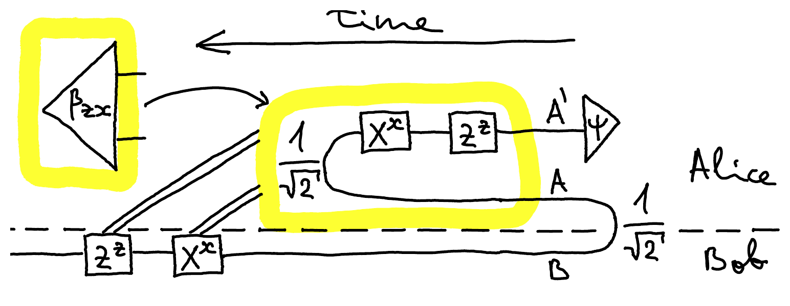

This reproduces the correct state $\ket{\psi}$ since

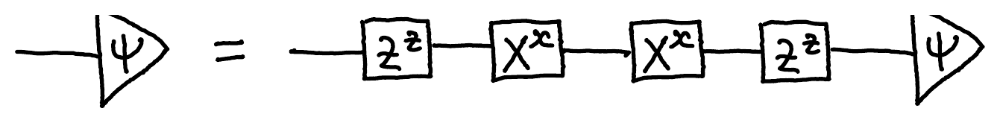

because $X^0 = X^2 = I = Z^0 = Z^2$.

Graphical notation and tensor networks is not only a fun theoretical tool but also has important practical applications. One of such applications is the simulation of quantum circuits on a classical computers, such as in Cirq.
