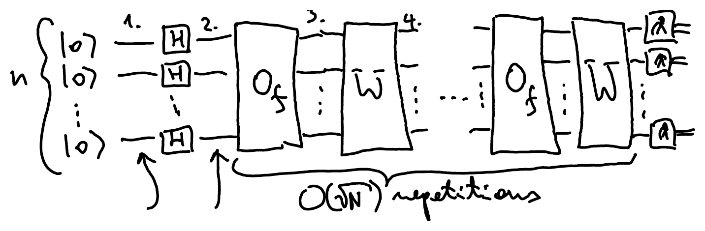
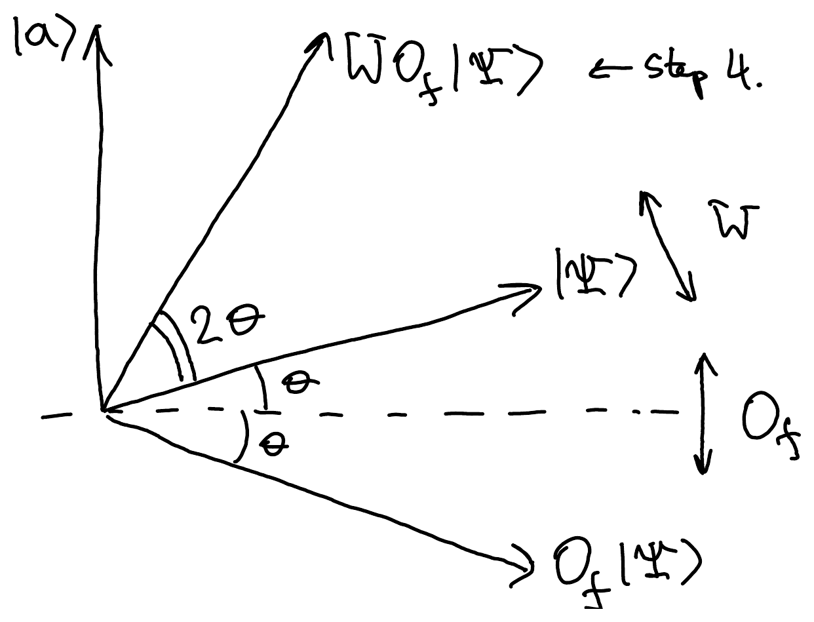
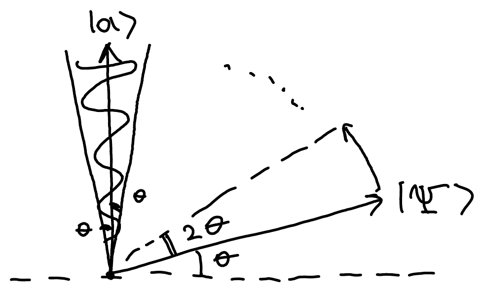
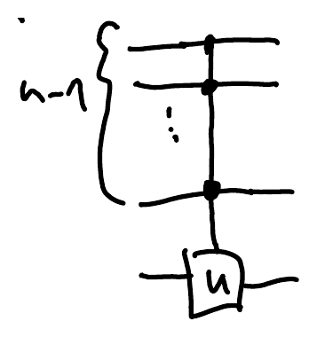
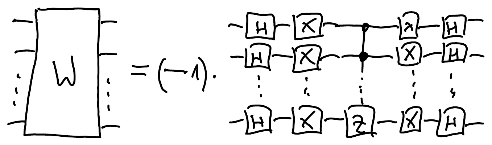
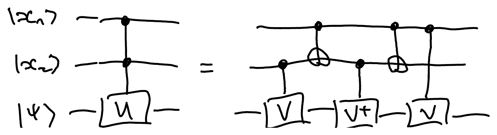

## The search problem

::pagebreak{lecture="9" page="1"}

**Problem:** Let $f:\{0,1\}^n \to \{0,1\}$ be a function such that

$$
f(x) = \begin{cases} 1 & \text{if } x = a \text{ for some } a \in \{0,1\}^n \\ 0 & \text{otherwise} \end{cases}
$$

The task is to find $a$. Classically, searching through $2^n$ different entries takes

- for sorted data, $\log_2(2^n) = n$ queries using binary search;
- for unsorted data, $2^n$ queries by brute force.

Quantum brute-force search takes $\sqrt{2^n}$ queries. More generally, searching through $N$ items takes $N$ queries classically versus $\sqrt{N}$ queries quantumly.

The quantum algorithm accesses $f$ through the [phase oracle](/notes/reversible-computation/#phase-kick-back):

$$
O_f \ket{x} = (-1)^{f(x)} \ket{x} = \begin{cases} -\ket{x} & \text{if } x = a \\ \ket{x} & \text{otherwise} \end{cases}
$$

:::example
Explicitly storing the password for a user as

$$
f(x) = \begin{cases} 1 & \text{if } x = \text{``password''} \\ 0 & \text{otherwise} \end{cases}
$$

is problematic in case the source code of $f$ gets stolen.
:::

::pagebreak{lecture="9" page="2"}

:::example
Storing the hash (for example SHA) of a password instead:

$$
f(x) = \begin{cases} 1 & \text{if } h(x) = \text{``73A0F2BE5''} \\ 0 & \text{otherwise} \end{cases}
$$
:::

The hash function $h$ is easy to compute but hard to invert, so a hacker cannot easily recover the password even if the data is stolen. The source code of $f$ contains only the source code of the hash function $h$, which usually is already public, and the string "73A0F2BE5", which does not reveal the password in a straightforward way. The only way to crack it is by brute force, that is, by searching for an $x$ with $f(x) = 1$.

## Grover's algorithm

Let $N = 2^n$ be the size of the set we are searching in. Grover's algorithm repeats the oracle $O_f$, followed by an operation $W$ defined below, $O(\sqrt{N})$ times:

The states at the first three marked steps are:

1. $\ket{0}^{\otimes n}$
2. $\ket{+}^{\otimes n} = \frac{1}{\sqrt{2^n}} \sum_{x \in \{0,1\}^n} \ket{x}$
3. $\frac{1}{\sqrt{2^n}} \left( \left( \sum_{x \in \{0,1\}^n} \ket{x} \right) - 2\ket{a} \right)$, since $O_f$ flips the sign of $\ket{a}$

We want to get $a \in \{0,1\}^n$ as the answer, so we want to amplify the amplitude of $\ket{a}$. The oracle acts as

$$
O_f \ket{x} = \begin{cases} -\ket{x} & \text{if } x = a \\ \ket{x} & \text{otherwise} \end{cases}
$$

and you can check that this is the matrix

$$
O_f = I - 2\ket{a}\!\bra{a}
$$

$$
O_f = \begin{array}{cc} & \hspace{1.2em} a \\ a & \begin{pmatrix} 1 & & & & \\ & \ddots & & & \\ & & -1 & & \\ & & & \ddots & \\ & & & & 1 \end{pmatrix} \end{array}
$$

## Main idea

Two consecutive reflections make a rotation, and Grover's algorithm alternates between two reflections, $O_f$ and $W$.

Let $\ket{\Psi} = \ket{+}^{\otimes n} = \frac{1}{\sqrt{2^n}} \sum_{x \in \{0,1\}^n} \ket{x}$ be the uniform superposition and let $W = -(I - 2\ket{\Psi}\!\bra{\Psi})$ be the reflection with respect to $\ket{\Psi}$.

Let $G = W O_f$ be one Grover iteration. The final state after $\sqrt{N}$ iterations[^fix-1] is

$$
G^{\sqrt{N}} H^{\otimes n} \ket{0}^{\otimes n} = G^{\sqrt{N}} \ket{+}^{\otimes n} = G^{\sqrt{N}} \ket{\Psi}.
$$

Now consider how one Grover iteration $G = W O_f$ affects the state. Recall that

$$
W = 2\ket{\Psi}\!\bra{\Psi} - I \qquad O_f = I - 2\ket{a}\!\bra{a}
$$

Note that $\braket{\Psi|a} = \braket{a|\Psi} = 1/\sqrt{2^n} = 1/\sqrt{N}$. Consider how $W$ and $O_f$ act on $\ket{\Psi}$ and $\ket{a}$:

$$
W\ket{\Psi} = \ket{\Psi} \qquad O_f \ket{\Psi} = \ket{\Psi} - \frac{2}{\sqrt{N}} \ket{a}
$$

$$
W\ket{a} = \frac{2}{\sqrt{N}} \ket{\Psi} - \ket{a} \qquad O_f \ket{a} = -\ket{a}
$$

So if you start from the state $\ket{\Psi}$ and apply any sequence of $O_f$ and $W$, you still get a real linear combination of $\ket{a}$ and $\ket{\Psi}$. That is, the state remains in the two-dimensional subspace of states

$$
\alpha \ket{\Psi} + \beta \ket{a} \quad \text{for some } \alpha, \beta \in \mathbb{R}
$$

## Geometric view of Grover's algorithm

- Since $O_f\ket{a} = -\ket{a}$, $O_f$ reflects about the line perpendicular to $\ket{a}$.
- Since $W\ket{\Psi} = \ket{\Psi}$, $W$ is a reflection about $\ket{\Psi}$.

Recall that $\braket{a|\Psi} = 1/\sqrt{N}$, so $\ket{a}$ and $\ket{\Psi}$ are almost orthogonal. In the figure, $\theta$ is the angle between $\ket{\Psi}$ and the dashed line perpendicular to $\ket{a}$:

:::exercise
The composition of two reflections is a rotation. If the angle between the axes is $\theta$, the angle of rotation is $2\theta$.
:::

## Analysis of complexity

The Grover iteration $G = W O_f$ is a rotation by angle $2\theta$ in the direction from $\ket{\Psi}$ to $\ket{a}$, where the angle between $\ket{\Psi}$ and $\ket{a}$ is $\pi/2 - \theta$. Note that

$$
\sin\theta = \cos\left(\frac{\pi}{2} - \theta\right) = \braket{a|\Psi} = 1/\sqrt{N}.
$$

If $N$ is large, $\ket{\Psi}$ and $\ket{a}$ are nearly orthogonal, so $\theta$ is small and

$$
\theta \approx \sin\theta = 1/\sqrt{N}.
$$

After $t = \frac{\pi/2}{2\theta} \approx \frac{\pi}{4}\sqrt{N}$ iterations of $G$, the state has rotated by a total angle of $\pi/2$, so the final state $G^t\ket{\Psi}$ is within angle $\theta$ of $\ket{a}$:

Measuring in the computational basis then yields $a \in \{0,1\}^n$ with probability

$$
|\braket{a|G^t|\Psi}|^2 \geq (\cos\theta)^2 = 1 - (\sin\theta)^2 = \frac{N-1}{N} \approx 1
$$

when $N$ is large. Note that further iterations beyond $t$ decrease the probability of success.

## Multiple solutions

Grover's algorithm works even if the solution $a \in \{0,1\}^n$ is not unique. Let $A \subseteq \{0,1\}^n$ be the set of solutions, and $M = |A|$. Then the Grover iteration is a rotation in the two-dimensional subspace spanned by

$$
\ket{\Psi} = \frac{1}{\sqrt{N}} \sum_{x \in \{0,1\}^n} \ket{x} \quad \text{and} \quad \ket{A} = \frac{1}{\sqrt{M}} \sum_{a \in A} \ket{a}.
$$

The angle $\pi/2 - \theta$ between these vectors is smaller, since now $\sin\theta = \braket{A|\Psi} = \sqrt{M/N}$. So the required number of iterations (but also the guaranteed success probability) is also smaller. The number of iterations is $t = O(\sqrt{N/M})$, and the probability of success is at least $1 - \frac{M}{N}$.[^fix-2]

## Implementing W

Recall that $W = 2\ket{\Psi}\!\bra{\Psi} - I$, where $\ket{\Psi} = \ket{+}^{\otimes n}$, so $H^{\otimes n}\ket{\Psi} = \ket{0}^{\otimes n}$. Hence

$$
H^{\otimes n} W H^{\otimes n} = 2\ket{0^n}\!\bra{0^n} - I
$$

$$
= \underbrace{\begin{pmatrix} 1 & & & \\ & -1 & & \\ & & -1 & \\ & & & \ddots \\ & & & & -1 \end{pmatrix}}_{\leftarrow\, 00\ldots0}
$$

Conjugate further by $X^{\otimes n}$, which maps $\ket{0^n}$ to $\ket{1^n}$:

$$
-X^{\otimes n} H^{\otimes n} W H^{\otimes n} X^{\otimes n} = -(2\ket{1^n}\!\bra{1^n} - I) = I - 2\ket{1^n}\!\bra{1^n}
$$

$$
= \underbrace{\begin{pmatrix} 1 & & & \\ & 1 & & \\ & & \ddots & \\ & & & -1 \end{pmatrix}}_{\leftarrow\, 11\ldots1} = C_{n-1}(Z)
$$

where $C_{n-1}(U)$ is the multiply controlled $U$ operation:

As a matrix, it has the block $U$ in the rows and columns labelled $11\ldots10$ and $11\ldots11$:

$$
C_{n-1}(U) = \begin{pmatrix} 1 & & & & 0 \\ & 1 & & & \\ & & \ddots & & \\ & & & 1 & \\ 0 & & & & \boxed{U} \end{pmatrix}
$$

$$
= \boxed{\sum_{x \in \{0,1\}^{n-1} \setminus \{1^{n-1}\}} \ket{x}\!\bra{x} \otimes I + \ket{1^{n-1}}\!\bra{1^{n-1}} \otimes U}
$$

For example, $C_1(X) = \text{CNOT}$. Since $HZH = X$,

$$
C_1(Z) = (I \otimes H)\,\text{CNOT}\,(I \otimes H).
$$

Solving for $W$ gives

$$
W = \underbrace{-}_{\text{can ignore this global phase}} H^{\otimes n} X^{\otimes n} C_{n-1}(Z) X^{\otimes n} H^{\otimes n}
$$

::pagebreak{lecture="9" page="8"}

When the control qubits are in computational basis states, $C_{n-1}(U)$ acts as

$$
C_{n-1}(U)\ket{x_1}\ket{x_2}\ldots\ket{x_{n-1}}\ket{\psi}
$$

<!-- unclear: right-hand side drawn as wires/dashes in place of the control kets: "= ___ 1 ___ U^{x_1...x_{n-1}}|psi>" -->

$$
= \ket{x_1}\ket{x_2}\ldots\ket{x_{n-1}}\; U^{x_1 \cdots x_{n-1}}\ket{\psi}
$$

so it applies $U$ to $\ket{\psi}$ only if $x_1 = \cdots = x_{n-1} = 1$. As a circuit, the formula for $W$ above reads:

How can we implement $C_{n-1}(U)$?

This uses $O(n)$ Toffoli gates and $O(n)$ workspace qubits.

Can we further decompose the Toffoli gate into one- and two-qubit gates?

:::exercise
Any 1-qubit operation can be decomposed as a sequence of Pauli ZYZ rotations.
:::

:::exercise
For any $U \in U(2)$ (the $2 \times 2$ unitary matrices), $C_1(U)$ can be implemented using only CNOT and Pauli rotations (ABC decomposition).
:::

## Special trick for C₂(U)

For any $U \in U(2)$, $C_2(U)$ can be implemented as follows. Find $V \in U(2)$ such that $V^2 = U$. Then

Only if $x_1 = x_2 = 1$ do we apply $V^2 = U$.

When $U = X$, we get a decomposition of the Toffoli gate.

[^fix-1]: Corrected from the original notes, which say *after $N$ iterations*.
[^fix-2]: Corrected from the original notes, which use $\theta$ for the angle between $\ket{\Psi}$ and $\ket{A}$, although $\theta$ above is the angle to the line perpendicular to $\ket{a}$. They also give the success probability as exactly $1 - \frac{M}{N}$, not at least.
