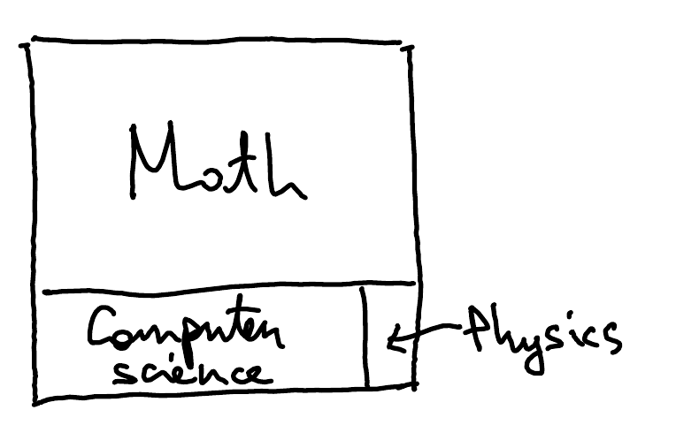

::pagesources{items="L01:1"}

::source{lecture="1" pages="1"}

Contents of the course:

Prerequisites:

- Linear Algebra
- Probability

## Main directions

::source{lecture="1" pages="1"}

1. Experimental
2. Theoretical
   - quantum algorithms
   - quantum information

   (these two together form the mathematical model)
3. Practical (quantum programming) (Cirq)

## Motivation

::source{lecture="1" pages="1"}

1. The world is quantum

   Information & computation is physical.

   better physics $\Rightarrow$ better computers

   Quantum mechanics is one of the most powerful and fundamental physical theories.
2. Miniaturization

   Moore's law has slowed down.
   Quantum effects unavoidable.
3. Exploiting quantum phenomena

   Computational advantage (quantum speed-up).

Note: "classical" = not quantum
