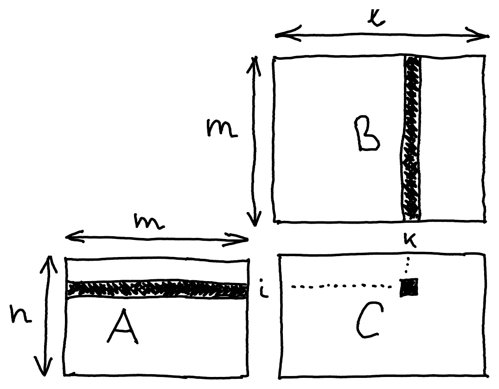

Quantum states form a **vector space**, and the ways they can be transformed are **linear operators** on that space. Both are studied in **linear algebra**, which this part reviews. You have already seen an example: [qubit states](/notes/qubits/) are vectors with two complex entries, and qubit operations are $2 \times 2$ matrices.

In quantum computing, all vector spaces are over $\C$ unless stated otherwise. Informally, a vector space over $\C$ is a set of objects that you can add together and multiply by complex numbers.

## Matrices

An $n \times m$ matrix is an array of numbers with $n$ rows and $m$ columns:

$$
A = \begin{pmatrix}
a_{11} & a_{12} & \cdots & a_{1m} \\
a_{21} & a_{22} & \cdots & a_{2m} \\
\vdots & \vdots & \ddots & \vdots \\
a_{n1} & a_{n2} & \cdots & a_{nm}
\end{pmatrix}
$$

We write $A_{ij}$ for the entry in row $i$ and column $j$ of $A$, so for the matrix above $A_{ij} = a_{ij}$. The set of all $n \times m$ complex matrices is written $M_{n,m}(\C)$.

## Basic matrix operations

Matrices of the same shape can be added, and any matrix can be multiplied by a constant (a *scalar*). Both operations work entry by entry, so $M_{n,m}(\C)$ is itself a vector space. For $A, B \in M_{n,m}(\C)$ and $c \in \C$:

- **addition**: $(A+B)_{ij} = A_{ij} + B_{ij}$
- **scalar multiplication**: $(cA)_{ij} = c A_{ij}$

$$
\begin{pmatrix} a_{11} & a_{12} \\ a_{21} & a_{22} \end{pmatrix} + \begin{pmatrix} b_{11} & b_{12} \\ b_{21} & b_{22} \end{pmatrix} = \begin{pmatrix} a_{11}+b_{11} & a_{12}+b_{12} \\ a_{21}+b_{21} & a_{22}+b_{22} \end{pmatrix}
\qquad
c \begin{pmatrix} a_{11} & a_{12} \\ a_{21} & a_{22} \end{pmatrix} = \begin{pmatrix} ca_{11} & ca_{12} \\ ca_{21} & ca_{22} \end{pmatrix}
$$

Three more operations conjugate the entries, swap rows and columns, or do both. To illustrate them, take the $2 \times 3$ matrix

$$
A = \begin{pmatrix} a_{11} & a_{12} & a_{13} \\ a_{21} & a_{22} & a_{23} \end{pmatrix}.
$$

- The **complex conjugate** conjugates every entry: $A^* = \bar{A} = \begin{pmatrix} a_{11}^* & a_{12}^* & a_{13}^* \\ a_{21}^* & a_{22}^* & a_{23}^* \end{pmatrix}$

  $$
  (A^*)_{ij} = (A_{ij})^*
  $$

- The **transpose** turns rows into columns, so the $2 \times 3$ matrix becomes $3 \times 2$: $A^\mathsf{T} = \begin{pmatrix} a_{11} & a_{21} \\ a_{12} & a_{22} \\ a_{13} & a_{23} \end{pmatrix}$

  $$
  (A^\mathsf{T})_{ij} = A_{ji}
  $$

- The **conjugate transpose**, or **adjoint**, does both, in either order:

  $$
  (A^\dagger)_{ij} = A_{ji}^* \qquad A^\dagger = (A^*)^\mathsf{T} = (A^\mathsf{T})^* = \begin{pmatrix} a_{11}^* & a_{21}^* \\ a_{12}^* & a_{22}^* \\ a_{13}^* & a_{23}^* \end{pmatrix}
  $$

Watch out for notation in other sources: mathematicians often write $A^*$ for the conjugate transpose $A^\dagger$. In these notes, $A^*$ is the complex conjugate defined above.

## Vectors

A **vector** is a matrix with only one row or only one column:

$$
\underbrace{(a_1 \;\; a_2 \;\; \cdots \;\; a_n)}_{\text{row vector}} \qquad \underbrace{\begin{pmatrix} b_1 \\ b_2 \\ \vdots \\ b_n \end{pmatrix}}_{\text{column vector}}
$$

Just like matrices, vectors of the same shape can be added and multiplied by scalars. The column vectors with $n$ complex entries form the vector space $\C^n$.

## Vector multiplication

A row vector can be multiplied by a column vector with the same number of entries: multiply them entry by entry and add up the results.

$$
(a_1 \;\; a_2 \;\; \cdots \;\; a_n) \cdot \begin{pmatrix} b_1 \\ b_2 \\ \vdots \\ b_n \end{pmatrix} = a_1 b_1 + a_2 b_2 + \cdots + a_n b_n = \sum_{i=1}^n a_i b_i
$$

The result is a single number. This is a special case of matrix multiplication: a $1 \times n$ matrix times an $n \times 1$ matrix.

## Matrix multiplication

Let $A$ be an $n \times m$ matrix and $B$ an $m \times l$ matrix. Their product $C = A \cdot B$ is the $n \times l$ matrix with entries

$$
C_{ik} = \sum_{j=1}^m A_{ij} B_{jk}
$$

for all $i = 1, \dots, n$ and $k = 1, \dots, l$. In other words, $C_{ik}$ is the product of the $i$-th row of $A$ with the $k$-th column of $B$, as in the vector multiplication above:

:::note
You can only multiply $A$ and $B$ if the number of columns of $A$ is the same as the number of rows of $B$:

$$
[n \times \underbrace{m}_{\text{same!}}] \cdot [m \times l] = [n \times l]
$$
:::

## Properties of matrix multiplication

- **associativity**: $(AB)C = A(BC) = ABC$
- **distributivity**: $A(B+C) = AB + AC$

  $(A+B)C = AC + BC$
- **scalar multiplication**: $\lambda(AB) = (\lambda A)B = A(\lambda B) = (AB)\lambda$
- **complex conjugate**: $(AB)^* = A^* B^*$
- **transpose**: $(AB)^\mathsf{T} = B^\mathsf{T} A^\mathsf{T}$. Note that the order of the factors is reversed!
- **conjugate transpose**: $(AB)^\dagger = B^\dagger A^\dagger$, again in reversed order.

Unlike multiplication of numbers, matrix multiplication is **not** commutative: in general $AB \neq BA$, so the order of the factors matters.
