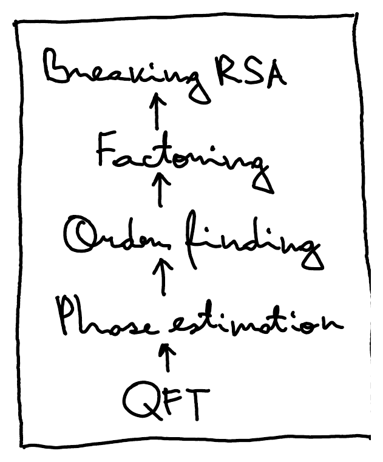
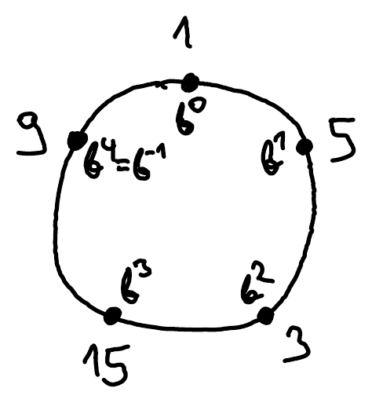

Recall that in the previous class we opened the two bottom doors of our advent calendar: [quantum Fourier transform](/notes/fourier-transform/) and [phase estimation](/notes/phase-estimation/). Now we will open the next two, order finding and factoring. (The top one, breaking RSA, you can open on Christmas yourself and read up on in a book.)

To understand the order finding problem, we need to recap some basic number theory, namely modular arithmetic.

## Extended Euclidean algorithm

The extended Euclidean algorithm can be used to find the greatest common divisor of two integers and the modular multiplicative inverse.

Let $a, b \in \mathbb{Z}$ be integers, not both 0. The **greatest common divisor** of $a$ and $b$, $\gcd(a,b)$, is the largest positive integer that divides both $a$ and $b$.

Assume $a \geq b \geq 0$. Note that $\gcd(a,b) = \gcd(a-b, b)$. In fact, $\gcd(a,b) = \gcd(a - mb, b)$ for any $m \in \mathbb{Z}$. Let's take $m$ as large as possible such that $a - mb \geq 0$, that is, $m = \lfloor a/b \rfloor$ (or `a//b` in Python notation). Then $a - mb$ is the remainder of $a$ modulo $b$, that is, $a \bmod b$ (or `a % b` in Python).

::pagebreak{lecture="11" page="2"}

The Euclidean algorithm consists of repeatedly applying the substitution

$$
(a, b) := (b, \underbrace{a \% b}_{\text{mod}})
$$

until the smaller number becomes 0, which happens very fast. At this point $a$ is equal to the gcd of the original two numbers.

:::example
($a = 66$, $b = 15$):

$$
\begin{aligned}
66 \bmod 15 &= 6 \\
15 \bmod 6 &= 3 \\
6 \bmod \underline{3} &= 0 \qquad \gcd(66,15) = 3
\end{aligned}
$$
:::

If we number the pairs, starting from $(a_1, b_1) = (a, b)$, each step computes

$$
\boxed{(a_k, b_k) := (b_{k-1}, a_{k-1} \bmod b_{k-1})}
$$

The **extended** version of the Euclidean algorithm finds a solution to Bézout's identity by also keeping track of the quotients. Namely, it finds integers $x, y \in \mathbb{Z}$ such that

$$
x \cdot a + y \cdot b = d
$$

where $d = \gcd(a,b)$. Once we find the gcd, we have an equation $a_k - m_k \cdot b_k = d$, where $m_k = \lfloor a_k / b_k \rfloor$ is the quotient. This equation expresses $d$ as an integer linear combination of $a_k$ and $b_k$. We can substitute $b_k$ from the previous equation $a_{k-1} - m_{k-1} \cdot b_{k-1} = b_k$ to express $d$ as an integer linear combination of $a_{k-1}$ and $b_{k-1} = a_k$. We repeat until we get back to $a_1$ and $b_1$.

:::example
($a = 66$, $b = 15$):

$$
\begin{aligned}
66 - 4 \cdot 15 &= 6 \\
15 - 2 \cdot 6 &= 3 = \gcd(a,b)
\end{aligned}
$$

$$
15 - 2 \cdot (66 - 4 \cdot 15) = \underbrace{-2 \cdot 66}_{132}\, + \underbrace{9 \cdot 15}_{135} = 3
$$

So $x = -2$ and $y = 9$.
:::

## Multiplicative inverse

If $\gcd(a,b) = 1$, the integers $a$ and $b$ have no non-trivial common divisor and are called **relatively prime**. In that case Bézout's identity reads

$$
x \cdot a + y \cdot b = 1.
$$

If we take both sides modulo $a$, we get

$$
y \cdot b \equiv 1 \pmod a,
$$

meaning $y$ is the **modular multiplicative inverse** of $b$ modulo $a$. We can write this as $y = b^{-1}$.

:::example
($a = 66/3 = 22$, $b = 15/3 = 5$): Dividing the previous Bézout identity $-2 \cdot 66 + 9 \cdot 15 = 3$ by $3$ we get $-2 \cdot 22 + 9 \cdot 5 = 1$. Modulo $22$ gives $9 \cdot 5 \equiv 1 \pmod{22}$, so $5^{-1} \equiv 9 \pmod{22}$. Indeed, $5 \cdot 9 = 45 \equiv 1 \pmod{22}$.
:::

## Multiplicative order

Hence, if $\gcd(a,b) = 1$, we can both multiply and divide by $b$ modulo $a$ (or the other way round). What numbers do we get in this way? That is, what does the set $\{b^k \bmod a : k \in \mathbb{Z}\}$ look like?

:::example
($a = 22$, $b = 5$):

$$
\begin{array}{ccccccccc}
b^0 & b^1 & b^2 & b^3 & b^4 & b^5 & b^6 & \dots \\
1 & 5 & 3 & 15 & 9 & 1 & 5 & \dots
\end{array}
$$

Hence, modulo 22, $b^k = b^{k+5}$ for any $k \in \mathbb{Z}$.
:::

The powers of $b$ go around in a cycle:

Let $a, N \in \mathbb{Z}$ with $N \geq 1$ and $\gcd(a,N) = 1$. The **multiplicative order** of $a$ modulo $N$ is the smallest positive integer $r$ such that $a^r \equiv 1 \pmod N$.

::pagebreak{lecture="11" page="4"}

Such an $r$ always exists when $\gcd(a,N) = 1$, because there are at most $N$ possible values that $a^k$ can take modulo $N$. Hence, the sequence $a^0, a^1, a^2, \dots$ has to repeat at some point, that is,

$$
a^k \equiv a^{k+r} \pmod N,
$$

for some $r \geq 1$ and all sufficiently large $k$. But since $a$ is [invertible](#multiplicative-inverse) modulo $N$, we can multiply both sides by $(a^{-1})^k = a^{-k}$ and get $1 \equiv a^r \pmod N$.

This also follows from a more general result known as **Euler's Theorem**: if $a$ and $N$ are relatively prime then

$$
a^{\varphi(N)} \equiv 1 \pmod N,
$$

where $\varphi(N)$ is the number of integers $c \in \{1, \dots, N\}$ such that $\gcd(N,c) = 1$.[^fix-1] The security of the RSA cryptosystem is based on the assumption that it is hard to compute $\varphi(N)$ without knowing the prime factorization of $N$.

[^fix-1]: Corrected from the original notes, which have $\gcd(a,c) = 1$.
