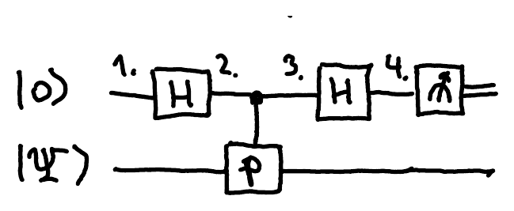

## Observables

It is often convenient to use the mathematical formalism of observables to describe the strategies in a [non-local game](/notes/non-local-games/). An **observable** is simply a [Hermitian](/notes/eigenvalues-and-special-matrices/#normal-hermitian-and-unitary-matrices) matrix, that is, a matrix $P$ such that $P^\dagger = P$. Consider its spectral decomposition

$$
P = \sum_{i=1}^K \lambda_i \Pi_i
$$

where $\lambda_i \in \mathbb{R}$ are the eigenvalues of $P$ and $\Pi_i$ are the projectors onto the corresponding eigenspaces.

**Measuring an observable** $P$ simply corresponds to performing the orthogonal measurement with operators $\{\Pi_1, \dots, \Pi_K\}$ and outputting $\lambda_i$ instead of $i$ as the measurement outcome.

In non-local games, the observables being measured typically have just the eigenvalues $\pm 1$, so that the output bit $a \in \{0,1\}$ corresponds to the eigenvalue $(-1)^a$. Moreover, if Alice measures an observable $A$ and Bob measures $B$, their joint measurement is described by $A \otimes B$. This observable has eigenvalues $(-1)^a \cdot (-1)^b = (-1)^{a \oplus b}$, which correspond to the XOR of the two bits.

:::example
Measuring in the computational basis corresponds to measuring the observable $Z = \ket{0}\!\bra{0} - \ket{1}\!\bra{1}$, while measuring in the Hadamard basis corresponds to measuring $\ket{+}\!\bra{+} - \ket{-}\!\bra{-} = HZH = X$. Hence each player's [GHZ game strategy](/notes/non-local-games/#quantum-strategies) is to measure $Z$ if their input is 0, and $X$ if it is 1.
:::

::pagebreak{lecture="8" page="11"}

If a measurement is required to produce several outcomes, one can simultaneously measure several observables. However, for this measurement to be unambiguous, the observables should be simultaneously diagonalizable, that is, there should be a basis in which all of the observables being measured are diagonal. Then the joint measurement can still be interpreted as a single orthogonal measurement. To determine whether $P$ and $Q$ can be measured simultaneously, one simply needs to check that they commute: $PQ = QP$.

:::example
$P = X \otimes X$ and $Q = Z \otimes Z$ can be measured simultaneously, while $P = X$ and $Q = Z$ cannot.
:::

## Quantum circuit for measuring an observable

An observable $P$ with eigenvalues $\pm 1$ can be measured on a state $\ket{\Psi}$ using the following circuit, which requires an extra qubit initialized in the state $\ket{0}$:

The state at each of the numbered points in the circuit is:

1. $\ket{0}\ket{\Psi}$
2. $\ket{+}\ket{\Psi} = \frac{1}{\sqrt2}(\ket{0} + \ket{1})\ket{\Psi}$
3. $\frac{1}{\sqrt2}\left(\ket{0}\ket{\Psi} + \ket{1}P\ket{\Psi}\right)$
4. $\frac12\left((\ket{0} + \ket{1})\ket{\Psi} + (\ket{0} - \ket{1})P\ket{\Psi}\right)$
   $= \ket{0} \otimes \left(\frac{I+P}{2}\ket{\Psi}\right) + \ket{1} \otimes \left(\frac{I-P}{2}\ket{\Psi}\right)$

Since $P$ has eigenvalues $\pm 1$, the corresponding two eigenvalues of $\frac{I+P}{2}$ are $\frac{1+1}{2} = 1$ and $\frac{1-1}{2} = 0$, respectively. So $\frac{I+P}{2}$ and, similarly, $\frac{I-P}{2}$ are the projectors onto the two eigenspaces of $P$, and the spectral decomposition of $P$ is given by $P = \left(\frac{I+P}{2}\right) - \left(\frac{I-P}{2}\right)$. Measuring the first qubit projects the second qubit onto one of the two eigenspaces of $P$, which is equivalent to measuring $P$.
