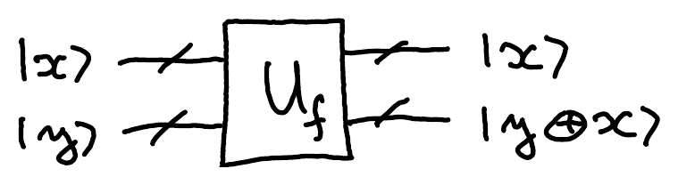
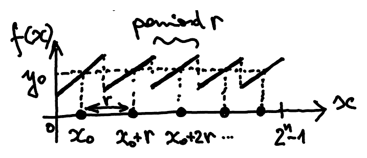
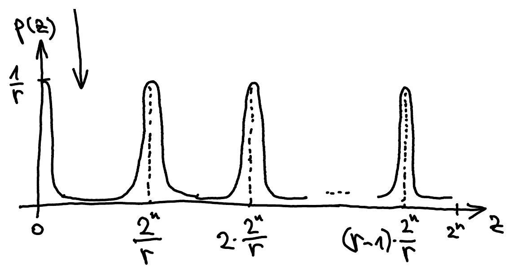

## Period finding

Let us consider a more general problem than [finding the period of $f_a$](/notes/factoring/#order-finding--period-finding): finding the period of some arbitrary function $f : \mathbb{N} \to \{0, \dots, N-1\}$ that is promised to be periodic, meaning that there is some $r \geq 1$ such that

$$
f(x + r) = f(x) \qquad \forall x.
$$

We have the ability to evaluate this function in superposition on any input.

In the case of $f_a$, we can use a [reversible](/notes/reversible-computation/) classical circuit for implementing $a^x$ (this can be done using repeated squaring and integer multiplication based on the binary digits of $x$). More generally, we can imagine having an oracle $U_f$ for computing $f$, and work from there.

## Algorithm

We truncate $\mathbb{N}$ to $n$ bits and take $N = 2^n$, so that $f : \{0,1\}^n \to \{0,1\}^n$. Let $U_f$ be its bit oracle, which maps $\ket{x}\ket{y}$ to $\ket{x}\ket{y \oplus f(x)}$:[^fix-1]

The quantum circuit is just like for [Simon's algorithm](/notes/simon/), but with the second Hadamard transform $H^{\otimes n}$ replaced by $\text{QFT}^\dagger$. It is also identical to the [phase estimation](/notes/phase-estimation/#quantum-phase-estimation) circuit.

The states at the numbered points are:

1. $\ket{0^n}\ket{0^n}$
2. $\ket{+}^{\otimes n}\ket{0^n}$
3. $\underbrace{\dfrac{1}{\sqrt{2^n}} \displaystyle\sum_{x=0}^{2^n-1} \ket{x}\ket{f(x)}}_{\text{the uniform superposition over all } x \text{ and the corresponding } f(x)}$
4. Let $y_0 \in \{0,1\}^n$ be the measurement outcome when measuring the second register. The post-measurement state is

   $$
   \left( \frac{1}{\sqrt{m}} \sum_{k=0}^{m-1} \ket{x_0 + kr} \right) \ket{y_0}
   $$

   

   where

   - $x_0 \in \{0, \dots, N-1\}$ is the least value such that $f(x_0) = y_0$,
   - $r \in \{1, \dots, N-1\}$ is the period of $f$,
   - $m = \lfloor 2^n / r \rfloor$ is the number of $x$ such that $f(x) = y_0$.

The state in the first register has a periodic structure, while $y_0$ itself is not useful for determining $r$.

::pagebreak{lecture="11" page="9"}

4. The first register is in the state $\dfrac{1}{\sqrt{m}} \displaystyle\sum_{k=0}^{m-1} \ket{x_0 + kr}$.
5. [Recall](/notes/fourier-transform/#discrete-fourier-transform) that, for any $x \in \{0, \dots, 2^n-1\}$,

   $$
   \text{QFT}^\dagger \ket{x} = \frac{1}{\sqrt{2^n}} \sum_{z=0}^{2^n-1} \omega^{-xz} \ket{z}
   $$

   where $\omega = \exp(2\pi i / 2^n)$. Applying this to the state from the previous step gives

   $$
   \begin{aligned}
   \frac{1}{\sqrt{m}} \sum_{k=0}^{m-1} \text{QFT}^\dagger \cdot \ket{x_0 + kr}
   &= \frac{1}{\sqrt{m}} \sum_{k=0}^{m-1} \frac{1}{\sqrt{2^n}} \sum_{z=0}^{2^n-1} \omega^{-(x_0 + kr)z} \ket{z} \\
   &= \sum_{z=0}^{2^n-1} \omega^{-x_0 z} \frac{1}{\sqrt{m}} \cdot \frac{1}{\sqrt{2^n}} \left( \sum_{k=0}^{m-1} \omega^{-krz} \right) \ket{z}
   \end{aligned}
   $$

6. The probability of observing outcome $z \in \{0,1\}^n$ in the final measurement is just the $|\cdot|^2$ of the amplitude in front of $\ket{z}$. The factor $\omega^{-x_0 z}$ has absolute value 1, so it drops out:

   $$
   p(z) = \frac{1}{m 2^n} \left| \sum_{k=0}^{m-1} \omega^{-krz} \right|^2
   $$

The plot of $p(z)$, for $z \in \{0, \dots, 2^n-1\}$, looks something like this:

It has $r$ peaks, each of height roughly $1/r$, located at integer multiples of $2^n/r$. Indeed, note that $\omega^{-krz} = \exp(-2\pi i\, krz / 2^n)$. So if $z = \ell \cdot 2^n/r$ for some $\ell \in \mathbb{Z}$, then $2\pi i\, krz/2^n = 2\pi i\, k\ell$. Hence $\omega^{-krz} = 1$ for every $k$, and $p(z) = \frac{1}{m 2^n} \cdot m^2 = m/2^n \simeq 1/r$, since $m = \lfloor 2^n/r \rfloor$.

How do we recover $r$ from the measurement outcome $z$?

::pagebreak{lecture="11" page="10"}

The general procedure involves finding a continued fraction expansion for $z/2^n$. Just to get the main idea, let us consider the very special case when the period $r$ itself is a power of 2: $r = 2^u$, for some $u \in \{0, \dots, n\}$. Then

$$
m = \lfloor 2^n / r \rfloor = \lfloor 2^{n-u} \rfloor = 2^{n-u} = 2^n / r \tag{*}
$$

and the probability of getting measurement outcome $z = \ell \cdot 2^n/r$ is exactly $1/r$ for all $\ell \in \{0, \dots, r-1\}$ since

$$
\begin{aligned}
p(z) &= \frac{1}{m 2^n} \left| \sum_{k=0}^{m-1} \omega^{-krz} \right|^2 \\
&= \frac{1}{m 2^n} \left| \sum_{k=0}^{m-1} \exp\left( -\frac{2\pi i}{2^n} \cdot kr \cdot \ell \cdot \frac{2^n}{r} \right) \right|^2 \\
&= \frac{1}{m 2^n} \left| \sum_{k=0}^{m-1} \underbrace{\exp(-2\pi i \cdot k \cdot \ell)}_{1} \right|^2 \\
&= \frac{1}{m 2^n} \cdot m^2 = \frac{m}{2^n} = 1/r \qquad \text{by } (*).
\end{aligned}
$$

These $r$ probabilities add up to 1, so we do not get any other outcomes than $z = \ell \cdot 2^n/r$ for some $\ell \in \{0, \dots, r-1\}$. To estimate $r$ from such $z$, note that $z/2^n \in [0,1)$ is given by

$$
z/2^n = \ell/r = \ell/2^u
$$

since we assumed that $r = 2^u$. Since $\ell \in \{0, \dots, r-1\}$ is uniformly random, it is odd with probability $1/2$. In that case the binary expansion of $z/2^n = \ell/2^u$ looks as follows:

$$
\ell/2^u = 0.\overbrace{\underbrace{1011}_{u \text{ bits}}00\dots0}^{n \text{ bits}}
$$

where, since $\ell$ is odd, the last non-zero bit is at position $u$. From this $u$ we can infer $r$ since $r = 2^u$. The case of a general $r$ is more complicated and requires a continued fraction expansion for $z/2^n$.

::pagebreak{lecture="11" page="11"}

There is another way to think about the algorithm, which does not use period finding but directly connects to phase estimation. The unitary

$$
U\ket{x} = \ket{ax \bmod N}
$$

is a permutation matrix. It splits into cycles, and on each cycle it is diagonal in the Fourier basis of that cycle, so its eigenvalues are of the form $\exp(2\pi i\, k/\ell)$, where $\ell$ is the length of some cycle.[^fix-2] In particular, $U\ket{1} = \ket{a}$, $U\ket{a} = \ket{a^2}$, and so on, is the cycle that goes through all powers of $a$, so the corresponding eigenvalues are $e^{2\pi i\, k/r}$ for $k = 0, \dots, r-1$, where $r$ is the order of $a$ modulo $N$.[^fix-3]

We can get $r$ by running phase estimation on $\ket{1}$ (which is not an eigenvector itself, but has squared overlap $1/r$ with each of the $r$ eigenvectors of this cycle, such as the uniform superposition of all powers of $a$).[^fix-4]

Note that $\displaystyle\sum_{i=0}^{2^n-1} \ketbra{i}{i} \otimes U^i$, the operation in the [phase estimation circuit](/notes/phase-estimation/#quantum-phase-estimation), plays the role of the bit oracle for $f_a(x) = a^x \pmod N$: it maps $\ket{x}\ket{1}$ to $\ket{x}\ket{a^x \bmod N}$, just as the bit oracle maps $\ket{x}\ket{0}$ to $\ket{x}\ket{f_a(x)}$.[^fix-5] That's why the algorithm is the way it is: we are literally just using phase estimation.

[^fix-1]: Corrected from the original notes, whose figure labels the second output $\ket{y \oplus x}$.
[^fix-2]: Corrected from the original notes, which say that $U$ is diagonal in the Fourier basis. That holds within each cycle, not for $U$ as a whole.
[^fix-3]: Corrected from the original notes, which give only the eigenvalue $e^{2\pi i / r}$. A cycle of length $r$ has all $r$ of these eigenvalues.
[^fix-4]: Corrected from the original notes, which say that $\ket{1}$ has overlap $1/r$ with all eigenvectors. The overlap is $1/\sqrt{r}$, and only with the eigenvectors of the cycle through $\ket{1}$.
[^fix-5]: Corrected from the original notes, which call this operation the bit oracle for $f_a$. It multiplies the second register by $a^x$ instead of XORing $f_a(x)$ into it, but on $\ket{x}\ket{1}$ it has the same effect.
