This and the following lecture are dedicated to deriving Shor's algorithm for factoring integers. In this lecture we will cover quantum phase estimation (QPE) and the quantum Fourier transform (QFT). The algorithm for order finding and factoring will be covered in the next lecture.

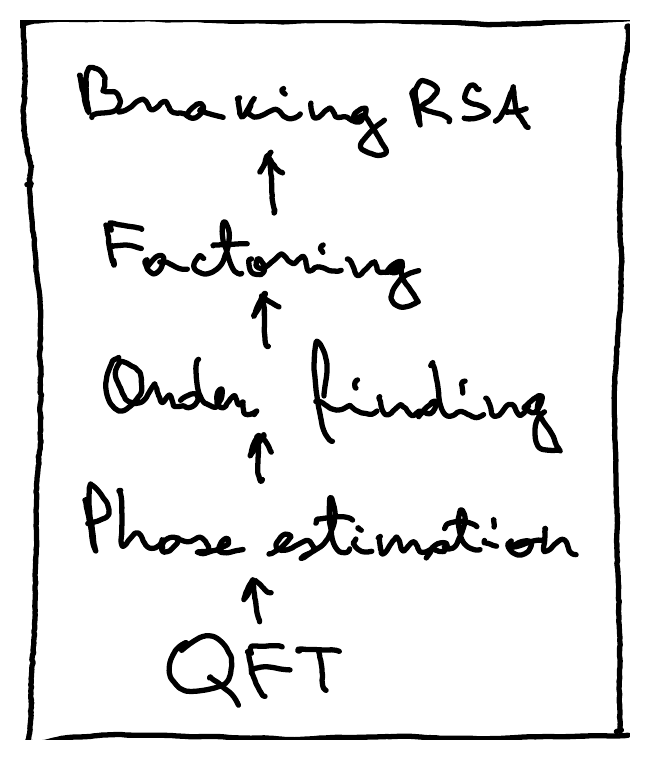

Let's recall [Deutsch's algorithm](/notes/deutsch/) and the [phase kick-back](/notes/reversible-computation/#phase-kick-back) trick for converting bit oracles to phase oracles.

Let $f : \{0,1\} \to \{0,1\}$ and $U_f \ket{x,y} = \ket{x, y \oplus f(x)}$, for all $x, y \in \{0,1\}$, be the bit oracle for $f$. Deutsch's algorithm determines $f(0) \oplus f(1)$, that is, whether $f$ is constant or balanced. For concreteness, let's take $f(x) = x$, so $f(0) \oplus f(1) = 0 \oplus 1 = 1$, that is, $f$ is balanced. For this choice of $f$, $U_f \ket{x,y} = \ket{x, y \oplus x}$, so $U_f$ is just a CNOT:

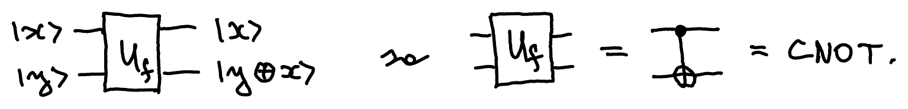

Since $f(0) \oplus f(1) = 1$, Deutsch's algorithm outputs 1:

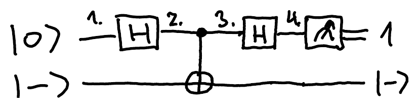

The states at the numbered points are:

1. $\ket{0}\ket{-}$
2. $\ket{+}\ket{-} = \frac{1}{\sqrt{2}} (\ket{0}\ket{-} + \ket{1}\ket{-})$
3. $\frac{1}{\sqrt{2}} (\ket{0}\ket{-} - \ket{1}\ket{-}) = \ket{-}\ket{-}$ (because $X\ket{-} = -\ket{-}$)
4. $\ket{1}\ket{-}$

What if the second qubit is $\ket{+}$ instead of $\ket{-}$?

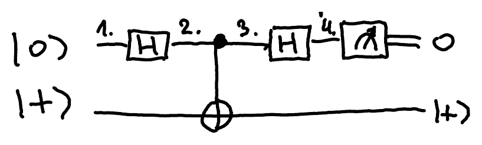

1. $\ket{0}\ket{+}$
2. $\ket{+}\ket{+}$
3. $\ket{+}\ket{+}$
4. $\ket{0}\ket{+}$

::pagebreak{lecture="10" page="2"}

Here is how we can think about this. Note that a CNOT is the same as a controlled-$X$,

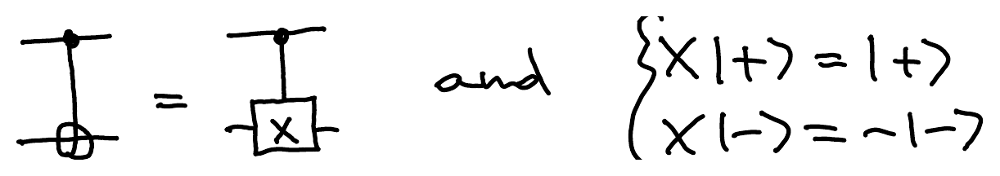

and that

$$
\begin{cases} X\ket{+} = \ket{+} \\ X\ket{-} = -\ket{-} \end{cases}
$$

so $\ket{+}$ and $\ket{-}$ are the eigenvectors of $X$. Given an eigenvector of $X$ as a quantum state, Deutsch's algorithm determines which eigenvector it is. Equivalently, it determines the corresponding eigenvalue: if the measurement outcome is $b_1 \in \{0,1\}$, then the eigenvalue is $(-1)^{b_1}$ and the eigenstate was $\ket{(-1)^{b_1}}$, that is, $\ket{+}$ if $b_1 = 0$ and $\ket{-}$ if $b_1 = 1$. Note that this procedure preserves the eigenstate: the final state is $\ket{b_1}\ket{(-1)^{b_1}}$. This is the same as [measuring an observable](/notes/observables/#quantum-circuit-for-measuring-an-observable) on one of its eigenvectors!

This idea can be generalized to an arbitrary basis. Let $V \in U(2)$ be an arbitrary unitary basis change, and let $U = V X V^\dagger$ be $X$ in a different basis. Since $X = \ketbra{+}{+} - \ketbra{-}{-}$, we get $U = \ketbra{\psi_0}{\psi_0} - \ketbra{\psi_1}{\psi_1}$, where $\ket{\psi_0} = V\ket{+}$ and $\ket{\psi_1} = V\ket{-}$ are the eigenvectors of $U$. We can generalize the algorithm as follows: for any $b_1 \in \{0,1\}$, run the circuit below on $\ket{\psi_{b_1}}$.

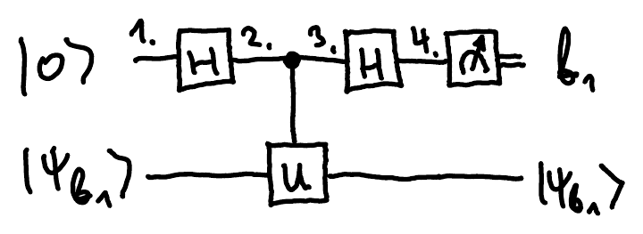

Since

$$
U\ket{\psi_{b_1}} = (-1)^{b_1}\ket{\psi_{b_1}},
$$

the states at the numbered points are:

1. $\ket{0}\ket{\psi_{b_1}}$
2. $\ket{+}\ket{\psi_{b_1}} = \frac{1}{\sqrt{2}} \left(\ket{0}\ket{\psi_{b_1}} + \ket{1}\ket{\psi_{b_1}}\right)$
3. $\frac{1}{\sqrt{2}} \left(\ket{0}\ket{\psi_{b_1}} + \ket{1}(-1)^{b_1}\ket{\psi_{b_1}}\right)$

   $= \frac{1}{\sqrt{2}} \left(\ket{0} + (-1)^{b_1}\ket{1}\right)\ket{\psi_{b_1}} = \ket{(-1)^{b_1}}\ket{\psi_{b_1}}$
4. $\ket{b_1}\ket{\psi_{b_1}}$

Again, we determine the eigenvalue of $\ket{\psi_{b_1}}$ without destroying the state itself (it belongs to the basis in which we measure it).

This idea can be generalized beyond $\pm 1$ eigenvalues to an arbitrary eigenvalue $e^{i\varphi}$, $\varphi \in [0, 2\pi)$.

## Quantum phase estimation

Let $U \in U(d)$ be a unitary and $\ket{\psi} \in \C^d$ an eigenvector of $U$:

$$
U\ket{\psi} = e^{2\pi i \cdot b}\ket{\psi}, \quad \text{for some } b \in [0,1).
$$

The **phase estimation problem** is: given access to a subroutine for controlled-$U$ and one copy of $\ket{\psi}$, determine $b$ (that is, the phase, or equivalently the eigenvalue, of $\ket{\psi}$).

We already solved the case when $e^{2\pi i b} \in \{1, -1\}$, so $b \in \{0, 1/2\}$, or in binary $b \in \{0.0, 0.1\}$. In other words, $b = 0.b_1$, and we determined $b_1 \in \{0,1\}$. How about 2-bit accuracy? If $b = 0.b_1 b_2$, how do we find $b_1, b_2 \in \{0,1\}$?

Note that $U^2\ket{\psi} = e^{2\pi i \cdot 2b}\ket{\psi} = e^{2\pi i \cdot 0.b_2}\ket{\psi}$[^fix-1], since $2b = 10_2 \cdot 0.b_1 b_2 = b_1.b_2$ and $e^{2\pi i} = 1$. Hence, by using $U^2$ instead of $U$, we can determine $b_2$. But how about $b_1$?

More generally, if $b = 0.b_1 b_2 \ldots b_n$, then

$$
U^{2^k}\ket{\psi} = e^{2\pi i \cdot 2^k \cdot b}\ket{\psi}
$$

where

$$
2^k \cdot b = \underbrace{10\ldots 0_2}_{k} \cdot 0.b_1 b_2 \ldots b_n = \underbrace{b_1 b_2 \ldots b_k}_{\text{integer part}} . \underbrace{b_{k+1} b_{k+2} \ldots b_n}_{\text{fractional part with } n-k \text{ digits}}
$$

so the integer part drops out of the exponent and $e^{2\pi i \cdot 2^k \cdot b} = e^{2\pi i \cdot 0.b_{k+1} \ldots b_n}$. Using controlled-$U^{2^k}$ in the circuit from before, but without the final Hadamard, puts the bits $b_{k+1} \ldots b_n$ into the relative phase of the first qubit:

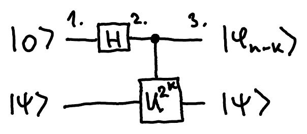

1. $\ket{0}\ket{\psi}$
2. $\ket{+}\ket{\psi} = \frac{1}{\sqrt{2}} \left(\ket{0}\ket{\psi} + \ket{1}\ket{\psi}\right)$
3. $\frac{1}{\sqrt{2}} \left(\ket{0}\ket{\psi} + \ket{1} e^{2\pi i \cdot 2^k \cdot b}\ket{\psi}\right)$

   $= \underbrace{\frac{1}{\sqrt{2}} \left(\ket{0} + e^{2\pi i \cdot 0.b_{k+1} \ldots b_n}\ket{1}\right)}_{\ket{\varphi_{n-k}}} \ket{\psi}$

On the [Bloch sphere](/notes/qubits/#bloch-sphere), a state $\frac{1}{\sqrt{2}}(\ket{0} + e^{i\varphi}\ket{1})$ like this lies on the equator, at angle $\varphi$ from the $x$ axis:

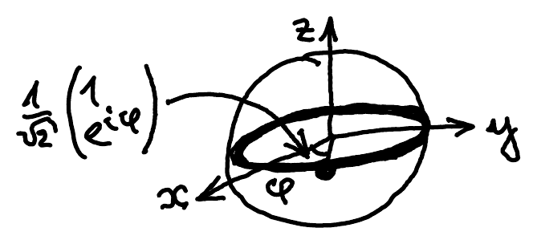

::pagebreak{lecture="10" page="4"}

Let's see what happens if we take $n=2$ and produce both the state with $k=0$ and the one with $k=1$, and how we can recover $b_1$ from them.

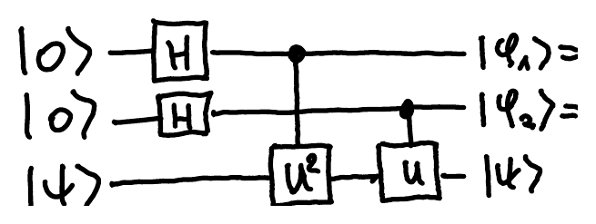

$$
\ket{\varphi_1} = \frac{1}{\sqrt{2}} \left(\ket{0} + e^{2\pi i \cdot 0.b_2}\ket{1}\right) = \frac{1}{\sqrt{2}} \left(\ket{0} + (-1)^{b_2}\ket{1}\right)
$$

$$
\ket{\varphi_2} = \frac{1}{\sqrt{2}} \left(\ket{0} + e^{2\pi i \cdot 0.b_1 b_2}\ket{1}\right) = \frac{1}{\sqrt{2}} \left(\ket{0} + (-1)^{b_1 . b_2}\ket{1}\right)
$$

We can first recover $b_2$ the same way as before, by applying $H$ to the first qubit. Once we have $b_2$, we can remove it from the second state as follows. Let $S = \begin{pmatrix} 1 & 0 \\ 0 & i \end{pmatrix}$ and note that

$$
S^\dagger = \begin{pmatrix} 1 & 0 \\ 0 & i^{-1} \end{pmatrix} \quad \text{so} \quad \begin{aligned} (S^\dagger)^{b_2}\ket{0} &= \ket{0} \\ (S^\dagger)^{b_2}\ket{1} &= (i^{-b_2})\ket{1} \end{aligned}
$$

Hence, an $S^\dagger$ on the second qubit, controlled by the first qubit (now $\ket{b_2}$), turns the second qubit into $\frac{1}{\sqrt{2}}(\ket{0} + (-1)^{b_1}\ket{1})$, and a Hadamard then gives $b_1$:

The swap at the end puts $\ket{b_1}$ and $\ket{b_2}$ in the right order.

The **inverse** of the highlighted circuit (the dashed box) is called the **quantum Fourier transform** (QFT). So the 2-qubit QFT is

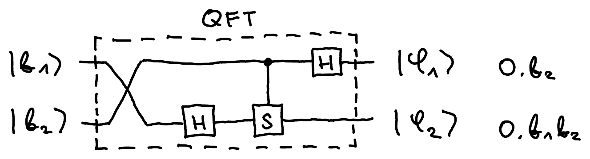

where $\ket{\varphi_k} = \frac{1}{\sqrt{2}} \left(\ket{0} + e^{2\pi i \cdot \overbrace{2^{n-k} \cdot b}^{0.b_{n-k+1} \ldots b_n}}\ket{1}\right)$. More generally,

$$
\mathrm{QFT}\ket{b_1 b_2 \ldots b_n} = \ket{\varphi_1} \otimes \ket{\varphi_2} \otimes \ldots \otimes \ket{\varphi_n}.
$$

and the circuit can be obtained recursively.

::pagebreak{lecture="10" page="5"}

The general quantum phase estimation circuit, which estimates the phase of an eigenvalue of $U$ up to $n$ binary digits of precision, looks as follows:

Here is how you can think of the highlighted part (the dashed box). If the first $n$ qubits are in the computational basis state $\ket{a_1 a_2 \ldots a_n}$, for some $a_i \in \{0,1\}$, the total power of $U$ applied to $\ket{\psi}$ is

$$
a_1 2^{n-1} + a_2 2^{n-2} + \ldots + a_{n-1} 2^1 + a_n 2^0 = a
$$

where $a \in \{0, \ldots, 2^n - 1\}$ is the integer whose binary representation is $a_1 a_2 \ldots a_n$. Hence this part implements the following operation:

$$
\sum_{a=0}^{2^n - 1} \ketbra{a}{a} \otimes U^a
$$

We can abbreviate the quantum phase estimation circuit as follows:

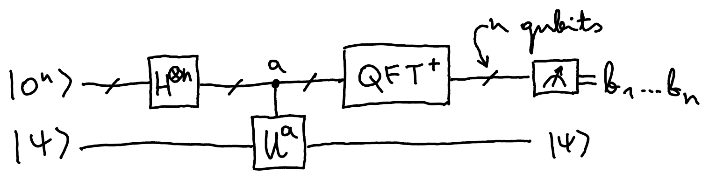

This is somewhat reminiscent of [Simon's algorithm](/notes/simon/), except with $\mathrm{QFT}^\dagger$ instead of $H^{\otimes n}$, and $a$-controlled-$U$ instead of the bit oracle $U_f$ for some $f$.

[^fix-1]: Corrected from the original notes, which leave out the final $\ket{\psi}$.
