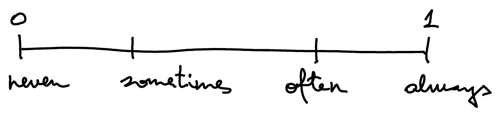
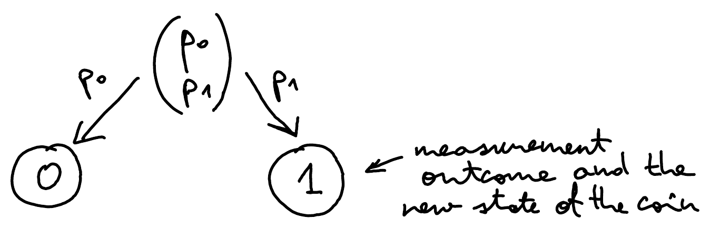

::pagesources{items="L01:2-6" exercises="/exercises/foundations/#probabilistic-bits"}

## Probabilistic bits (closest thing to quantum bits)

::source{lecture="1" pages="2"}

Probability quantifies likelihood:

Probabilistic bit

$$
=
\begin{cases}
0 & \text{with probability } p_0 \\
1 & \text{w.p. } p_1
\end{cases}
$$

where $p_0, p_1 \geq 0$ and $p_0 + p_1 = 1$.

:::example
Random coin: $p_0 = p_1 = \frac{1}{2}$.
:::

Note: enough to specify $p_0$ since $p_1 = 1 - p_0$.

Vector notation:

$$
\begin{pmatrix} p_0 \\ p_1 \end{pmatrix} = p_0 \begin{pmatrix} 1 \\ 0 \end{pmatrix} + p_1 \begin{pmatrix} 0 \\ 1 \end{pmatrix}
\qquad\qquad
\boxed{\begin{aligned} \textcircled{0} &= \begin{pmatrix} 1 \\ 0 \end{pmatrix} \\ \textcircled{1} &= \begin{pmatrix} 0 \\ 1 \end{pmatrix} \end{aligned}}
$$

Intuition:

$$
\underbrace{\textcircled{?}}_{\text{random coin}} = p_0 \underbrace{\textcircled{0}}_{\text{"heads"}} + p_1 \underbrace{\textcircled{1}}_{\text{"tails"}}
$$

(deterministic states)

## Probabilistic information is information too !

::source{lecture="1" pages="3"}

:::example
Party planning

| Name | Coming? | Chances? |
|------|---------|----------|
| John | Y | 0.1 |
| Sarah | N | 0.1 |
| Peter | — | 0.8 |
| Anna | — | 0.5 |
| Tom | Y | 0.6 |
| Total: | 2 - 4 | 2.1 |

*(Under "Coming?": 2 - 4, large range. Under "Chances?": 2.1, more informed estimate.)*
:::

## Operations on probabilistic bits

::source{lecture="1" pages="4"}

Inverting a coin:

$$
\mathrm{NOT}\ \textcircled{0} = \textcircled{1} \qquad\qquad \mathrm{NOT}\ \textcircled{1} = \textcircled{0}
$$

Vector notation:

$$
\mathrm{NOT} \begin{pmatrix} 1 \\ 0 \end{pmatrix} = \begin{pmatrix} 0 \\ 1 \end{pmatrix} \qquad\qquad \mathrm{NOT} \begin{pmatrix} 0 \\ 1 \end{pmatrix} = \begin{pmatrix} 1 \\ 0 \end{pmatrix}
$$

How can we extend this to prob. bits?

Extension by linearity:

$$
\boxed{\mathrm{NOT}\left[ p_0 \begin{pmatrix} 1 \\ 0 \end{pmatrix} + p_1 \begin{pmatrix} 0 \\ 1 \end{pmatrix} \right] = p_0\, \mathrm{NOT} \begin{pmatrix} 1 \\ 0 \end{pmatrix} + p_1\, \mathrm{NOT} \begin{pmatrix} 0 \\ 1 \end{pmatrix}}
$$

We get:

$$
\mathrm{NOT} \begin{pmatrix} p_0 \\ p_1 \end{pmatrix} = p_0 \begin{pmatrix} 0 \\ 1 \end{pmatrix} + p_1 \begin{pmatrix} 1 \\ 0 \end{pmatrix} = \begin{pmatrix} p_1 \\ p_0 \end{pmatrix}
$$

Intuition: w.p. $p_0$ the bit is $\textcircled{0}$ and we invert it to $\textcircled{1}$, and w.p. $p_1$ the bit is $\textcircled{1}$ and we invert it to $\textcircled{0}$.

Matrix notation:

$$
\mathrm{NOT} = \begin{pmatrix} 0 & 1 \\ 1 & 0 \end{pmatrix} \quad\text{since}\quad \begin{pmatrix} 0 & 1 \\ 1 & 0 \end{pmatrix} \cdot \begin{pmatrix} p_0 \\ p_1 \end{pmatrix} = \begin{pmatrix} p_1 \\ p_0 \end{pmatrix}
$$

## Adding and multiplying probabilities

::source{lecture="1" pages="5"}

- $\cdot$ if you have two independent events and you want to know if they both occurred simultaneously
- $+$ if you have a single event with multiple outcomes and you want to know if any of them occurred (but you don't care which one), so you are grouping them together

:::example
If I look at my watch at a random point in time, the probability that it is 8:23 is $\frac{1}{12} \cdot \frac{1}{60} = \frac{1}{720}$.

The probability that the hour hand is on a prime is $\frac{1}{12} + \frac{1}{12} + \frac{1}{12} + \frac{1}{12} + \frac{1}{12} = \frac{5}{12}$.

$(2 \quad 3 \quad 5 \quad 7 \quad 11)$
:::

## Measuring a probabilistic bit

::source{lecture="1" pages="6"}

Probabilistic bit is like a coin that you have flipped and immediately covered with your hand when it lands. You don't know which side is up. All you know is that each side has the chance of $\frac{1}{2}$ to be up. You can describe such coin by the uniform distribution $\begin{pmatrix} 1/2 \\ 1/2 \end{pmatrix}$.

When you uncover the coin and look at it, this is **measurement**. You see one of two **outcomes**, each with a certain probability:

After the measurement, the state of the coin is no longer $\begin{pmatrix} p_0 \\ p_1 \end{pmatrix}$ but either $\begin{pmatrix} 1 \\ 0 \end{pmatrix}$ or $\begin{pmatrix} 0 \\ 1 \end{pmatrix}$, depending on the measurement outcome. Further measurements will not change the state.

:::note
The measurement does not give you the values of $p_0$ and $p_1$. All you get is 0 or 1 and a new state that no longer contains information about $p_0$ and $p_1$.
:::
