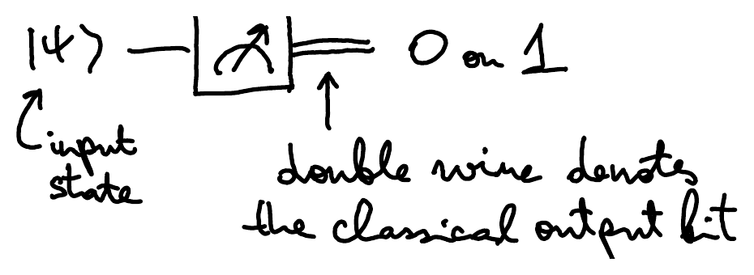
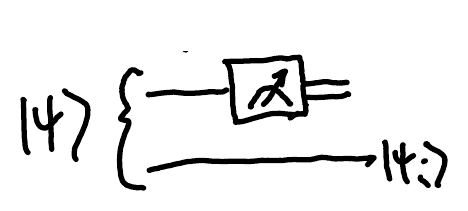
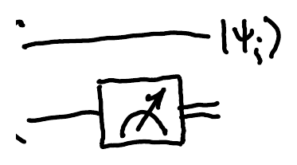
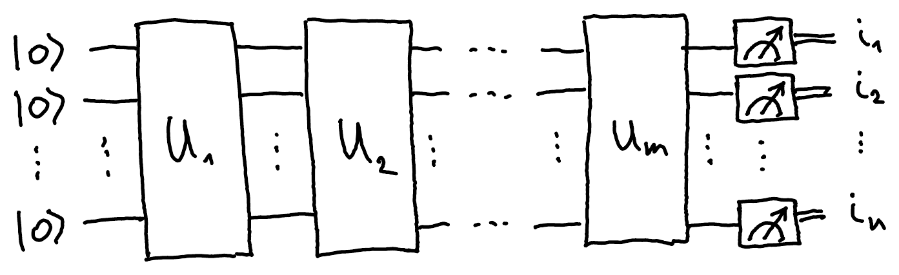
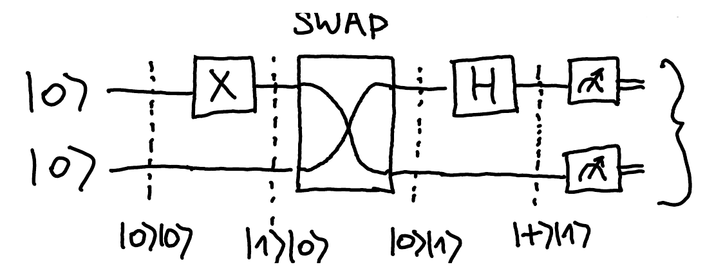
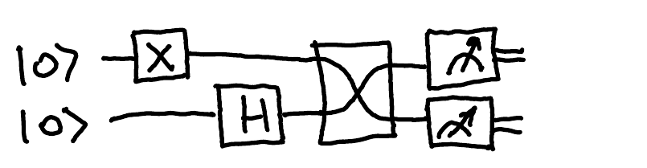
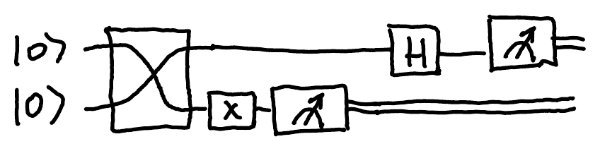
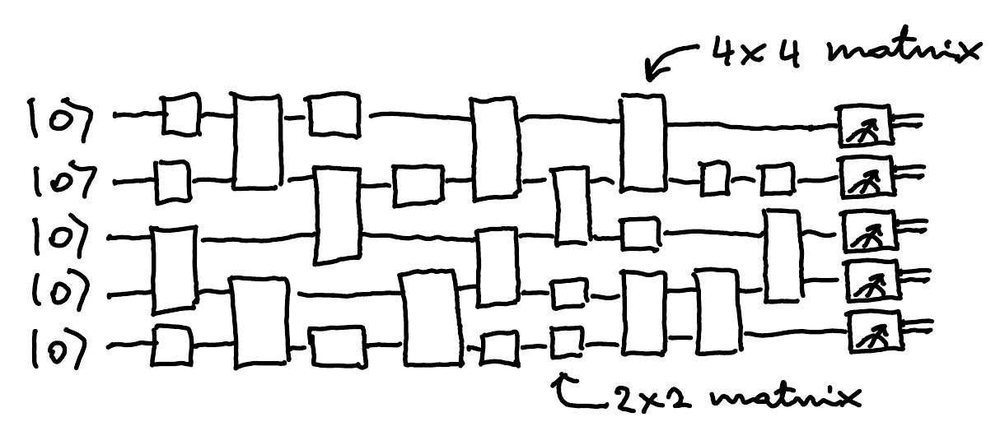

::pagesources{items="L04:4-7"}

## Single- and multi-qubit measurements

::source{lecture="4" pages="4"}

The **standard basis measurement** of a qubit is denoted by

$$
\ket{\psi} = \alpha_0\ket{0} + \alpha_1\ket{1}
\qquad
\xrightarrow{\ \abs{\alpha_0}^2\ }\ 0
\qquad
\xrightarrow{\ \abs{\alpha_1}^2\ }\ 1
$$

We can describe such measurement using the operators (now vectors) $\{\bra{0},\bra{1}\}$. Indeed, the outcome $i\in\{0,1\}$ occurs with probability $p_i := \abs{\braket{i|\psi}}^2$. If you want to also keep the post-measurement state, you can instead use the operators ($2\times 2$ matrices) $\{\ket{0}\!\bra{0}, \ket{1}\!\bra{1}\}$. Let $\Pi_i = \ket{i}\!\bra{i}$. Then

$$
p_i := \norm{\Pi_i\ket{\psi}}^2 = \norm{\ket{i}\braket{i|\psi}}^2 = \underbrace{\norm{\ket{i}}^2}_{1} \cdot \abs{\braket{i|\psi}}^2
$$

and the state after the measurement is

$$
\ket{\psi_i} = \frac{\Pi_i\ket{\psi}}{\sqrt{p_i}} = \frac{\ket{i}\!\braket{i|\psi}}{\abs{\braket{i|\psi}}} \underset{\text{equal up to a global phase}}{\sim} \ket{i}.
$$

This is called **projective measurement** since $\Pi_i$ are projectors. The same formulas work for any orthonormal basis.

If you measure only one out of two qubits, you can tensor the measurement operators with $I$:

$$
\{\bra{i}\otimes I\}
$$

$$
p_i := \norm{(\bra{i}\otimes I)\ket{\psi}}^2
$$

$$
\underbrace{\ket{\psi_i}}_{\text{remaining state on the 2nd qubit}} = \frac{(\bra{i}\otimes I)\ket{\psi}}{\sqrt{p_i}}
$$

$$
\{I\otimes\bra{i}\}
$$

$$
p_i := \norm{(I\otimes\bra{i})\ket{\psi}}^2
$$

$$
\ket{\psi_i} = \frac{(I\otimes\bra{i})\ket{\psi}}{\sqrt{p_i}}
$$

## Quantum circuits

::source{lecture="4" pages="5"}

An $n$-qubit **quantum circuit** is a sequence of $n$-qubit unitary operations, followed by the measurement in the standard basis:

The output is an $n$-bit string $i_1 i_2 \ldots i_n \in \{0,1\}^n$, with probability

$$
\left|\underbrace{\bra{i_1 i_2 \ldots i_n}}_{\text{output}}\ \underbrace{U_m \cdots U_2 U_1}_{\text{computation}}\ \underbrace{\overbrace{\ket{00\ldots 0}}^{\ket{0}^{\otimes n}}}_{\text{input}}\right|^2 .
$$

:::example
SWAP$\ket{i}\otimes\ket{j} = \ket{j}\otimes\ket{i}$

$01$ w.p. $\frac12$

$11$ w.p. $\frac12$

This circuit is equivalent to

and

:::

:::theorem[Fact]
Any intermediate measurement can be deferred to the end. Measurements in any other orthonormal basis can always be converted to the standard basis measurement.
:::

## Locality and uniformity

::source{lecture="4" pages="6"}

Computation is **local** if it consists of elementary operations that act only on a few qubits at a time.

:::example[for bits]
Any Boolean function $f\colon\{0,1\}^n\to\{0,1\}$ can be computed using logical gates (e.g., AND and NOT) with at most two input bits.
:::

We would like quantum circuits to be local as well because:

- it is hard to make more than two quantum systems to interact simultaneously,
- the hardware might have only a finite number of different types of interactions available (in particular, they act only on some finite number of qubits),
- we cannot afford to store $2^n\times 2^n$ matrices to describe the algorithm (e.g., when $n=50$, there are not enough atoms in the universe to write down each matrix entry, even if we use one atom per entry).

To solve a computational problem, we need not just a single circuit, but a family of circuits - one circuit for every input size of the problem (e.g., we cannot simply use the circuit that adds 3-bit numbers to add 5-bit numbers). But where do we get these circuits in the first place? They are generated by some other (classical) algorithm.

A **uniform** family of circuits is one that can be produced by a deterministic Turing machine in polynomial time.

This excludes the possibility of generating an (exponential size) look-up table that stores all possible answers.

## Quantum algorithm

::source{lecture="4" pages="7"}

A quantum algorithm is an infinite family $C_1, C_2, \ldots$ of quantum circuits, where $C_n$ acts on $n$ qubits and consists of a finite sequence of 1-qubit and 2-qubit gates: $C_n = (U_1, U_2, \ldots, U_{L(n)})$ where $L(n)$ denotes the number of gates in the circuit. The map $n\mapsto C_n$ must be efficiently computable (in polynomial time on a deterministic Turing machine). In particular, $L(n)$ must be polynomial in $n$.

This is how a typical quantum algorithm might look like. All gates act on at most two (neighbouring) qubits and are easy to specify since they involve at most $4\times 4 = 16$ complex numbers. To fully specify the algorithm, one must provide at most $16\cdot L(n)$ complex numbers, which is only polynomial in $n$, plus at most two $\lceil\log_2 n\rceil$-bit numbers per gate to specify on which qubits it acts on. The total amount of information is still polynomial in $n$ and hence in principle manageable.

In contrast, the overall unitary transformation implemented by the algorithm is described by a $2^n\times 2^n$ matrix, which is too big to even write down. This also implies that not all unitary $n$-qubit transformations can be implemented by a $\mathrm{poly}(n)$-size quantum circuit.
