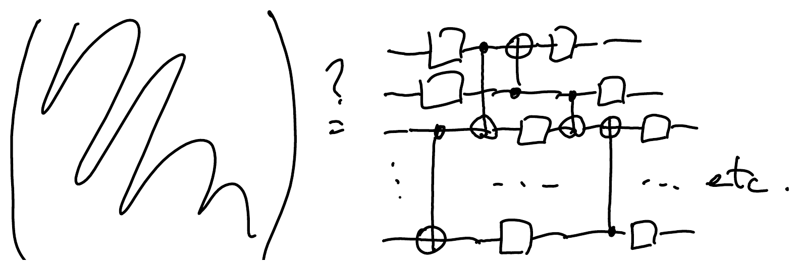
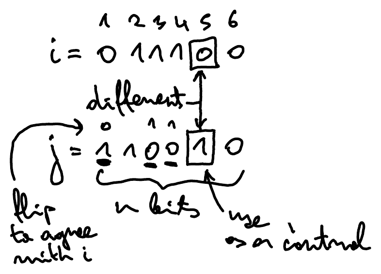

::pagesources{items="L09:10-12" exercises="/exercises/circuits/#quantum-compiling"}

## Quantum compiling

::source{lecture="9" pages="10-12"}

Given some $n$-qubit unitary $U \in U(2^n)$, how do we implement it as a sequence of only 1- and 2-qubit gates (only CNOTs, say)?

**Main idea:**

$$
\underbrace{\frac{1}{\sqrt{|\alpha|^2 + |\beta|^2}} \begin{pmatrix} \bar{\alpha} & \bar{\beta} \\ -\beta & \alpha \end{pmatrix}}_{\text{Unitary}} \underbrace{\begin{pmatrix} \alpha \\ \beta \end{pmatrix}}_{\in\, \mathbb{C}^2} = \begin{pmatrix} \sqrt{|\alpha|^2 + |\beta|^2} \\ 0 \end{pmatrix}
$$

Generalization of this is QR decomposition:

Let $G_{ij}(\alpha, \beta)$ $(\alpha, \beta \in \mathbb{C};\ i, j \in \{0,1\}^n)$ (Givens rotation)

$$
G_{ij}(\alpha, \beta) = \frac{1}{\sqrt{|\alpha|^2 + |\beta|^2}} \begin{pmatrix} 1 & & & & & \\ & \ddots & & & & \\ & & \bar{\alpha} & & \bar{\beta} & \\ & & & 1 & & \\ & & & & \ddots & \\ & & -\beta & & \alpha & \\ & & & & & 1 \\ & & & & & & \ddots \end{pmatrix}
$$

*(the entries $\bar\alpha, \bar\beta$ are in row $i$, columns $i, j$; the entries $-\beta, \alpha$ are in row $j$, columns $i, j$; all other diagonal entries are $1$)*

$$
\underbrace{\begin{pmatrix} * & * & * \\ \alpha & * & * \\ \beta & * & * \end{pmatrix}}_{U} \xmapsto{G_{1,2}(\alpha,\beta)} \begin{pmatrix} \gamma & * & * \\ \delta & * & * \\ 0 & * & * \end{pmatrix} \xmapsto{G_{0,1}(\gamma,\delta)} \begin{pmatrix} 1 & \underbrace{0 \quad 0}_{\text{because unitary}} \\ 0 & \varepsilon & * \\ 0 & \varphi & * \end{pmatrix}
$$

(rows labelled $0, 1, 2$)

$$
\xmapsto{G_{1,2}(\varepsilon,\varphi)} \begin{pmatrix} 1 & 0 & 0 \\ 0 & 1 & 0 \\ 0 & 0 & * \end{pmatrix} \qquad e^{i\theta} = \det(U)
$$

::pagebreak{lecture="9" page="11"}

**Observation:** we can decompose any $n$-qubit unitary as a sequence of $4^n$ Givens rotations.

How do we implement an arbitrary Givens rotation $G_{ij}(\alpha, \beta)$ ?

1. Find a bit where $i, j \in \{0,1\}$ differ and use it as a control in the next step
2. Make all other differing bits of $i$ and $j$ the same by applying CNOTs that use them as target
3. Apply $X$ to all bits where $i$ and $j$ are now 0
4. Apply $U$ on the bit where $i$ and $j$ still differ, using all other bits as controls
5. Undo steps 3., 2., 1.

$$
\begin{pmatrix} 1 & & & & & \\ & \ddots & & & & \\ & & u_{00} & & u_{01} & \\ & & & 1 & & \\ & & & & \ddots & \\ & & u_{10} & & u_{11} & \\ & & & & & 1 \\ & & & & & & \ddots \end{pmatrix} = G_{ij}(U) \qquad U = \begin{pmatrix} u_{00} & u_{01} \\ u_{10} & u_{11} \end{pmatrix}
$$

::pagebreak{lecture="9" page="12"}

**Summary:** We can decompose any $n$-qubit unitary into Givens rotations, then decompose those into CNOT, $X$, $C_{n-1}(U)$, then using extra workspace decompose $C_{n-1}(U)$ into Toffoli and $C_1(U)$, then use the ABC decomposition.

Since a unitary matrix on $n$ qubits is of size $2^n \times 2^n$, we need roughly $4^n$ parameters to describe it. Since each one- and two-qubit gate is of size $2\times 2$ and $4 \times 4$, respectively, they contain only at most 4 and 16 parameters, respectively. It is thus inevitable that in general we end up with roughly $4^n/16$ gates, which is exponential in $n$.
