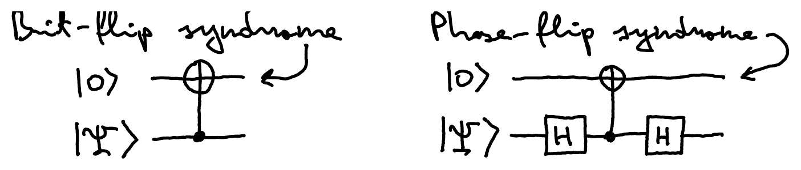
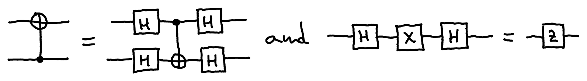
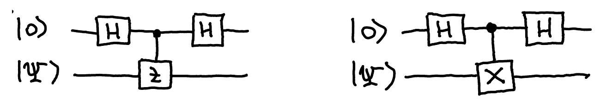
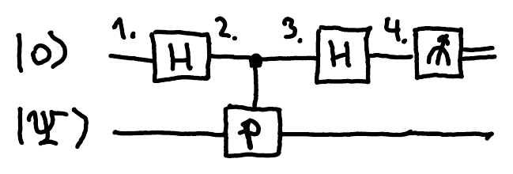
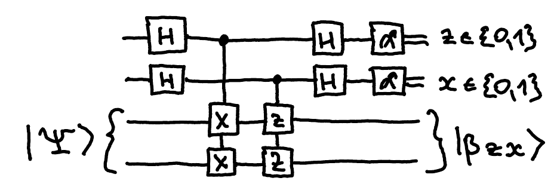

::pagesources{items="L12:7-12" exercises="/exercises/error-correction/#quantum-error-correction"}

## Quantum error correction

::source{lecture="12" pages="7-12"}

We can use a procedure that is identical to the 3-bit repetition code for probabilistic bits also in the quantum case. However, this protects only against $X$ errors (or more generally, linear combinations of $X$ and $I$). How about the most general single-qubit unitary error $U \in \mathrm{U}(2)$? We can write

$$
U = e^{i\varphi} \begin{pmatrix} a & b \\ -\bar{b} & \bar{a} \end{pmatrix}, \qquad |a|^2 + |b|^2 = 1,
$$

for some $\varphi \in \R$ and $a, b \in \C$. Let $a = t + iz$ and $b = y + ix$, for some $x, y, z, t \in \R$. Ignoring the global phase $e^{i\varphi}$,

$$
U \sim \begin{pmatrix} t+iz & y+ix \\ -y+ix & t-iz \end{pmatrix} = tI + ixX + iyY + izZ,
$$

$$
t^2 + x^2 + y^2 + z^2 = 1.
$$

::pagebreak{lecture="12" page="8"}

This is just the expansion of $U$ as a linear combination of the four Pauli matrices (any complex $2 \times 2$ matrix has a unique such expansion since the Pauli matrices form an orthogonal matrix basis).

Assume this $U$ error occurs on the first qubit of some quantum state $\ket{\Psi}$. The resulting state is

$$
U_1\ket{\Psi} = t\ket{\Psi} + ix X_1\ket{\Psi} + iy Y_1\ket{\Psi} + iz Z_1\ket{\Psi},
$$

where the subscript denotes the qubit on which the gate acts. E.g., if $\ket{\Psi}$ has 3 qubits then $U_1 = U \otimes I \otimes I$.

Since $iY = ZX$, we can think of the four terms as corresponding to four types of errors:

$$
\begin{aligned}
I &= \text{no error} \\
X &= \text{bit-flip} \\
Z &= \text{phase-flip} \\
ZX &= \text{bit- and phase-flip}
\end{aligned}
$$

Hence, if we are able to distinguish just those 4 cases, we can by linearity deal with any single-qubit unitary error – we simply compute the syndrome in a separate register, and by measuring this register force the continuous error $U$ to collapse to one of those four cases.

To fix a general error $U$, it suffices to deal with just bit-flip and phase-flip errors, since the $Y$ error can be dealt with by consecutively fixing both types of errors.

::pagebreak{lecture="12" page="9"}

We can deal with bit-flip errors the same way as for probabilistic bits – by using a sequence of CNOTs to compute the parity of the desired qubits. For phase-flip errors, we can use the same circuit but conjugate the control qubits by $H$:

Here is another way to think about this. Since

we can equivalently write the above two circuits as follows:

Note that this is phase estimation of $Z$ and $X$ up to one bit of precision. Recall that $Z^2 = X^2 = I$, so their eigenvalues are $\pm 1$, and $1 = e^{2\pi i \cdot 0.0}$ while $-1 = e^{2\pi i \cdot 0.1}$ where the phase is written in binary. Also, the same as measuring $X$ and $Z$ observables.

If we measure the syndrome qubit, we project the data qubit to one of the eigenspaces of the corresponding Pauli operator $P$:

$$
\begin{aligned}
&1.\ \ket{0}\ket{\Psi} \qquad 2.\ \ket{+}\ket{\Psi} = \tfrac{1}{\sqrt{2}}(\ket{0} + \ket{1})\ket{\Psi} \\
&3.\ \tfrac{1}{\sqrt{2}}\big(\ket{0}\ket{\Psi} + \ket{1}P\ket{\Psi}\big) \\
&4.\ \tfrac{1}{2}\big((\ket{0} + \ket{1})\ket{\Psi} + (\ket{0} - \ket{1})P\ket{\Psi}\big) \\
&\qquad = \ket{0} \otimes \Big(\tfrac{I+P}{2}\ket{\Psi}\Big) + \ket{1} \otimes \Big(\tfrac{I-P}{2}\ket{\Psi}\Big)
\end{aligned}
$$

::pagebreak{lecture="12" page="10"}

Since $P$ has eigenvalues $\pm 1$, the operators $\frac{I \pm P}{2}$ have eigenvalues 0 and 1, and they are the projectors onto the $\pm 1$ eigenspaces of $P$. Indeed, if $P = \ket{\psi_0}\!\bra{\psi_0} - \ket{\psi_1}\!\bra{\psi_1}$ then $I = \ket{\psi_0}\!\bra{\psi_0} + \ket{\psi_1}\!\bra{\psi_1}$ and $(I+P)/2 = \ket{\psi_0}\!\bra{\psi_0}$ and $(I-P)/2 = \ket{\psi_1}\!\bra{\psi_1}$.

This procedure is also known as **measuring the observable** $P$. For us, an **observable** is simply a Hermitian matrix ($P^\dagger = P$) such that $P^2 = I$. The above procedure projects a given state $\ket{\Psi}$ onto either the $+1$ or $-1$ eigenspace of $P$, and outputs which of the two projections happened (this is the same as measuring in the eigenbasis of $P$). Note that for detecting $X$ errors we measure the $Z$ observable, while for detecting $Z$ errors we measure $X$.

For example, to determine the parity of two qubits, we measure $Z \otimes Z$:

$$
Z \otimes Z = \begin{pmatrix} 1 & & & \\ & -1 & & \\ & & -1 & \\ & & & 1 \end{pmatrix}
\begin{matrix} 00 \\ 01 \\ 10 \\ 11 \end{matrix}
\qquad
\begin{aligned}
00,\, 11 &\to (+1)\text{-eigenspace} = \text{even parity} \\
01,\, 10 &\to (-1)\text{-eigenspace} = \text{odd parity}
\end{aligned}
$$

Hence, the parity checks for the quantum version of the 3-bit code correspond to measuring the observables $I \otimes Z \otimes Z$ and $Z \otimes I \otimes Z$. The common $+1$ eigenspace of these is spanned by $\ket{000}$ and $\ket{111}$.

More generally, if two observables $P$ and $Q$ commute, i.e., $PQ = QP$, the order in which they are measured does not affect the probabilities of the outcomes. We say that such observables can be measured **simultaneously**. Indeed, commuting observables can be simultaneously diagonalized. This common basis can be used to unambiguously assign measurement outcomes to

::pagebreak{lecture="12" page="11"}

each eigenvector. Intuitively, we can think of measuring an observable $P$ as asking the question of whether the system has "property $P$". For commuting observables, the process of determining $P$ does not affect the value of $Q$, so one can simultaneously ask to determine $P$ and $Q$.

:::example
Let $P = X \otimes X$ and $Q = Z \otimes Z$. Note that $PQ = QP$. Bell states have the following eigenvalues for $P$ and $Q$:

$$
\begin{array}{l|c|c}
\text{Bell states} & X \otimes X & Z \otimes Z \\
\hline
\ket{\beta_{00}} = \frac{1}{\sqrt{2}}(\ket{00} + \ket{11}) & + & + \\
\ket{\beta_{01}} = \frac{1}{\sqrt{2}}(\ket{01} + \ket{10}) & + & - \\
\ket{\beta_{10}} = \frac{1}{\sqrt{2}}(\ket{00} - \ket{11}) & - & + \\
\ket{\beta_{11}} = \frac{1}{\sqrt{2}}(\ket{01} - \ket{10}) & - & -
\end{array}
$$

In short:

$$
\begin{aligned}
(X \otimes X)\ket{\beta_{zx}} &= (-1)^z\ket{\beta_{zx}} \\
(Z \otimes Z)\ket{\beta_{zx}} &= (-1)^x\ket{\beta_{zx}}
\end{aligned}
$$

The circuit for measuring these observables looks as follows:

This amounts to measuring $\ket{\Psi}$ in the Bell basis – if the outcome is $z, x \in \{0,1\}$, the post-measurement state is $\ket{\beta_{zx}}$. If $\ket{\Psi} = (U \otimes I)\ket{\beta_{00}}$, for some single-qubit error $U = tI + ixX + iyY + izZ$ then, thanks to "local conversion",

$$
\ket{\Psi} = t\ket{\beta_{00}} + ix\ket{\beta_{01}} + iy\ket{\beta_{11}} + iz\ket{\beta_{10}}
$$

is a linear combination of Bell states ($t^2 + x^2 + y^2 + z^2 = 1$). The above circuit measures this state in the Bell basis, producing $\ket{\beta_{zx}}$ if the outcome is $z, x \in \{0,1\}$. We can restore this back to $\ket{\beta_{00}}$ by, say, applying $Z^z X^x$ on the first qubit.
:::

::pagebreak{lecture="12" page="12"}

The above example lets us remove errors from the $\ket{\beta_{00}}$ state. However, it is not a quantum error correcting code, since it does not encode an arbitrary qubit state – it merely helps when dealing with this particular state. Is a 2- or 3-qubit code even possible?

Let us do some counting to see how many qubits we need to protect a single qubit against Pauli errors. If we encode the original single-qubit state into $n$ qubits, the total dimension is $2^n$. There are $n$ qubits and on each of them can occur one of three possible Pauli errors, plus the lucky case when no error occurs at all. Hence, we need to distinguish between $3n + 1$ different cases, which means we need to be able to fit $3n + 1$ mutually orthogonal 2-dimensional subspaces into $2^n$ dimensions:

$$
2^n \geq 2(3n + 1).
$$

This is possible only when $n \geq 5$, and indeed there is a 5 qubit code. However, there is also a somewhat simpler 7 qubit code.
