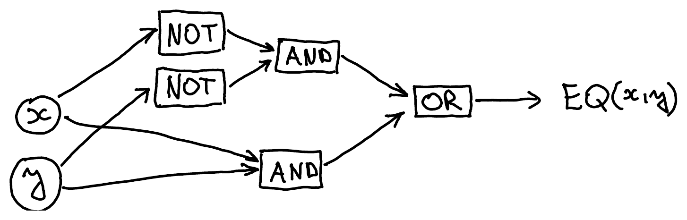
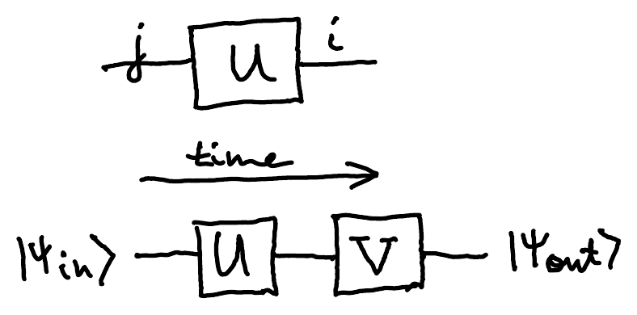
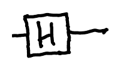
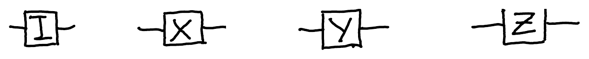
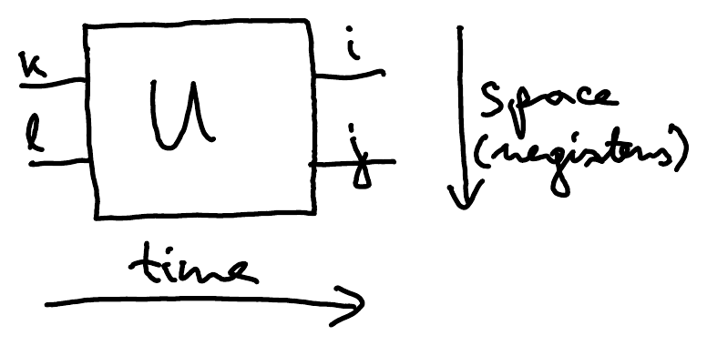
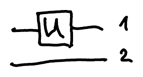
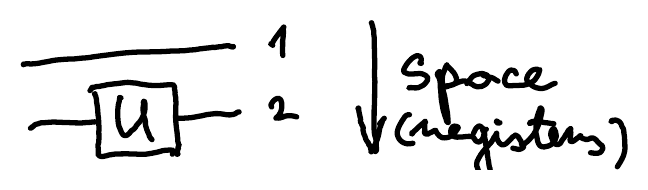
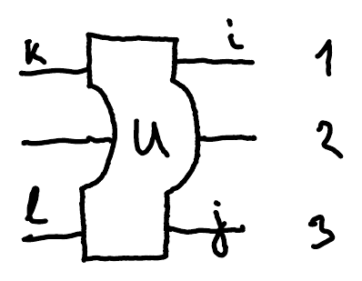

## Logical gates

**Logical gates** model elementary computational steps in digital electronic circuits. For example:

| $x$ | NOT$(x)$ |
|:---:|:---:|
| 0 | 1 |
| 1 | 0 |

| $xy$ | AND$(x,y)$ | OR$(x,y)$ | XOR$(x,y)$ |
|:---:|:---:|:---:|:---:|
| 00 | 0 | 0 | 0 |
| 01 | 0 | 1 | 1 |
| 10 | 0 | 1 | 1 |
| 11 | 1 | 1 | 0 |

Algebraically, with arithmetic modulo 2, we have $\mathrm{NOT}(x) = x+1$, $\mathrm{AND}(x,y) = x \cdot y$, $\mathrm{XOR}(x,y) = x+y$.

Any **Boolean function** $f\colon \{0,1\}^n \to \{0,1\}$ can be expressed using just AND, OR and NOT. For example, take the equality function:

| $xy$ | EQ$(x,y)$ |
|:---:|:---:|
| 00 | 1 |
| 01 | 0 |
| 10 | 0 |
| 11 | 1 |

It is 1 exactly on the rows $00$ and $11$:

$$
\mathrm{EQ}(x,y) = 1 \iff x = y \iff (x=0 \text{ and } y=0) \text{ or } (x=1 \text{ and } y=1)
$$

This gives the formula

$$
\mathrm{EQ}(x,y) = \mathrm{OR}\big(\mathrm{AND}(\mathrm{NOT}(x), \mathrm{NOT}(y)),\ \mathrm{AND}(x,y)\big)
$$

which can be drawn as a **Boolean circuit**:

Since this construction works for any Boolean function, $\{\mathrm{AND},\mathrm{OR},\mathrm{NOT}\}$ is a **universal set of logical gates**. In fact, just $\{\mathrm{AND},\mathrm{NOT}\}$ or even just $\{\mathrm{NAND}\}$ would also do the job.

## Single-qubit gates

We saw in Lecture 1 that a [general one-qubit operation](/notes/qubits/#general-qubit-operation) is of the form $U = \begin{pmatrix} a & c \\ b & d \end{pmatrix}$, where $a,b,c,d \in \C$ are such that $\abs{a}^2 + \abs{b}^2 = 1$, $\abs{c}^2 + \abs{d}^2 = 1$ and $a\bar{c} + b\bar{d} = 0$. This is equivalent to $U^\dagger U = I$, meaning that $U$ is unitary.

Thus, a **one-qubit gate** is any $2\times 2$ unitary. Expanded in the computational basis, it is

$$
U = \sum_{i,j=0}^{1} U_{i,j} \ket{i}\!\bra{j}
$$

with the input $j$ on the right and the output $i$ on the left. In the same way, if we first apply $U$ and then $V$, the output state is

$$
\ket{\psi_\text{out}} = VU\ket{\psi_\text{in}}
$$

So in formulas, time runs from right to left. In the graphical notation for circuits, it runs from left to right:

:::example
The **Hadamard gate** $H = \frac{1}{\sqrt{2}} \begin{pmatrix} 1 & 1 \\ 1 & -1 \end{pmatrix}$ changes basis between the computational basis $\{\ket{0},\ket{1}\}$ and the Hadamard basis $\{\ket{+},\ket{-}\}$:

$$
\begin{aligned}
H\ket{0} &= \ket{+} & H\ket{+} &= \ket{0} \\
H\ket{1} &= \ket{-} & H\ket{-} &= \ket{1}
\end{aligned}
$$

:::

:::example
The **Pauli gates**:

$$
I = \begin{pmatrix} 1 & 0 \\ 0 & 1 \end{pmatrix}
\qquad
X = \underbrace{\begin{pmatrix} 0 & 1 \\ 1 & 0 \end{pmatrix}}_{\text{NOT operation}}
\qquad
Y = \begin{pmatrix} 0 & -i \\ i & 0 \end{pmatrix}
\qquad
Z = \begin{pmatrix} 1 & 0 \\ 0 & -1 \end{pmatrix}
$$

You can check that $X^2 = Y^2 = Z^2 = I$ and $XY = -YX = iZ$.
:::

The Pauli matrices are closely related to the quaternions.

## Multi-qubit quantum gates

A **two-qubit gate** is a $4\times 4$ unitary matrix:

$$
\begin{aligned}
U &= \sum_{i,j,k,l=0}^{1} U_{ij,kl} \overbrace{\ket{i,j}}^{\text{output}} \underbrace{\bra{k,l}}_{\text{input}} \\
&= \sum_{i,j,k,l=0}^{1} U_{ij,kl} \ket{i}\!\bra{k} \otimes \ket{j}\!\bra{l}
\end{aligned}
$$

Again, time runs from right to left in the formula and from left to right in the circuit:

:::example
The 2-qubit identity operation is

$$
\ket{00}\!\bra{00} + \ket{01}\!\bra{01} + \ket{10}\!\bra{10} + \ket{11}\!\bra{11} =
\begin{pmatrix} 1 & & & \\ & 1 & & \\ & & 1 & \\ & & & 1 \end{pmatrix}
\begin{matrix} \ket{00} \\ \ket{01} \\ \ket{10} \\ \ket{11} \end{matrix}
$$
:::

Similarly, an $n$-qubit gate is a $2^n \times 2^n$ unitary. It has $n$ input and $n$ output qubits.

## Local operations

If a 1-qubit gate $U$ is applied **locally** on one of two qubits, we can write it as a 2-qubit unitary by taking its tensor product with $I$ on the other qubit:

$$
\underbrace{\overset{1}{U} \otimes \overset{2}{I}}_{\text{1st qubit}}
\qquad\qquad
\overset{1}{I} \otimes \underbrace{\overset{2}{U}}_{\text{2nd qubit}}
$$

If a 2-qubit gate is applied locally on qubits 1 and 3, we can write this as a 3-qubit operation:

$$
\sum_{i,j,k,l=0}^{1} U_{ij,kl}\ \overset{1}{\ket{i}\!\bra{k}} \otimes \overset{2}{I} \otimes \overset{3}{\ket{j}\!\bra{l}}
$$

