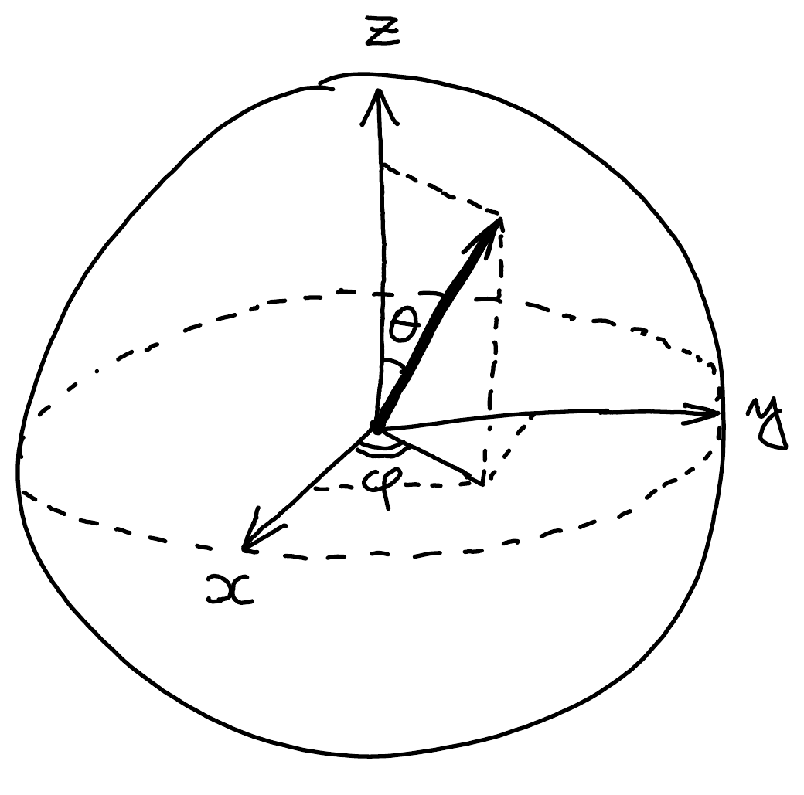

::pagesources{items="L01:9-14" exercises="/exercises/foundations/#qubits-and-the-bloch-sphere"}

## Quantum bits (qubits)

::source{lecture="1" pages="9"}

Only two differences between probabilistic and quantum bits:

1. probabilities replaced by complex amplitudes,
2. amplitudes are squared when measuring.

Everything else in quantum computing is a consequence of these two small changes!

When added, complex (or just negative) numbers can cancel -- this important effect is called **interference** and it does not happen with probabilities.

## Qubit states

::source{lecture="1" pages="9"}

Instead of coins $\textcircled{0}$ and $\textcircled{1}$ we use "kets":

$$
\ket{0} = \begin{pmatrix} 1 \\ 0 \end{pmatrix} \qquad\qquad \ket{1} = \begin{pmatrix} 0 \\ 1 \end{pmatrix}
$$

A general qubit state is a **superposition** (or linear combination) of these:

$$
\psi_0 \ket{0} + \psi_1 \ket{1} = \psi_0 \begin{pmatrix} 1 \\ 0 \end{pmatrix} + \psi_1 \begin{pmatrix} 0 \\ 1 \end{pmatrix} = \begin{pmatrix} \psi_0 \\ \psi_1 \end{pmatrix}
$$

where $\psi_0, \psi_1 \in \C$ are called **amplitudes** and satisfy

$$
|\psi_0|^2 + |\psi_1|^2 = 1
$$

## Measuring a qubit

::source{lecture="1" pages="10"}

Born rule: probability $= |\text{amplitude}|^2$

$$
\begin{pmatrix} \psi_0 \\ \psi_1 \end{pmatrix}
\ \xrightarrow{\ |\psi_0|^2\ }\ \ket{0}
\qquad
\begin{pmatrix} \psi_0 \\ \psi_1 \end{pmatrix}
\ \xrightarrow{\ |\psi_1|^2\ }\ \ket{1}
$$

If the measurement outcome is $k \in \{0, 1\}$ then the state after the measurement becomes $\ket{k}$ and the original state is gone. In particular, you don't learn $\psi_0$ or $\psi_1$ this way.

## Quantum NOT

::source{lecture="1" pages="10"}

Just like for probabilistic bits, quantum operations are **extended by linearity**:

$$
\begin{aligned}
\mathrm{NOT}\left(\psi_0 \ket{0} + \psi_1 \ket{1}\right) &= \psi_0\, \mathrm{NOT} \ket{0} + \psi_1\, \mathrm{NOT} \ket{1} \\
&= \psi_0 \ket{1} + \psi_1 \ket{0}.
\end{aligned}
$$

The output is also a quantum state since $|\psi_0|^2 + |\psi_1|^2 = 1$.

## General qubit operation

::source{lecture="1" pages="11"}

Let's call it $U$. For some $a, b, c, d \in \C$,

$$
U\ket{0} = \begin{pmatrix} a \\ b \end{pmatrix} \qquad\text{and}\qquad U\ket{1} = \begin{pmatrix} c \\ d \end{pmatrix}
$$

These too are quantum states so

$$
|a|^2 + |b|^2 = 1 \qquad\text{and}\qquad |c|^2 + |d|^2 = 1
$$

Are these the only constraints? Let $\ket{\psi} := \psi_0 \ket{0} + \psi_1 \ket{1}$ be an arbitrary qubit state ($|\psi_0|^2 + |\psi_1|^2 = 1$). By linearity,

$$
U\ket{\psi} = \psi_0 U\ket{0} + \psi_1 U\ket{1} = \psi_0 \begin{pmatrix} a \\ b \end{pmatrix} + \psi_1 \begin{pmatrix} c \\ d \end{pmatrix} = \begin{pmatrix} \psi_0 a + \psi_1 c \\ \psi_0 b + \psi_1 d \end{pmatrix} = \begin{pmatrix} \psi_0' \\ \psi_1' \end{pmatrix}
$$

This should also be a quantum state so

$$
\begin{aligned}
|\psi_0'|^2 + |\psi_1'|^2 &= |\psi_0 a + \psi_1 c|^2 + |\psi_0 b + \psi_1 d|^2 \\
&= (\psi_0 a + \psi_1 c)(\bar{\psi}_0 \bar{a} + \bar{\psi}_1 \bar{c}) + (\psi_0 b + \psi_1 d)(\bar{\psi}_0 \bar{b} + \bar{\psi}_1 \bar{d}) \\
&= |\psi_0|^2 \underbrace{(|a|^2 + |b|^2)}_{1} + |\psi_1|^2 \underbrace{(|c|^2 + |d|^2)}_{1} \\
&\quad + \psi_0 \bar{\psi}_1 \underbrace{(a\bar{c} + b\bar{d})}_{0} + \psi_1 \bar{\psi}_0 \underbrace{(c\bar{a} + d\bar{b})}_{0} \\
&= |\psi_0|^2 + |\psi_1|^2 \quad\text{for all } \psi_0, \psi_1 \in \C.
\end{aligned}
$$

*(Recall: $z \cdot \bar{z} = |z|^2$.)*

*(Pointing at the term $c\bar{a} + d\bar{b}$: $\overline{a\bar{c} + b\bar{d}}$ so it's redundant.)*

$$
\boxed{\begin{array}{l}
\text{A general qubit operation is of the form } U = \begin{pmatrix} a & c \\ b & d \end{pmatrix} \\
\text{where } a, b, c, d \in \C \text{ are such that} \\
|a|^2 + |b|^2 = 1, \quad |c|^2 + |d|^2 = 1, \quad a\bar{c} + b\bar{d} = 0.
\end{array}}
$$

## Global and relative phases

::source{lecture="1" pages="12"}

- The **phase** of $re^{i\varphi}$ is $e^{i\varphi}$. We say that two vectors $\ket{\psi}$ and $\ket{\psi'}$ differ only by a **global phase** if

  $$
  \ket{\psi} = e^{i\varphi} \ket{\psi'} \qquad\qquad \text{for some } \varphi \in \R.
  $$

  Such states produce the same measurement statistics since $|e^{i\varphi} z| = |z|$ for any $z \in \C$. Moreover, $U\ket{\psi} = e^{i\varphi} U\ket{\psi'}$ so they still differ only by a global phase also after any operation $U$. This means that $\ket{\psi}$ and $\ket{\psi'}$ represent the same physical reality.
- For comparison, consider

  $$
  \ket{+} = \frac{1}{\sqrt{2}} (\ket{0} + \ket{1}) \qquad\text{and}\qquad \ket{-} = \frac{1}{\sqrt{2}} (\ket{0} - \ket{1})
  $$

  They also produce the same measurement statistics:

  $$
  \begin{cases}
  0 & \text{w.p. } \frac{1}{2} \\
  1 & \text{w.p. } \frac{1}{2}
  \end{cases}
  $$

  Are $\ket{+}$ and $\ket{-}$ the same state? No. In fact, you can find $U$ such that $U\ket{+} = \ket{0}$ and $U\ket{-} = \ket{1}$. Generally, the $e^{i\varphi}$ in $\ket{0} + e^{i\varphi}\ket{1}$ is called a **relative phase**.

**Remember**: global phase doesn't matter, relative phase matters!

## Qubit geometry

::source{lecture="1" pages="13-14"}

Since we can ignore the global phase, any qubit state can be written as

$$
\ket{\psi} = \underbrace{\cos\frac{\theta}{2}}_{\psi_0} \ket{0} + e^{i\varphi} \underbrace{\sin\frac{\theta}{2}}_{\psi_1} \ket{1}
$$

for some angles $\theta \in [0, \pi]$ and $\varphi \in [0, 2\pi)$. Note that $\psi_0 \in [0, 1]$ and $|\psi_0|^2 + |\psi_1|^2 = 1$. Also:

$$
\begin{aligned}
\theta = 0 &\implies \ket{\psi} = \ket{0} \\
\theta = \pi &\implies \ket{\psi} = e^{i\varphi}\ket{1} \overset{\text{"up to global phase"}}{\sim} \ket{1}
\end{aligned}
$$

In these two extreme cases the parameter $\varphi$ has become redundant. This is similar to how the longitude become irrelevant at the poles of the Earth, suggesting that qubit has the same topology as the sphere! Indeed, there is a one-to-one correspondence between qubit states $\ket{\psi} \in \C^2$ and unit vectors in $\R^3$:

$$
\begin{pmatrix} \psi_0 \\ \psi_1 \end{pmatrix} \in \C^2 \quad\longrightarrow\quad \begin{pmatrix} 2\,\mathrm{Re}(\bar{\psi}_0 \psi_1) \\ 2\,\mathrm{Im}(\bar{\psi}_0 \psi_1) \\ |\psi_0|^2 - |\psi_1|^2 \end{pmatrix} \in \R^3
$$

The resulting vector in $\R^3$ is called the **Bloch vector** of $\ket{\psi}$.

::pagebreak{lecture="1" page="14"}

Going the other way:

$$
\frac{1}{\sqrt{2(z+1)}} \begin{pmatrix} z + 1 \\ x + iy \end{pmatrix} \in \C^2 \quad\longleftarrow\quad \begin{pmatrix} x \\ y \\ z \end{pmatrix} \in \R^3
$$

## Bloch sphere

::source{lecture="1" pages="14"}

The correspondence is particularly elegant when expressed using the spherical coordinates:

$$
\begin{pmatrix} \cos\frac{\theta}{2} \\ e^{i\varphi} \sin\frac{\theta}{2} \end{pmatrix} \longrightarrow
\begin{cases}
x = \sin\theta \cos\varphi \\
y = \sin\theta \sin\varphi \\
z = \cos\theta
\end{cases}
$$
