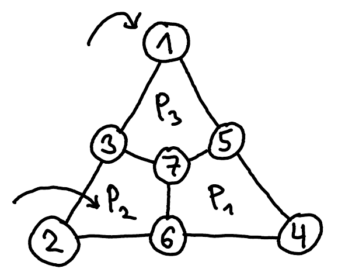
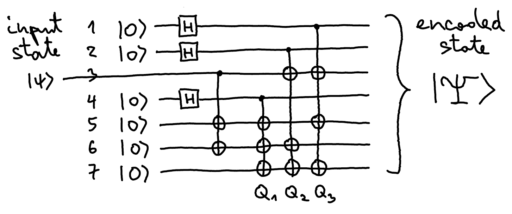
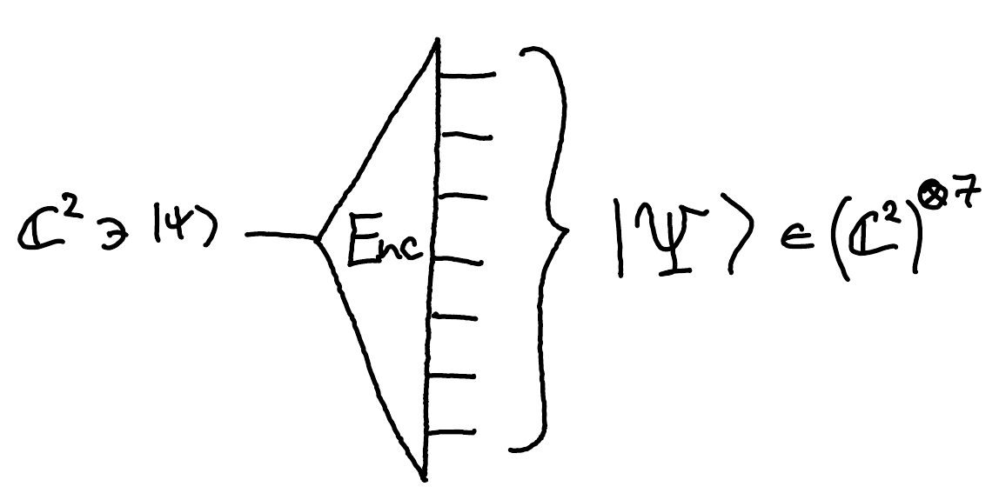

## Steane code

The Steane code involves 7 qubits, and its syndrome is obtained by measuring six observables $P_1, P_2, P_3, Q_1, Q_2, Q_3$.

$$
\begin{array}{r|c|c|c|c|c|c|c|}
 & 1 & 2 & 3 & 4 & 5 & 6 & 7 \\
\hline
P_1 = & & & & Z & Z & Z & Z \\
\hline
P_2 = & & Z & Z & & & Z & Z \\
\hline
P_3 = & Z & & Z & & Z & & Z \\
\hline
\end{array}
$$

$$
\begin{array}{r|c|c|c|c|c|c|c|}
\hline
Q_1 = & & & & X & X & X & X \\
\hline
Q_2 = & & X & X & & & X & X \\
\hline
Q_3 = & X & & X & & X & & X \\
\hline
\end{array}
$$

These observables pairwise commute, since any two of the plaquettes have an even number of vertices in common (the corners of plaquette $P_i$ are the qubits on which $P_i$ and $Q_i$ act non-trivially). For a $P_i$ and a $Q_j$, the $Z$ and $X$ on each shared qubit anticommute ($XZ = -ZX$), and an even number of such sign changes cancel out.

::pagebreak{lecture="12" page="13"}

There are 6 observables and hence 6 syndrome qubits, so there are $2^6 = 64$ different possible syndromes. Recall that there are $3n + 1 = 22$ different discrete single-qubit errors on $n = 7$ qubits. In fact, the Steane code can correct not only those, but also the more general errors that correspond to $X$ on at most one qubit and $Z$ on at most one (possibly different) qubit. There are exactly $(7+1) \cdot (7+1) = 8 \cdot 8 = 64$ such errors (no $X$ or an $X$ on one of the 7 qubits, and likewise for $Z$), perfectly matching the number of syndromes. It turns out that each of those 64 errors moves the state to a different 2-dimensional subspace, and these subspaces are mutually orthogonal. Together they have $2 \cdot 64 = 128 = 2^7$ dimensions, which fit exactly in 7 qubits.

The full syndrome measurement circuit is as follows:

To correct the errors, we apply $X_x$ and $Z_z$, where $x, z \in \{0, \dots, 7\}$[^fix-1] are the two halves of the syndrome, read in binary. If $x = 0$ or $z = 0$, we do not need to apply that correction. Note that, just like in the [example with the Bell states](/notes/quantum-error-correction/), the $Z$ observables detect $X$ errors and the other way round.

This is the Fix operation from the [problem setup](/notes/classical-error-correction/#problem-setup).

::pagebreak{lecture="12" page="14"}

What remains to discuss are the states that represent $\ket{0}$ and $\ket{1}$, and the circuit for encoding a general qubit state $\ket{\psi} \in \C^2$. Those states have no error, so they must be $(+1)$-eigenvectors of all 6 observables simultaneously.

Since $Z\ket{a} = (-1)^a\ket{a}$ for all $a \in \{0,1\}$, a computational basis state $\ket{a_1 \dots a_n}$ is a $(+1)$-eigenvector of $Z_1^{b_1} \otimes \dots \otimes Z_n^{b_n}$ if $a_1b_1 \oplus a_2b_2 \oplus \dots \oplus a_nb_n = a \cdot b = 0$. Here the bitstring $b$ marks the qubits on which the observable applies $Z$. Since each $Z$ observable has an even number of $Z$'s, and any two plaquettes overlap in an even number of positions, the three bitstrings

$$
\begin{array}{l}
0001111 \\
0110011 \\
1010101
\end{array}
$$

representing the three plaquettes already have this property for all three $Z$ observables, and so does any linear combination of them (over $\mathbb{Z}_2$, that is, the bitwise XOR of any subset of them). There are $2^3 = 8$ such combinations:

$$
\begin{array}{l}
0000000 \\
1010101 \\
0110011 \\
1100110 \\
0001111 \\
1011010 \\
0111100 \\
1101001
\end{array}
$$

The corresponding computational basis states span an 8-dimensional subspace of $(\C^2)^{\otimes 7}$ that is invariant under all three $Z$ observables. The $X$ observables permute these eight states (applying $Q_i$ XORs each bitstring with the bitstring of plaquette $i$), so their uniform superposition is also left invariant by all three $X$ observables. We use this superposition to encode the $\ket{0}$ state. The state $\ket{1}$ is encoded by the same superposition, but with $X$ applied to all 7 qubits.

::pagebreak{lecture="12" page="15"}

More explicitly:

$$
\ket{0} \mapsto \frac{1}{\sqrt{8}}\left(
\begin{array}{l}
\ket{0000000} \\
+\ket{1010101} \\
+\ket{0110011} \\
+\ket{1100110} \\
+\ket{0001111} \\
+\ket{1011010} \\
+\ket{0111100} \\
+\ket{1101001}
\end{array}
\right)
\qquad
\ket{1} \mapsto \frac{1}{\sqrt{8}}\left(
\begin{array}{l}
\ket{1111111} \\
+\ket{0101010} \\
+\ket{1001100} \\
+\ket{0011001} \\
+\ket{1110000} \\
+\ket{0100101} \\
+\ket{1000011} \\
+\ket{0010110}
\end{array}
\right)
$$

Or, for $x \in \{0,1\}$,

$$
\ket{x} \mapsto \frac{1}{\sqrt{8}} \sum_{b_0, b_1, b_2 \in \{0,1\}} \ket{x \oplus b_2, x \oplus b_1, x \oplus b_1 \oplus b_2, x \oplus b_0, x \oplus b_0 \oplus b_2, x \oplus b_0 \oplus b_1, x \oplus b_0 \oplus b_1 \oplus b_2}
$$

To produce a superposition of these two states with the right coefficients from $\ket{\psi} = \alpha\ket{0} + \beta\ket{1}$, one can use the following circuit:

It is based on the observation that qubits 1, 2, 4 take each of the $2^3 = 8$ values in exactly one of the eight terms. This superposition is created by applying $H$ on these three qubits. The last three gates produce the correct values on the remaining four qubits by effectively applying the three $X$ observables $Q_i$. The remaining gate guarantees that all bits get inverted when $\ket{\psi} = \ket{1}$. This works because the three gates labelled $Q_1, Q_2, Q_3$ in the circuit satisfy[^fix-2]

$$
Q_1Q_2Q_3 X^{\otimes 7} = (X^{\otimes 6} \otimes I) Q_1Q_2Q_3,
$$

::pagebreak{lecture="12" page="16"}

so we only need to negate the first six qubits if we want to encode $\ket{1}$.

Since qubits 1, 2, 4 are prepared in state

$$
H\ket{0} = \ket{+} = (\ket{0} + \ket{1})/\sqrt{2}
$$

and $X\ket{+} = (\ket{1} + \ket{0})/\sqrt{2} = \ket{+}$, we can skip the $X$ gates on them. So if qubit 3 is $\ket{1}$, it is already negated, and we only need to negate qubits 5 and 6. This explains the additional gate in the circuit.

This completes the description of the encoding circuit Enc from 1 to 7 qubits:

The decoding circuit Dec is identical to the Enc circuit run backwards.

## Fault tolerance

The scheme described above protects only against errors that occur in between two Fix operations. However, an error can occur at any time, even during a Fix operation. Dealing with this requires more sophisticated tricks that are part of the theory of fault tolerance.

[^fix-1]: Corrected from the original notes, which have $\{1, \dots, 7\}$. The value 0 means that no error was detected.
[^fix-2]: Corrected from the original notes, which do not say that this identity is about the controlled gates in the circuit. It does not hold for the $X$ observables $Q_i$ defined above.
