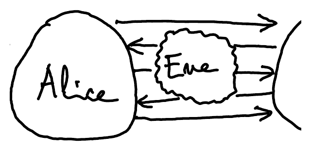
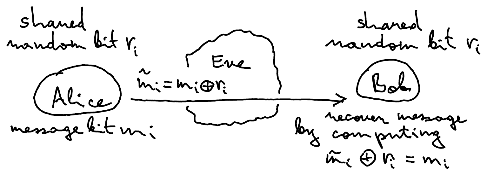
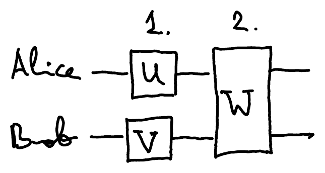
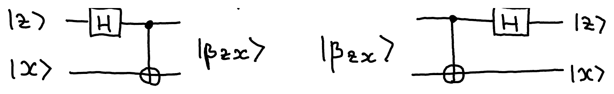

::pagesources{items="L07:1-4" exercises="/exercises/entanglement/#bell-states-and-superdense-coding"}

::source{lecture="7" pages="1"}

This lecture is on applications of quantum information to communication and cryptography. Exchanging information encoded in quantum states rather than bits can have surprising advantages. Also, building two small quantum computers that can communicate and perform simple operations on one or two qubits can be easier than making one large quantum computer that can store many qubits and run complicated algorithms.

We call algorithms that involve several parties who exchange information, **protocols**. The three most important protocols in quantum computing are:

- quantum key distribution (QKD) $\leftarrow$ We will not cover this.
- superdense coding
- quantum teleportation

They are not about achieving computational speed-up but instead about exploiting the unusual properties of quantum information, such as superposition and entanglement.

A typical scenario involves two friends, Alice and Bob, who want to jointly perform some task, such as exchange information, but they want the information to remain private from eavesdropper Eve who tries to intercept their messages:

## One-time pad

::source{lecture="7" pages="2"}

Is there in principle a perfectly secure way for Alice and Bob to communicate? yes!

**Goal**: Send a private message from Alice to Bob using public communication.

**Protocol**:

1. **Preparation**: Alice and Bob meet upfront to generate $n$ shared uniformly random bits $r_1, r_2, \dots, r_n$ where $n$ is the length of the message they want to exchange. Then they part.
2. **Encoding**: If the $i$-th message bit Alice wants to send is $m_i$, she sends $m_i \oplus r_i$.
3. **Decoding**: If Bob receives $\tilde{m}_i$, he can find the actual message bit by computing

$$
\tilde{m}_i \oplus r_i = (m_i \oplus r_i) \oplus r_i = m_i
$$

**Security**: If Eve intercepts $\tilde{m}_i$, she gains no information about the actual message $m_i$ since $\tilde{m}_i$ appears uniformly random to her. This is called **information-theoretic security**. (No amount of computational power can help Eve to recover $m_i$.)

## Local vs global operations

::source{lecture="7" pages="3"}

1. **Local operations**: Alice applies $U$ and Bob applies $V$ on their respective qubits. The overall operation is $U \otimes V$.
2. **Global operation**: Alice and Bob put their qubits together and jointly apply $W$.

## Bell states

::source{lecture="7" pages="3-4"}

The following states form an orthonormal basis for two qubits:

$$
\begin{aligned}
\ket{\beta_{00}} &= \tfrac{1}{\sqrt{2}}(\ket{00} + \ket{11}) \quad \text{(the EPR (Einstein-Podolsky-Rosen) state)} & \ket{\beta_{01}} &= \tfrac{1}{\sqrt{2}}(\ket{01} + \ket{10}) \\
\ket{\beta_{10}} &= \tfrac{1}{\sqrt{2}}(\ket{00} - \ket{11}) & \ket{\beta_{11}} &= \tfrac{1}{\sqrt{2}}(\ket{01} - \ket{10})
\end{aligned}
$$

More concisely, for $z, x \in \{0,1\}$,

$$
\ket{\beta_{zx}} = \frac{1}{\sqrt{2}}\left(\ket{0,x} + (-1)^z \ket{1, x \oplus 1}\right)
$$

Recall that $H\ket{z} = \frac{1}{\sqrt{2}}(\ket{0} + (-1)^z \ket{1})$, for all $z \in \{0,1\}$, and $\mathrm{CNOT}\ket{a,x} = \ket{a, x \oplus a}$, for all $a, x \in \{0,1\}$.

**Preparation**/**unpreparation** of $\ket{\beta_{zx}}$:

$$
\ket{\beta_{zx}} = \mathrm{CNOT} \cdot (H \otimes I) \cdot \ket{z,x} \qquad\qquad \ket{z,x} = (H \otimes I) \cdot \mathrm{CNOT} \cdot \ket{\beta_{zx}}
$$

Note that CNOT is a global operation on both qubits.

::pagebreak{lecture="7" page="4"}

**Local conversion**: surprisingly, one can convert any Bell state into any other by acting only on one of the qubits, i.e., by a local operation:

$$
\ket{\beta_{zx}} = (Z^z X^x \otimes I) \cdot \ket{\beta_{00}} = (I \otimes X^x Z^z) \cdot \ket{\beta_{00}}
$$

These local operations are just a combination of Pauli $X$ and $Z$ matrices.

## Superdense coding

::source{lecture="7" pages="4"}

**Goal**: send 2 classical bits by transmitting 1 qubit.

This can be achieved by using the local conversion and orthogonality of Bell states:

Mathematically:

$$
\boxed{(H \otimes I) \cdot \mathrm{CNOT} \cdot (Z^z X^x \otimes I) \cdot \ket{\beta_{00}} = \ket{z,x}}
$$

Resource trade-off:

1 shared EPR state + 1 qubit of quantum communication = 2 bits of classical communication
