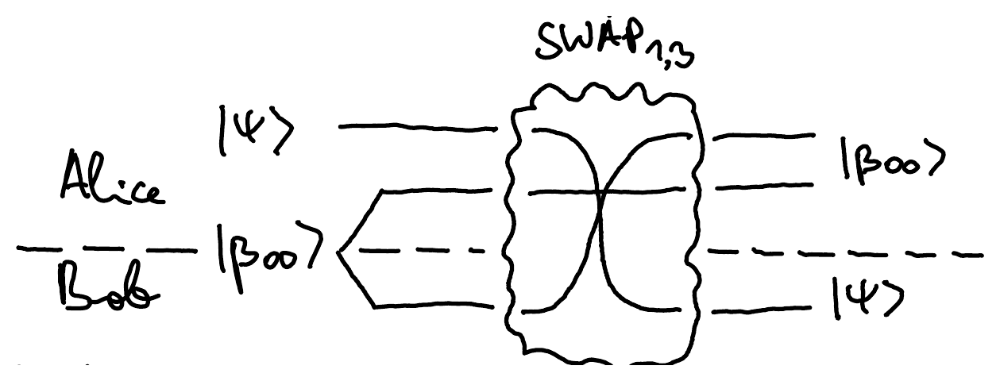

::pagesources{items="L07:5-7" exercises="/exercises/entanglement/#quantum-teleportation"}

## One-time pad with probabilistic bits

::source{lecture="7" pages="5"}

With one-time pad, Alice can in fact send even a probabilistic bit $\binom{p_0}{p_1}$ by transmitting what appears to Eve as a uniformly random bit. Let us write $[0]$ and $[00]$ as the probabilistic versions of the computational basis states $\ket{0}$ and $\ket{00}$. Let

$$
m = p_0 [0] + p_1 [1] = \begin{pmatrix} p_0 \\ p_1 \end{pmatrix}.
$$

be the probabilistic bit Alice wants to send to Bob. The shared uniformly random bit is then

$$
r = \tfrac{1}{2}[00] + \tfrac{1}{2}[11] = \frac{1}{2}\begin{pmatrix} 1 \\ 0 \\ 0 \\ 1 \end{pmatrix}.
$$

All three bits together look as follows:

$$
m \otimes r = \left(p_0 [0] + p_1 [1]\right)_A \otimes \left(\tfrac{1}{2}[00] + \tfrac{1}{2}[11]\right)_{A'B}
$$

where Alice has the first two bits $A$ and $A'$ and Bob has the third bit $B$. The one-time pad protocol looks as follows:

After the first CNOT: $\frac{1}{2}\binom{p_0}{p_1}_A \otimes [00]_{A'B} + \frac{1}{2}\binom{p_1}{p_0} \otimes [11]$.

Discarding $A'$: $\frac{1}{2}\binom{p_0}{p_1}_A \otimes [0]_B + \frac{1}{2}\binom{p_1}{p_0} \otimes [1]$. Eve sees only system $A$ which to her looks like $\frac{1}{2}\binom{p_0}{p_1} + \frac{1}{2}\binom{p_1}{p_0} = \frac{1}{2}\binom{p_0 + p_1}{p_1 + p_0} = \frac{1}{2}\binom{1}{1}$, i.e., uniformly random. After his CNOT, Bob gets:

$$
\frac{1}{2}\binom{p_0}{p_1} \otimes [0] + \frac{1}{2}\binom{p_0}{p_1} \otimes [1] = m \otimes \frac{1}{2}\binom{1}{1}.
$$

After discarding the second bit he recovers the original message $m$.

## Quantum teleportation

::source{lecture="7" pages="6-7"}

This is the quantum version of the one-time pad - instead of transmitting a probabilistic bit, Alice transmits a quantum bit!

| One-time pad | Quantum teleportation |
| --- | --- |
| 1 shared random bit + 1 bit of public communication = 1 probabilistic (private) bit of communication | 1 shared EPR state + 2 bits of public communication = 1 qubit of quantum communication |

This is how you could try to invent the protocol... If only we could SWAP qubits 1 and 3, we would be done:

But this is a global operation. Note that Pauli matrices form a basis for all $2 \times 2$ complex matrices and, similarly, tensor products of pairs of Pauli matrices forms a basis for all $4 \times 4$ matrices, so we can expand SWAP as a linear combination of local (Pauli) operations.

::pagebreak{lecture="7" page="7"}

Recall that

$$
\mathrm{SWAP} = \begin{pmatrix} 1 & 0 & 0 & 0 \\ 0 & 0 & 1 & 0 \\ 0 & 1 & 0 & 0 \\ 0 & 0 & 0 & 1 \end{pmatrix}.
$$

You can check that

$$
\begin{aligned}
\mathrm{SWAP} &= \tfrac{1}{2}(I \otimes I + X \otimes X + Y \otimes Y + Z \otimes Z) \\
&= \frac{1}{2}\sum_{z,x \in \{0,1\}} Z^z X^x \otimes X^x Z^z.
\end{aligned}
$$

Let's apply this to the 1st and 3rd qubit:

$$
\begin{aligned}
\ket{\psi} \otimes \ket{\beta_{00}} &= \mathrm{SWAP}_{1,3} \cdot \ket{\beta_{00}} \otimes \ket{\psi} \\
&= \frac{1}{2}\sum_{z,x \in \{0,1\}} \underbrace{(Z^z X^x \otimes I)\ket{\beta_{00}}}_{\ket{\beta_{zx}}} \otimes X^x Z^z \ket{\psi}
\end{aligned}
$$

We get the teleportation equation:

$$
\boxed{\ket{\psi} \otimes \ket{\beta_{00}} = \frac{1}{2}\sum_{z,x \in \{0,1\}} \ket{\beta_{zx}} \otimes X^x Z^z \ket{\psi}}
$$

From this we can see what the teleportation protocol should be:

Resource trade-off: 1 shared EPR state + 2 bits of classical communication = 1 qubit of quantum communication
