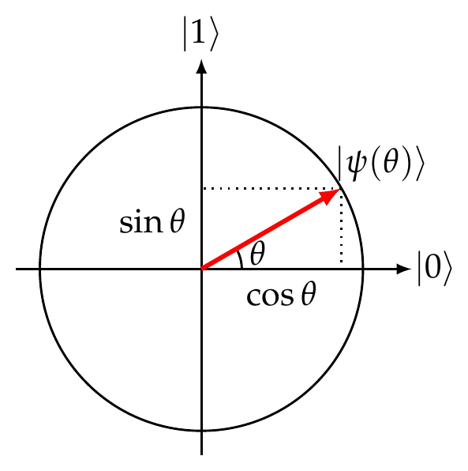

# Exercises 9

<!-- page 1 -->

## Exercise 1 (Two reflections make a rotation)

The goal of this exercise is to verify that two consecutive reflections produce a rotation whose angle is twice the angle between the axes of the two reflections (recall that this observation is at the core of the analysis of Grover's algorithm). Just like in Grover's algorithm, in this exercise all amplitudes are real. That is, we only consider qubit states of the form

$$
\ket{\psi(\theta)} = \begin{pmatrix} \cos\theta \\ \sin\theta \end{pmatrix} = \cos\theta \ket{0} + \sin\theta \ket{1},
\tag{1}
$$

for some angle $\theta \in [0, 2\pi)$. You can visualize any such state as a unit vector in two (real) dimensions:

1. Verify that the Pauli $Z$ operation

   $$
   Z = \begin{pmatrix} 1 & 0 \\ 0 & -1 \end{pmatrix}
   $$

   corresponds to a reflection about the horizontal axis in this picture. Explain why this implies that $Z\ket{\psi(\theta)} = \ket{\psi(-\theta)}$ where $\ket{\psi(\theta)}$ is defined in eq. (1).

2. Verify that

   $$
   R(\alpha) = \begin{pmatrix} \cos\alpha & \sin\alpha \\ \sin\alpha & -\cos\alpha \end{pmatrix}
   $$

   is a reflection about the axis that is at angle $\alpha/2$ with $\ket{0}$. That is, verify that

   $$
   R(\alpha)\ket{\psi(\tfrac{\alpha}{2})} = \ket{\psi(\tfrac{\alpha}{2})}, \qquad R(\alpha)\ket{\psi(\tfrac{\alpha}{2} + \tfrac{\pi}{2})} = -\ket{\psi(\tfrac{\alpha}{2} + \tfrac{\pi}{2})}.
   $$

<!-- page 2 -->

3. Verify that $R(\alpha)$ acts on a general state $\ket{\psi(\theta)}$ as follows:

   $$
   R(\alpha)\ket{\psi(\theta)} = \ket{\psi(\alpha - \theta)}.
   $$

4. Let $G(\alpha) = R(\alpha) Z$ be a product of two consecutive reflections, $Z$ and $R(\alpha)$. As determined previously, the angle between them is $\alpha/2$. Write down the matrix for $G(\alpha)$ and verify that $G(\alpha)$ is a rotation by angle $\alpha$ anti-clockwise. That is, verify that

   $$
   G(\alpha)\ket{\psi(\theta)} = \ket{\psi(\theta + \alpha)},
   $$

   for any $\theta \in \mathbb{R}$.

## Exercise 2 (`Cirq`: One-out-of-four search)

## Exercise 3 (Pauli rotations)

The goal of this exercise is to understand how Pauli matrices are related to various qubit rotation operations.

1. Recall that the matrix exponential of any complex square matrix $M$ is defined using the Taylor series of the exponential function:

   $$
   \exp(M) = \sum_{n=0}^{\infty} \frac{M^n}{n!}.
   $$

   Let $P$ be any complex square matrix such that $P^2 = I$. Show that, for any $\delta \in \mathbb{R}$,

   $$
   \exp(iP\delta) = I\cos\delta + iP\sin\delta.
   \tag{2}
   $$

   *Hint:* Recall Euler's formula $e^{i\varphi} = \cos\varphi + i\sin\varphi$, for any $\varphi \in \mathbb{R}$. This formula is in fact valid also for $\varphi \in \mathbb{C}$. To prove this, observe that cosine is an even function and sine is an odd function. Moreover, the even $n$ terms in the Taylor series of $e^{i\varphi}$ constitute precisely the Taylor series for $\cos\varphi$ and the odd $n$ terms constitute precisely the Taylor series for $i\sin\varphi$. You can prove the above matrix version of Euler's formula using the same observation.

2. Recall that the three non-trivial Pauli matrices are

   $$
   X = \begin{pmatrix} 0 & 1 \\ 1 & 0 \end{pmatrix}, \qquad Y = \begin{pmatrix} 0 & -i \\ i & 0 \end{pmatrix}, \qquad Z = \begin{pmatrix} 1 & 0 \\ 0 & -1 \end{pmatrix}.
   $$

   Let us exponentiate them and define the following single-qubit operations:

   $$
   R_x(\delta) = \exp(-iX\tfrac{\delta}{2}), \qquad R_y(\delta) = \exp(-iY\tfrac{\delta}{2}), \qquad R_z(\delta) = \exp(-iZ\tfrac{\delta}{2}).
   \tag{3}
   $$

   Note that these operations are unitary (recall Exercise 6 from Tutorial 2). Compute explicitly their matrix entries as a function of $\delta$.

3. Explain why $R_x(\alpha)R_x(\beta) = R_x(\alpha + \beta)$, for any $\alpha, \beta \in \mathbb{R}$, and similarly why this holds also for $R_y$ and $R_z$.

   *Hint:* Show that it follows from eq. (2) that $e^{iP\delta_1}e^{iP\delta_2} = e^{iP(\delta_1 + \delta_2)}$.

<!-- page 3 -->

4. Prove that $XR_y(\delta)X = R_y(-\delta)$ and $XR_z(\delta)X = R_z(-\delta)$.

   *Hint:* Note that $XYX = -Y$ and $XZX = -Z$. Then use eq. (2).

5. Recall from the first lecture that a general single-qubit state can be written as

   $$
   \ket{\psi(\theta, \varphi)} = \begin{pmatrix} \cos\frac{\theta}{2} \\ e^{i\varphi}\sin\frac{\theta}{2} \end{pmatrix},
   $$

   for some angles $\theta$ and $\varphi$ that correspond, respectively, to latitude and longitude in spherical coordinates. It turns out that the operations in eq. (3) correspond to rotations by an angle $\delta$ around the corresponding coordinate axis of the Bloch sphere.

   - Verify that $R_z(\delta)$ is indeed a rotation by angle $\delta$ around the $z$ axis of the Bloch sphere. That is, verify that, up to a global phase,

     $$
     R_z(\delta)\ket{\psi(\theta, \varphi)} = \ket{\psi(\theta, \varphi + \delta)}.
     $$

   - Verify that $R_y(\delta)$ is indeed a rotation by angle $\delta$ around the $y$ axis. That is,

     $$
     R_y(\delta)\ket{\psi(\theta, 0)} = \ket{\psi(\theta + \delta, 0)}.
     $$

## Exercise 4 (ZYZ, ABC, and controlled-$U$)

This exercise has two goals: first, we would like to decompose a general single-qubit operation $U$ as a sequence of Pauli rotations from eq. (3); second, we would like to implement the controlled-$U$ operation on two qubits using only CNOT and arbitrary single-qubit gates.

Recall from Homework 1 that any single-qubit unitary operation $U$ can be written as

$$
U = e^{i\varphi} \begin{pmatrix} e^{i\alpha}\cos\theta & e^{i\gamma}\sin\theta \\ -e^{-i\gamma}\sin\theta & e^{-i\alpha}\cos\theta \end{pmatrix},
$$

for some angles $\varphi, \alpha, \gamma, \theta \in \mathbb{R}$.

1. Verify that

   $$
   U = e^{i\varphi} R_z(-\alpha - \gamma) R_y(-2\theta) R_z(-\alpha + \gamma),
   $$

   where $R_z$ and $R_y$ are the $z$ and $y$ rotations defined in eq. (3). Explain why this implies that every single-qubit gate can be written as

   $$
   U = e^{i\varphi} R_z(\beta) R_y(\eta) R_z(\delta),
   $$

   for some angles $\varphi, \beta, \eta, \delta \in \mathbb{R}$. This is known as the "ZYZ decomposition" of $U$.

2. Out of nowhere, let us define

   $$
   \begin{aligned}
   A &= R_z(\beta) R_y(\eta/2), \\
   B &= R_y(-\eta/2) R_z(-(\delta + \beta)/2), \\
   C &= R_z((\delta - \beta)/2).
   \end{aligned}
   $$

<!-- page 4 -->

   Verify that

   $$
   ABC = I, \qquad\qquad U = e^{i\varphi} AXBXC.
   $$

   *Hint:* Use items 3 and 4 from the previous exercise. In particular, you can use item 4 to compute $XBX$ by noting that

   $$
   XR_y(\delta_1)R_z(\delta_2)X = XR_y(\delta_1)X \cdot XR_z(\delta_2)X = R_y(-\delta_1)R_z(-\delta_2).
   $$

3. Verify the following circuit identity:

   

   where $U$ and $A, B, C$ are from item 2 and $F = \begin{pmatrix} 1 & 0 \\ 0 & e^{i\varphi} \end{pmatrix}$.

## Exercise 5 (`Cirq`: Implementation of two-level unitaries)

## Exercise 6 (`Cirq`: Iterative reflection)

*Hint:* Python's built-in function `round` rounds to the nearest integer.

## Exercise 7 (`Cirq`: Grover's algorithm)

## Exercise 8 (`Cirq`: $ABC$ & $ZYZ$ decomposition)
