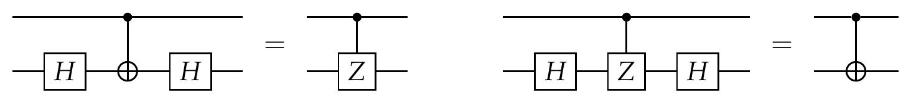
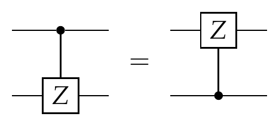
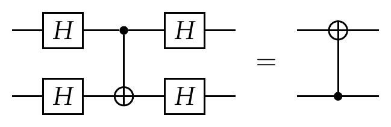
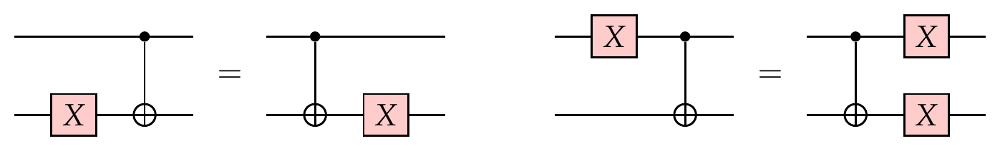
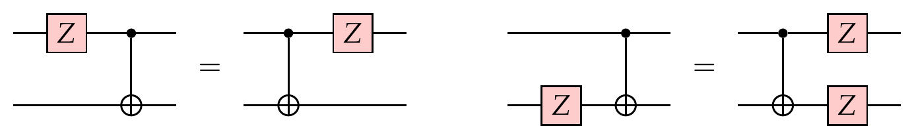

# Exercises 12

<!-- page 1 -->

## Exercise 1 (CNOT gymnastics)

Prove the following circuit identities:

1. Switching $X$ and $Z$:

   

2. Controlled-$Z$ is out of control:

   

3. Whaaaat?

   

## Exercise 2 (Propagation of Pauli errors)

Prove the following circuit identities:

1. Pauli $X$ moves through CNOT:

   

2. Pauli $Z$ moves through CNOT:

   

<!-- page 2 -->

3. Pauli $X$ moves through Toffoli:

   

4. Assume an $X$ error occurs on the last qubit of the state $\ket{\Psi}$. Propagate this error through the circuit that implements the detection and correction steps of the three-bit repetition code. What effect does this error have once it is moved to the right-hand side of the circuit?

   

## Exercise 3 (Measuring non-commuting observables)

Let $\ket{\psi} = \ket{0}$. Consider the following two scenarios that correspond to measuring the observables $Z$ and $X$ in different order:

1. First measure $\ket{\psi}$ in the standard basis, then in the $\ket{\pm}$ basis (this is the same as first measuring the $Z$ observable and then the $X$ observable).

2. First measure $\ket{\psi}$ in the $\ket{\pm}$ basis, then in the standard basis (this is the same as first measuring the $X$ observable and then the $Z$ observable).

Denote the measurement outcomes in the two cases by $a_1, b_1 \in \{0,1\}$ and $a_2, b_2 \in \{0,1\}$, respectively. What are the probability distributions of the strings $a_1 b_1$ and $a_2 b_2$?

## Exercise 4 (Commuting matrices can be simultaneously diagonalized)

Let $A$ and $B$ be two normal (and hence diagonalizable) matrices. For simplicity, assume they are $2 \times 2$ and invertible. Show that if $AB = BA$ then there is a unitary matrix $U$ such that $UAU^\dagger$ and $UBU^\dagger$ are both diagonal.

<!-- page 3 -->

## Exercise 5 (Stabilizers of Bell states)

Recall that the four Bell states are as follows:

$$
\begin{aligned}
\ket{\beta_{00}} &= \tfrac{1}{\sqrt{2}}(\ket{00} + \ket{11}), & \ket{\beta_{01}} &= \tfrac{1}{\sqrt{2}}(\ket{01} + \ket{10}), \\
\ket{\beta_{10}} &= \tfrac{1}{\sqrt{2}}(\ket{00} - \ket{11}), & \ket{\beta_{11}} &= \tfrac{1}{\sqrt{2}}(\ket{01} - \ket{10}).
\end{aligned}
$$

Note that $\ket{\beta_{00}}$ is stabilized by $X_1 X_2$ and $Z_1 Z_2$:

$$
(X \otimes X)\ket{\beta_{00}} = \ket{\beta_{00}}, \qquad\qquad (Z \otimes Z)\ket{\beta_{00}} = \ket{\beta_{00}}.
$$

Find the stabilizers of the other Bell states.

## Exercise 6 (`Cirq`: Steane code)
